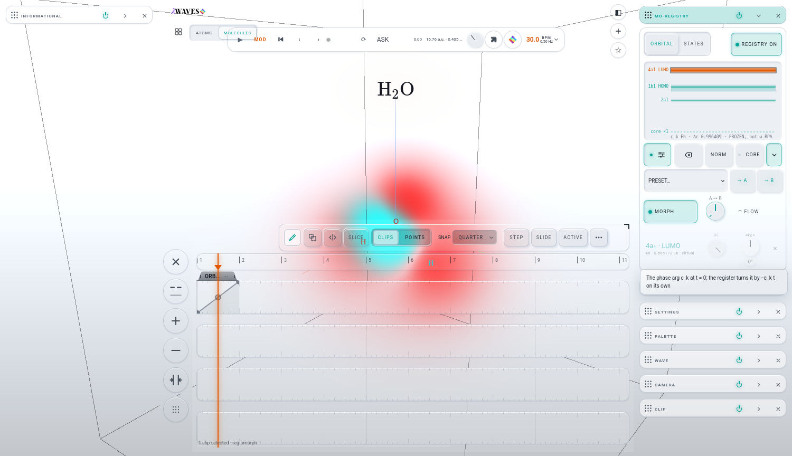

# B · A ↔ B AS AN AUTOMATION LANE: the build (iteration 007, branch `it007-morph`, from `c73c5c0`)

ADR: `architecture/ADR-draft-0002-orbital-morph-has-its-own-id.md`. Brief: `B-BRIEF.md`. JOSH-PROMPT item 6.

## What was built
MO-REGISTRY › ORBITAL's A ↔ B knob (`lab/orbitalsview.js` `morphK`) is now its own modulation target, **`reg.omorph`**. The
modulation window can route onto it, and the TIMELINE gives it an automation lane. **`reg.morph` is unchanged** and stays the STATES
register's.

| file | change |
|---|---|
| `lab/orbitalsview.js` | `export const OMORPH = 'reg.omorph'`. This is the one place the id lives (Josh may rename it). The hand law, as in statesview.js: a hand on the ROUTED dial moves its base through `api.modHand`. `knobs.morph()` gives the dial the row stamps. `setMorphValue(v)` is the modulator's road: it stores s, and the field is touched and repainted only while MORPH plays. `save()` / `applyRecord()` / `load()` carry `A`, `B` (`[{ k, re, im }]`), `morph` and `morphOn`. A record that lands before its molecule parks them with the selection. |
| `lab/shell/modulation.js` | One `defs` row after `reg.morph`: `ORBITAL MORPH`, linear 0..1, def 0, group `state`, a lazy knob accessor (`app.state.orbitals.knobs.morph()`), get/set, and a hint naming the ORBITAL register. |
| `lab/shell/persist.js` | modSeats: `[OMORPH]: [I.orbitals, 'morph']`, next to `reg.morph`'s row. |
| `docs/STATE-SCOPES.md` | One PROJECT row for `instruments.orbitals.A · B · morph · morphOn`. |
| `lab/sw.js` | The precache manifest (`node tests/pwa.test.mjs --write`). |

## Decisions
- **A `defs` row, not the `__LW.mod.register` door.** The register is built at boot (molecules.js), and the row's knob accessor is lazy
  like `reg.morph`'s. The port's `stamp()` runs a frame after install and finds the dial, so `data-param="reg.omorph"` lands on the
  knob root the TIMELINE reads. Measured: the stamp is on the card, and `reg.morph`'s stamp is still on the STATES pane's knob.
- **ABSENT unless a store exists.** The ADR said to save the stores "the way the STATES register already does", and statesview.js
  always writes them. Here the four keys are written only while the register holds a store, following the repo's default-absent
  precedent (vibrate, pulse, volume …). The reason: no store means no path, and MORPH cannot be on without stores. So NEW
  (`tools/new-project.mjs --check` is unchanged), the six demos and every older file keep their bytes, and
  `tests/orbitals.browser-test.mjs` L6 ("the record is exactly { on, selection }") still holds. I keyed it on the stores only, never
  on s. Under an LFO, s crosses 0, so keying on s would flip the edit scope's keys frame to frame.
- **A routed A ↔ B's base** goes into `instruments.orbitals.morph` through modSeats in the edit scope (undo) and in the project road
  (`projectSnapshot`, plus `modulationBases`).
- **The modulator does not switch MORPH on.** This is the same law as `reg.morph`: the knob moves, and the picture follows only while
  MORPH plays. The MIR check already lists the polish row for this ("routes and moves silently while … MORPH is off").
- The facade is untouched (`__LW.orbitals` has no `morph` getter; the check reads `__LW.orbitals.save().morph`), so `lw-facade.json`
  does not change. The hinge: shell/modulation.js went 11 → **12** (the new crossing is `app.state.orbitals`). G-G holds.

## The light check (H₂O/STO-3G, HOMO → A, LUMO → B, MORPH on, REGISTRY ON; gate 9611)
- **The lane.** A real 700 ms hold on the unrouted A ↔ B dial opened TIMELINE CLIP without moving the value. A real tap on CREATE
  AUTOMATION CLIP placed `ORB…` on LANE 1 (beats 0–4). With the curve set 0 → 1 and a paused seek to 10 / 50 / 90 % of the clip,
  the registry read 0.1 / 0.5 / 0.9, and so did the register's s. A real play from beat 0 ramped s through
  0.047, 0.097, 0.139 … 0.387 (30 BPM). `reg.morph` stayed at 0 throughout.
  
- **The route.** With the clip deleted, an LFO bound to a macro and routed to `reg.omorph` (0..1) moved s on play
  (0.005 → 0.298 in 2.1 s). `reg.morph` was not modulated.
- **The project.** With the route on and the base set to 0.37, a FOLDERS SAVE wrote `morph 0.37`, `morphOn true`, `A [{k:4}]`,
  `B [{k:5}]` and `modulationBases['reg.omorph'] 0.37`. I then unrouted, set MORPH off and pressed PRESET HOMO. A FOLDERS OPEN brought
  back base 0.37, the route, MORPH on and both stores.
- **The MIR check's finding** (a routed dial cannot get a lane from its own gesture: the ring owns the hold) applies to `reg.omorph`
  exactly as it does to every dial. Place the clip while the dial is unrouted (the hold, or a right-click → CREATE AUTOMATION CLIP),
  then route if you want both.

## What the brief / ADR got wrong
- **"Route and lane are EITHER-OR on a target (the kit's law; the top-most wins)" is not what the kit does.**
  `lab/mir/modulation/host.js` `livePos` makes the automation sample the **moving baseline**, and the routes modulate **around** it
  (`M.targetValue(id, baseline, …)`). A lane plus a route on `reg.omorph` measured roughly their sum (s 0.05 → 0.568 in 2.1 s, against
  0.26 for the clip alone and 0.30 for the LFO alone). "The top-most wins" is the TIMELINE model's rule for **overlapping clips** on one
  target (`timeline/model.js`: the latest-starting unmuted clip under the beat wins). It is not a rule between a lane and a route.
  λWAVES does not fight either. If Josh wants a true either-or, that is a MIR issue (a kit law); lab/mir/** is not mine to edit.
- The ADR's "saving `A`, `B`, `morph` and `morphOn` the way the STATES register already does" was built with default-absent instead
  of always-written. The reason is under Decisions above.
- The brief's line refs held (modulation.js:129–131, facade.js:135–138, persist.js:25–36, orbitalsview.js:116 / :595).

## Tests (gate 9611; the RTX at 100 % from the solvers)
- `./test.sh node`: **exit 0**, after `node tests/pwa.test.mjs --write`. It was red only on the precache manifest before that.
- `tests/timeline.browser-test.mjs`: **14 / 14 green**.
- `tests/routed-knob.browser-test.mjs`: **4 / 4 green**.
- `node tools/rack-deps.mjs --classes`: G-G holds. modulation 12, molecules 16, stage-words 5.
- Extra: `tests/orbitals.browser-test.mjs` is 23 / 24. L9 is red: a frame-count row (≥ 10 volume dispatches in 700 ms) read 8–9
  three times. **The base `c73c5c0` reds identically (9)** in a `git archive` copy served on 9612, so this is the GPU load and not
  this change.

## Polish seen (not built)
- The TIMELINE status line shows the raw id ("1 clip selected · reg.omorph"). This is the MIR check's "raw ids in the status line"
  row.
- The clip's name is truncated to `ORB…` at the default zoom (the MIR check's "clips tiny at the default zoom").
- Optional: `__LW.orbitals` could carry `morph` / `morphOn` getters like `__LW.states`. That would be a facade pin diff, so I left it
  out.

## Next
The integrator merges `it007-morph`, then runs `node tests/pwa.test.mjs --write` and `./test.sh node` on the merge. Josh may rename
`reg.omorph` (one constant in orbitalsview.js). If he wants a route and a lane to be exclusive, that ruling becomes a MIR issue.
