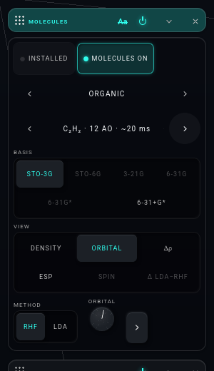
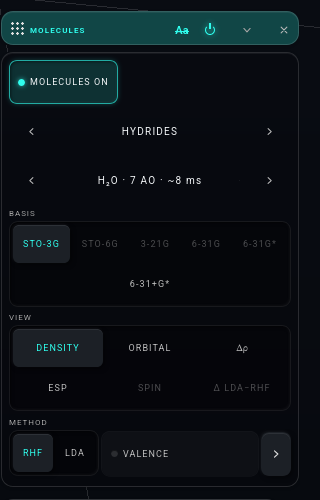

# M-BUILD · THE MOLECULES CARD (iteration 007, row M)

Builder: Opus 5.5. Worktree `.claude/worktrees/agent-a24039137fb70742b`, branch `it007-card` from `c73c5c0`. Gate server 9601 / GD 5601,
stopped by pid. NOT pushed.

## What changed (Josh's items 1–4, nothing else)
`lab/chemview.js` (rows only, +16 / −11), `lab/lab.css` (+8 / −3), `lab/sw.js` (two precache hashes, `pwa.test --write`).

| before (c73c5c0) | after |
|---|---|
| `‹ SECTION ›` · INSTALLED · MOLECULES ON (`.mol-section`) | **INSTALLED · MOLECULES ON** (`.mol-top`, new) |
| `‹ MOLECULE ›` | `‹ SECTION ›` (`.mol-section`, the section stepper alone) |
| BASIS · METHOD · VALENCE/ORBITAL dial · ⌄ (one wrapped row) | `‹ MOLECULE ›`, directly under the section (the shelf still opens under both) |
| VIEW: DENSITY ORBITAL Δρ ESP SPIN / Δ LDA−RHF (5 + 1) | BASIS (the ladder, unchanged) |
| | **VIEW, 3 + 3**: DENSITY · ORBITAL · Δρ / ESP · SPIN · Δ LDA−RHF |
| | **METHOD** · VALENCE or the ORBITAL dial (their shared seat) · ⌄ |

1. **INSTALLED and MOLECULES ON on top.** A new first row `.mol-top`. INSTALLED's rule is unchanged (`header()` hides it for a section with
   no records, or in a Safari tab). Its lamp and press are unchanged. MOLECULES ON is still a hand pick.
2. **The two steppers stacked.** `.mol-section` now holds only the section stepper, so `chem.browser-test` L6's `turners === 2` and
   `library.browser-test`'s `.mol-section .mir-step-b` still find the section's arrows. The molecule stepper (its name IS the `<select>`) is
   the next row.
3. **BASIS → VIEW → METHOD.** `r1` holds BASIS alone, `rV` holds VIEW, and the new `rM` holds METHOD, then VALENCE and the ORBITAL dial (the
   same seat: `seats()` shows VALENCE under DENSITY and the dial otherwise), then the `.mol-more` chevron. The fold, its WORKSPACE
   `more` and its phone/desktop rule are untouched (`.mol-more-toggle` keeps its class, so rack-wiring.js still finds it).
4. **VIEW in two balanced rows.** `vSeg` gets `cls: 'mol-view'`. `.mol-view .seg` is a 3-column grid (the kit render card's grid-on-`.seg`
   idiom), with each cell one word, never wrapped.

The ORBITAL dial: its knob(), `rebuildOrbKnob()` (which `replaceWith`s the root, so the dial rebuilds in whatever seat it has), `span()`
and the `orbital()` verb are untouched. Only the row it is first appended to moved (`r1` → `rM`), so row O's registration work starts from
the same code.

One polish inside the brief: `.mol-more-toggle` takes `margin-left: auto`, so the chevron sits at the row's end both under VALENCE (which
fills the row, so nothing changes there) and under the ORBITAL dial (where it used to float mid-row). Josh's hand law says positions never
move.

## Measured (Firefox headless, `.tmp/m-probe.mjs`, git-ignored: real taps through gatekit `tap`, rows read off the DOM)
| | card / body | rows (header) | VIEW lines | visible lines above the fold |
|---|---|---|---|---|
| before, desktop 1500×1000 | 280 / 262 | `‹SECTION›+ON` 91 px · `‹MOL›` 44 · BASIS+METHOD 162 · VIEW 100 | **5 + 1** | 8 |
| after, desktop 1500×1000 | 280 / 262 | top 44 · `‹SECTION›` 44 · `‹MOL›` 44 · BASIS 100 · VIEW 100 · METHOD 60 | **3 + 3** | 8 |
| after, card forced to 300 px | 300 / 282 | 44 · 44 · 44 · 100 · 100 · 60 | **3 + 3** | 8 |
| after, phone (Firefox's minimum window, 500 px; body.phone) | 274 / 258 | 44 · 44 · 44 · 112 · 112 · 66 | **3 + 3** | 8 |

Card height to the fold: 474 → 478 px (desktop, MORE folded). The new top row costs about one line. VIEW stops being 5 + 1, and METHOD
gets its own short line. The 0.5.3 M8 five-line header count holds: top, section, molecule, BASIS, VIEW are five rows, as before
(SECTION+ON, molecule, BASIS·ORBITAL, VIEW·⌄ had needed five as well). A 300 px VIEWPORT cannot be had: headless Firefox will not make a
window narrower than 500 px. So "300 px" is measured as the card forced to 300 px wide, and the phone row is the 500 px phone viewport.

The light check (every step a real pointer tap), desktop and phone alike, with 0 page errors:
- MOLECULES ON tapped in the new top row: the solve landed (`H2O|sto-3g|0`).
- BASIS 6-31+G* tapped: `H2O|6-31+g-star|0`. STO-3G tapped back: `H2O|sto-3g|0`. One desktop run missed the back-tap while the 6-31+G*
  solve was in flight; it passed on the re-run and on the phone.
- VIEW ORBITAL tapped: the dial shown in the METHOD row (`METHOD | ORBITAL`), VALENCE hidden. The dial read `1b1 · HOMO` (5), then
  `3a1` (4) after `chem.orbital(4)`.
- The section's › tapped: HYDRIDES → ORGANIC. The stepper reads ORGANIC, and INSTALLED appears in the top row (ORGANIC has one record,
  1.2 MB).
- The molecule's › tapped: C₂H₂ solved (`C2H2|sto-3g|0`), and the select reads `C2H2`.

Screenshots (`research/iteration-007/m-shots/`):
- desktop: `m-desktop-density.png` (water, DENSITY, VALENCE in the seat) and `m-desktop-orbital.png` (ORGANIC · C₂H₂, VIEW ORBITAL with
  the dial, INSTALLED shown)
- 300 px: `m-300px.png`
- phone: `m-phone-orbital.png`
- before: `m-before-desktop.png` (a hover tooltip covers the molecule row in it)

 

## Tests
- `./test.sh node`: **0** (1,128 PASS/GREEN lines, 0 RED). The first run was red on `pwa.test` only: sw.js's precache hashes for
  chemview.js and lab.css. Fixed with `node tests/pwa.test.mjs --write`, in the commit.
- `node tools/rack-deps.mjs --classes --no-write`: windows/molecules.js **16** (unchanged; the file is not touched), and the hinge
  HOLDS (the largest module is spectrum at 25).
- `tests/molecule-head.browser-test.mjs`: **RED, stale, not this row.** Its first row waits for THE HEAD on the stage, which Josh's
  iteration-001 ruling removed (`lab/windows/molecules.js` `headLand`, commit 503997b). This is already listed in
  `mir-check/FIXES.md:24` as a stale suite row. Its hand road (the `.mol-pick select.sel` change) still found the select.
- `tests/stage-text.browser-test.mjs`: **RED, stale, not this row.** Rows 1–3 PASS: the formula, a HAND preset's fade, the banners'
  names and the atom labels. Row 4 asserts INFORMATIONAL holds 2 knobs; it holds 3, because `lab/informational.js:25` added PAD before
  `c73c5c0`. Row I rebuilds INFORMATIONAL and should re-aim it.
- `tests/chem.browser-test.mjs` (the card's own suite, run as an extra check): see the foot.

## Decisions
- VALENCE and the ORBITAL dial ride METHOD's line, right under the VIEW grid, rather than taking a line of their own in the VIEW row.
  This keeps the card as short as it was and keeps the dial's seat where it stood relative to METHOD (the brief: "kept where VIEW
  ORBITAL expects them"). Moving them into `rV` would cost a whole line for one switch or one knob, because at 262 px the 3 × 3 grid
  needs the full width ("Δ LDA−RHF" is about 80 px).
- `.mol-top` is a new hook beside `mol-section`, and every existing `mol-*` hook keeps its element. No saved id, WORKSPACE key or
  `chem.*` target changed.
- BASIS keeps its kit flex-wrap: 4 + 2 at 262 px, 5 + 1 at 282 px. The brief says nothing else moves. A 3 + 3 grid like VIEW's would be a
  one-line follow-up if Josh wants the two segs to match.
- CLAUDE.md's MOLECULES paragraph is not edited. Proposed sentence for the integrator, replacing "Below the header and the rows ‹ MOLECULE ›,
  BASIS · ORBITAL (VALENCE takes the dial's seat under DENSITY, 0.4.0 S4c) and VIEW · the fold's chevron (five lines at 300 px and at
  phone width, 0.5.3 M8)": *"Since iteration 007 M the card reads top to bottom INSTALLED · MOLECULES ON (`.mol-top`), ‹ SECTION ›,
  ‹ MOLECULE ›, BASIS, VIEW in two rows of three (`.mol-view`), then METHOD · VALENCE or the ORBITAL dial (one seat, 0.4.0 S4c) · the fold's
  chevron."* The sentences before it ("then INSTALLED … beside MOLECULES ON; the MOLECULE picker below") also need "INSTALLED and
  MOLECULES ON head the card".

## What the brief got wrong
- "the five-line rule at 300 px": a headless browser cannot open a 300 px viewport. The 0.5.3 measure meant the rack card's body,
  262 px, which is this card's default on a desktop. Both were measured as above.
- "the `molecule-head` and `stage-text` browser tests (they read the hand road)": both were already red at the base for reasons outside
  the card (above). They are not a usable green/red signal for this row until they are re-aimed (molecule-head: Josh's notebook-head
  ruling; stage-text: INFORMATIONAL's PAD, row I).

## Foot: `tests/chem.browser-test.mjs` (54 of 56 GREEN)
- GREEN: L6, the card's layout law. The page turner's 2 arrows under `.mol-section`, 6 sections each holding exactly its molecules with
  the header naming it, the `<select class="sel">` with its optgroups and disabled reasons, and no page error.
- GREEN: L1–L4, LZ, and the rest.
- RED, stale: L5 asserts "its MORE fold open (the desktop default)". Since iteration 001 (Josh, 10-16), `lab/first-run.js` folds MORE on
  every first run (`more: false`). Every other clause of L5 holds (`folded:false`, `aaShown`, `rows 12`, `controls 24`, DENSITY, C₆H₆).
  `painted` fails only because the plot sits in the folded MORE.
- RED, timing: L7, glycine 2,021 ms against a 1,638 ms budget. The machine was loaded (the RTX is shared by three solvers), and nothing in
  this row touches the solve.
