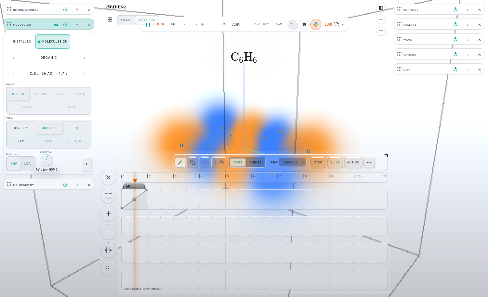

# O · THE ORBITAL DIAL AS A STEPPED TARGET: the build (iteration 007, branch `it007-orbital`, from M's merge `39abd1f`)

ADR: `architecture/ADR-draft-0001-orbital-index-is-a-stepped-target.md`, accepted with Josh's ruling: "Orbitals should be steps and I
think it could handle it at lower frequencies". Brief: `O-BRIEF.md`. JOSH-PROMPT item 5.

## What was built
The MOLECULES ORBITAL dial (in M's row `rM`, beside METHOD) is now the modulation target **`chem.orbital`**. A route can drive it, and
the TIMELINE gives it an automation lane. Every value either one writes is a whole orbital: the kit registry's `integer` map, step 1.

| file | change |
|---|---|
| `lab/shell/modulation.js` | **A `defs` row** `chem.orbital` (`MOLECULES ORBITAL`, integer, min 1, max `MOL_LIMITS.ao` = 768, group `state`, a lazy knob accessor `app.state.chem.knobs.orbital()`). The range 1..768 is only a placeholder, used until the first landing. **The hot re-registration:** right after `mod.install`, a `chem.subscribe` re-registers the id on every landing through `host.targets.installOne`, the same call the facade's `register` door makes, with the molecule's `span()`. The kit keeps the base and the routes. The subscriber then sets the base to the landing's orbital (the HOMO, or the index a file named), re-asserts a routed target at once (`clock.applyAll(true)`), and restamps. **The old comment** ("The ORBITAL INDEX is deliberately NOT registered…") is rewritten to the ADR, and it ends with "do not move it back out". The SIXTH ROOT comment now names three chem targets. |
| `lab/chemview.js` | **THE STEP-RATE CAP.** `stepOrbital(v, held)` is the modulator's road, and it coalesces: the latest value wins. A step is applied at most once per `max(120 ms, the measured rebuild)`. The rebuild is measured by `stepClock`: from the apply to the GPU finishing the frame whose `field.stats.generation` drew it, kept as an EMA. **A modulator never calls `sayOrbital()`.** It paints the dial with `show()` while it is held and `set()` when it lets go. **The rebuilt dial keeps its stamp:** `rebuildOrbKnob` copies `data-param` and the `mod-held` class onto the new knob, and the port's restamp gives it its base road. **The hand law:** `orbInput` sends a routed hand to the base through `modHand`. An unrouted hand (and the `orbital(k)` verb, and a file's `load`) also writes the base at once (`baseHand`). `handK` is the hand's index, and `orbitalKey()` (a saved file's orbital name) reads it, so a file names the base's orbital, never wherever an LFO stood at SAVE. **The clamp:** a file's index that is outside the molecule's span is clamped to the span (it used to fall back to HOMO), and `clamped` records the clamp. |
| `lab/shell/persist.js` | modSeats: `'chem.orbital': [I.chem, 'orbital']`. It is seated only while the orbital is a number: a null orbital (not chosen, so HOMO on landing) is never written. |
| `lab/windows/molecules.js` | `createChem` gets `field: () => field` (to time the rebuild) and `modBase`. A subscriber writes the clamp to STATE's status, in one line. |
| `lab/sw.js` | The precache manifest (`node tests/pwa.test.mjs --write`). |

The facade is untouched (only members of `__LW.chem` changed), so `lw-facade.json` is unchanged. The hinge: molecules 15 → **16**,
modulation **12**, persist **24**. G-G holds.

## Measured: the rebuild per step (gate 9631; the RTX at 98–99 % from the three solvers)
Each row is 16 steps through `__LW.chem.orbital(k)`, the hand's road with no cap. Each step is timed from the apply to the GPU
finishing the frame that drew it (`onSubmittedWorkDone` after `field.stats.generation` advanced). The grid is 64³. Two runs are shown.

| molecule · basis | AOs · road | step median | step max | GPU dispatch alone (`moleculeThroughput`) |
|---|---|---|---|---|
| benzene · STO-3G | 36 · tile | **40 ms** / 40 ms | 73 / 104 ms | 3.4 / 6.6 ms |
| benzene · 6-31G* (VOL. I) | 102 · orbital | **40 ms** / 39 ms | 63 / 44 ms | 3.3 / 3.3 ms |
| aspirin · 6-31G* (VOL. I) | 211 · orbital | **40 ms** / 40 ms | 74 / 79 ms | 3.4 / 3.3 ms |

A step is **frame-bound, not kernel-bound**. The kernel costs about 3.3 ms whatever the AO count at 64³. The roughly 40 ms is the paced
loop waiting for its frame on a contended card. While a lane played, the in-app EMA read 93–102 ms, because the frames were slower under
the solvers' load. Every measurement is under 120 ms, so **the cap stays at 120 ms**, which is at most 8.3 steps a second. If a slower
device's rebuild goes past 120 ms, the gap follows it.

## The light check (scratch scripts in `.tmp/`, not committed; benzene STO-3G, VIEW ORBITAL)
- **Registered and stamped.** `chem.orbital` reads `{ min 1, max 36, integer, step 1 }` on benzene. A molecule change re-registers the
  range: 6-31G* benzene reads 1–102, aspirin 1–211, and back on STO-3G it reads 1–36 with base 21 (the HOMO). After each rebuild,
  `.k[data-param="chem.orbital"]` is the live dial.
- **The lane.** A real right-click on the ORBITAL dial opened TIMELINE CLIP, and a real tap on CREATE AUTOMATION CLIP placed `MOL…` on
  LANE 1. With the curve set to 0 → 1, paused seeks to 10 / 30 / 50 / 70 / 90 % of the clip put the registry and the orbital at
  **5 / 12 / 19 / 26 / 33**. The dial read `1e2g (b)`, `3a1g`, `3e2g (b)`, `4e1u (a)`, `5e1u (a)`. A real play from beat 0, over 4.2 s at
  30 BPM, stepped **1, 2, 3 … 19, every orbital it crossed**, with none skipped.
  
- **The cap.** A 20 Hz writer into the registry's modulated door (79 writes in 4 s) gave **33 steps = 8.25 / s, the gap 120 ms**.
  The loop's own median stayed at 2 ms. A real LFO (its top free rate, a sine over all 36 orbitals) routed through a macro gave
  5–5.5 steps / s. The FRAME PROFILE was steady (total 0.9 ms, field 0.26 ms, loop median 2 ms) with no errors.
- **The project.** Benzene, a hand on orbital 18, then an LFO route on `chem.orbital`, playing (the orbital read 36 under it). A FOLDERS
  SAVE wrote `orbital 18`, `modulationBases['chem.orbital'] 18`, the route, and the nameKey of 3e2g (a), which is orbital 18. I then
  moved to WATER and unrouted. A FOLDERS OPEN brought back **C₆H₆, orbital 18, base 18, range 1–36, the route**, and STATE read
  "restored". The same file with WATER and index 30 opened on **orbital 7, base 7, range 1–7, the route kept**, and STATE read
  "ORBITAL 30 is past water's orbitals 1–7: clamped to 7". Nothing threw.

## Decisions
1. **A `defs` row plus re-registration by id, not the `__LW.mod.register` door alone.** The door calls `targets.installOne` and stamps,
   but it bypasses the port's `adapters`. As a result, `restampParams` never restamps the dial and never hands it its `setBase` road,
   and `setKnob` cannot tell the dial is routed. The row gives the target everything every other dial has. The re-registration uses the
   door's own call (`host.targets.installOne`) with the molecule's span. The row's range (1..768, the field's orbital ceiling) holds the
   id until the first landing. Restoring a project before its molecule lands therefore never clamps its base to the previous molecule.
2. **The cap drops nothing a lane crosses at a lane's tempo.** A 4-beat clip at 30 BPM crosses 36 orbitals in 8 s, which is 4.5 / s and
   under 8.3 / s. Faster than the cap, the latest value wins. A step still waiting when a new molecule lands is dropped, because it
   belongs to the old molecule.
3. **The base is the hand's at once.** The port's `syncBases` runs only while the modulation clock runs. A hand on the unrouted dial
   while paused therefore left the base stale, and a route added then rode on the stale base. The first project check measured this:
   base 21 after a hand on 18. `baseHand()` writes the base on every hand change. An orbital not yet chosen (null) has the placeholder
   base 1, and `stepApply` never lets that placeholder choose an orbital. Without this, the projectKey's base table differed after
   NEW → MOLECULES ON → undo. `history.browser-test` caught it ("dirty": true), and it is green now.
4. **The clamp replaces the HOMO fallback** for any file index the molecule lacks, as the brief asked. A link's `lw:orbital=` already
   clamped this way (the `orbital(k)` verb). A FRONTIER record whose columns start above 1 now clamps `orbital` itself. Before, the dial
   showed a clamped number while `orbital` held the raw index.
5. **The `orbital(k)` verb is a hand.** It moves the base, and under a route it also moves the picture until the next step.

## What the brief or the ADR got wrong
- **"min 1"** holds for a solved molecule. A FRONTIER record's span is its columns (`cols[0] + 1 …`), so the registered min is the
  record's first column. The brief's "(or the record's columns)" covers the max but not the min.
- **"through the door that exists (`__LW.mod.register`)"**: the door works, but it leaves the target outside the port's adapters (see
  decision 1). Re-registering by id over a `defs` row was the better reading, and the prompt allowed it.
- **"route and lane are either-or"** (brief, last bullet): as row B measured, the kit adds them (`host.js` `livePos`: the lane is the
  moving baseline, and the routes modulate around it). I did not change that. A true either-or would be a MIR issue.
- **Line refs moved after M:** `span()` was at chemview.js:551 and the rebuild at :565–571 on the base `39abd1f` (the brief said :547 and :561–568). modulation.js's comment was at
  :115-119, as the brief said.
- **Not in the ADR: photosensitivity.** Each step can change the whole picture. At 120 ms the cap allows 8.3 steps a second, which is
  above WCAG's 3 flashes a second, and the FLASH GUARD's limiter covers only its four luminance routes (the CLAUDE.md paragraph lists
  `reg.morph` and `chem.kick` among the routes it does not see). `chem.orbital` now joins them. Holding the cap at 333 ms would be WCAG's
  rate, and "it could handle it at lower frequencies" reads either way. **Josh's call.** The cap is one constant (`STEP_MS` in
  chemview.js).

## Tests (gate 9631 / GD 5631)
| check | result |
|---|---|
| `./test.sh node` | **exit 0** (after `node tests/pwa.test.mjs --write`; red before it only on the precache hashes of the four edited files) |
| `tests/timeline.browser-test.mjs` | **14 / 14 green** |
| `tests/routed-knob.browser-test.mjs` | **4 / 4 green** |
| `tests/molecule-head.browser-test.mjs` | **green** (3 PASS) |
| `tests/history.browser-test.mjs` (extra: the undo seats) | **green** (45 PASS), after decision 3. It was red once, on NEW → MOLECULES ON → undo "dirty". |
| `tests/new-project.browser-test.mjs` (extra) | green |
| `node tools/rack-deps.mjs --classes` · `tests/rack-deps.test.mjs` · `tests/new-project.test.mjs` | the hinge holds (molecules 16, modulation 12, persist 24) · 0 · 0 |

No new test files were added, and `lab/mir/**` was not touched. A dev link `lab/volumes` → `~/Documents/LAMBDAWAVES-VOLUMES/dist`
(git-ignored) let the 6-31G* rows open from VOL. I.

## Next
The integrator merges `it007-orbital`, then runs `node tests/pwa.test.mjs --write` and `./test.sh node`. Josh decides the photosensitivity
question (`STEP_MS` 120 → 333?). Possible polish rows: the stale-base-while-paused finding (decision 3) applies to every target routed
through the facade's `route()` while paused, and I checked only the facade road, not the window's drop. The TIMELINE's status line still
shows the raw id ("1 clip selected · chem.orbital"), the MIR check's raw-ids row.
