# R-BUILD · THE ONE LADDER (iteration 008, row R)

Builder: Opus 5.5. Own worktree (`.claude/worktrees/agent-a5b6e026d4e1bb99f`), branch `it008-ladder` from F's merge `07591a7`. Gate server
9671 / GD 5671, stopped by pid when done. NOT pushed.

## What Josh gets
- **VIEW reads DENSITY · ORBITAL · MIX / ESP · SPIN · Δ LDA−RHF.** MIX is the register on the field: the lines lit on the ladder, mixed in
  phase. Its saved id is still `registry`, so projects, `lw:view=registry`, the `view` verb and `LW.setView('registry')` all keep working.
- **The ladder is one picture with two marks.**
  - The register's lit levels are drawn as F left them.
  - The ORBITAL dial's orbital is a **bracket**, `[ ── ]`, round its row.
  - In VIEW ORBITAL the bracketed line lights up, the bracket is full ink, and the register's lit lines step back (half alpha, 2 px).
  - In MIX, and in every other VIEW, the register leads and the bracket steps back (40 % ink, 1 px).
- **The hand decides the VIEW.**
  - A stroke on the ladder → MIX. This is U's road, kept.
  - A hand turn of the ORBITAL dial, by drag or by keys, routed or not → ORBITAL, and the ladder switches to its ORBITAL pane so the
    bracket can be seen.
  - A modulator stepping `chem.orbital` moves the bracket and never changes the VIEW.
  - An undo, a restore, or opening a project or link changes neither the VIEW nor the pane on its own.

| desktop · VIEW DENSITY (the register holds HOMO; the bracket stepped back on it) | desktop · after a stroke: VIEW MIX | desktop · a dial turn: VIEW ORBITAL, cursor on 4a1 LUMO | → 1b1 HOMO | → 3a1 | desktop · MIX with an LFO on chem.orbital (the bracket moved, VIEW held) |
|---|---|---|---|---|---|
| 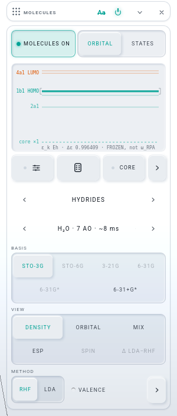 | 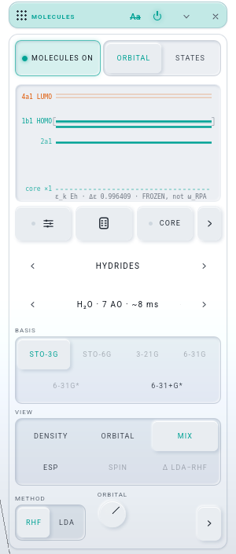 | 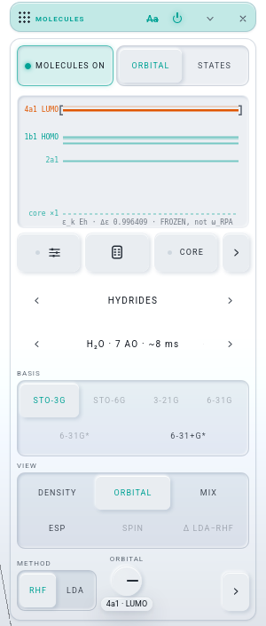 | 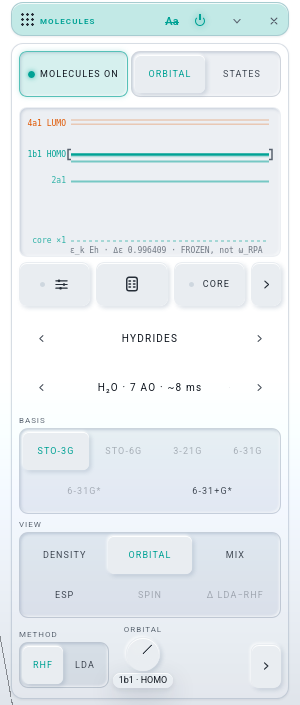 | 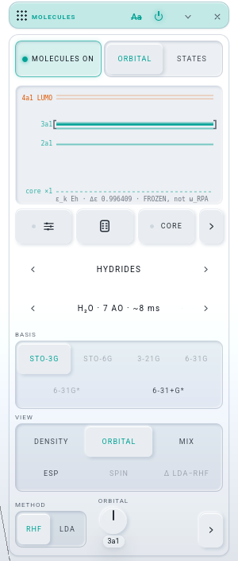 | 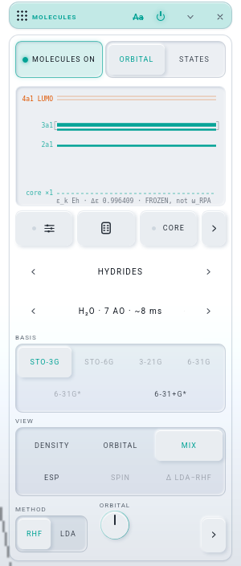 |

| 300 px · DENSITY | 300 px · MIX after a stroke | 300 px · ORBITAL, 4a1 | → 1b1 | → 3a1 | 300 px · MIX, LFO on chem.orbital | benzene, VIEW ORBITAL on 1e1g (b) · HOMO |
|---|---|---|---|---|---|---|
| 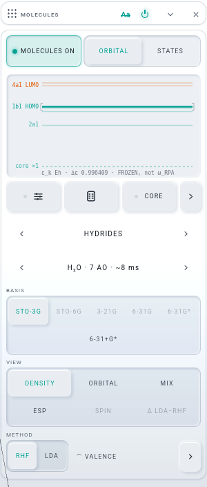 | 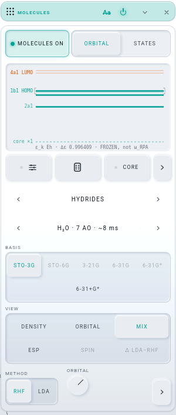 | 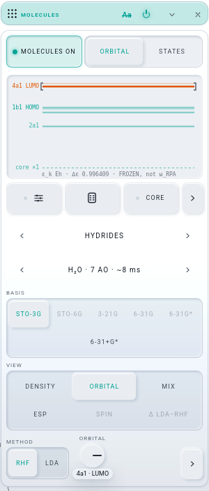 | 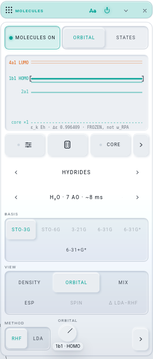 | 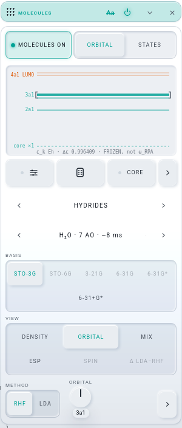 | 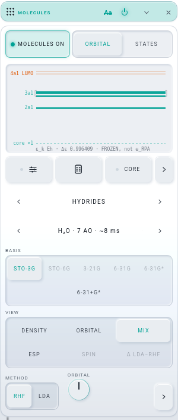 | 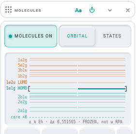 |

The shots are water / STO-3G (benzene for the degenerate row), light theme, headless Firefox at 1500 × 1150, cropped to the card. The "300 px"
shots force the card to 300 px wide, the measure U and M used. The 300 px routed shot is from a second run (see "Seen, not mine").

## The brief, item by item
1. **The name.** The `registry` option's label is `MIX`, and its hover is one line: "MIX — the register on the field: the lines lit on the ladder
   above, mixed in phase (ORBITAL pane: one electron's ψ(r, t); STATES: the many-electron state)". The word appears once in the seg
   (`lab/chemview.js`). The stage's `VIEW · …` announcement reads the seg's text, so it says `VIEW · MIX` with no change of its own.
   - The other places that showed the word now say MIX: the STATUS row (`lab/status.js`), the register's status and hover sentences
     ("MOLECULES ON, then VIEW MIX"), the MOLECULES ON hover, and the WIGNER refusal.
   - "REGISTRY off — …" and "REGISTRY · n orbitals" are left as they are. They name the register, not the VIEW.
2. **The ladder on the card.** U already seated it under the ON row in every VIEW and on both panes, and nothing folds it. The new part:
   MOLECULES OFF dims it (`.mol-reg.mol-reg-off`, the kit's `--state-disabled` 0.38) and keeps the last solve's lines. It stays paintable,
   as the 2026-10 ruling in `orbitalsview.js` refresh() asks. Today an OFF card is hidden by the ATOMS mode anyway.
3. **Two marks.** `orbitalsview.js` paint() reads `chem.orbital()` and `chem.view` each time it paints. Nothing new is stored, and the cursor is
   never a saved key: it IS `chem.orbital`.
   - **Why a bracket and not ACCENT B.** Occupied levels are already ACCENT A and virtual ones ACCENT B. An accent cursor would vanish on a
     virtual level (B on B) or read as "occupied". The bracket is vertical geometry in the theme's ink, so it differs from every
     horizontal line in both shape and colour. At 300 px it is the same 3 × 10 px it is on the desktop, because the gutter is fixed.
   - **The gutter.** The bracketed row's name always wins the gutter (rank −1), and the line's hover adds "the ORBITAL dial's orbital —
     VIEW ORBITAL draws it" (or "turn the dial for VIEW ORBITAL").
4. **The hand decides.**
   - `orbInput`, the dial's `onInput`, is the hand's road: the kit fires it only on a drag, a key, or a double-tap reset, never on `set()`.
     It now goes to ORBITAL through the same function the facade uses (`toView`, which was `api.setView`'s body). The function says
     `VIEW · ORBITAL` on the stage as the seg would.
   - When the dial is routed, the hand still moves the BASE (`modHand`) and the VIEW still goes to ORBITAL: a hand is a hand.
   - `molecules.js` `viewed(hand)` shows the ORBITAL pane when a HAND lands on VIEW ORBITAL, whether by the dial or by the seg.
   - The modulator road (`stepApply`) and every restore road never pass a hand, so neither the VIEW nor the pane moves.
5. **The same set.** The dial is `[1, nAO]` (a frontier record: its carried columns), and the ladder's lines are `sol.eps[0 … nAO)` of the
   same solve. The bracket is `orbital − 1`, so it always stands on a drawn line, or on the `core ×n` rung when the dial is inside a folded
   core. The canvas hover says this in its last two sentences.
6. **The facade.** `chem.setView` is now `toView` itself, with the same arguments and the same answer. `view === 'registry'` is unchanged,
   and `lw-facade` passes with no `--write`.

## Decisions
- **A degenerate row: bracketed whole, one line lit.** The brief says "a degenerate row lit whole as THE PAINT GESTURE does". The bracket
  spans the whole row, which is the level, so the cursor marks the level as a stroke takes it. But in VIEW ORBITAL only the member the dial
  names is lit (benzene: 1e1g (b)). That member is the only line the field draws, and lighting both would claim the picture shows the pair.
  Lighting the whole row instead is a one-line change in paint().
- **The dial switches the pane too.** The cursor lives on the MO ladder, and the STATES pane has no MOs. So a hand that goes to VIEW
  ORBITAL, by the dial or by the seg, also gets the ORBITAL pane; otherwise "lighting up one of the horizontal lines" would happen out of
  sight. A modulator never switches the pane.
- **The dial's `off` look under MIX is gone.** Under MIX the dial is live: it moves the bracket, and a turn takes the VIEW. It still dims
  under ESP, SPIN and Δ LDA−RHF, and it still yields its seat to VALENCE under DENSITY.
- **How the cursor is told.** chemview keeps one key, `view:orbital:on`, and checks it at the top of `refresh()` and at the end of `setOn`.
  Every road to the dial ends in `refresh()`: the hand, the modulator, a landing, `api.orbital`, the seg, and a load. On a change it calls
  `api.cursor()`, which `molecules.js` wires to `register.orbitals.paint()`. It never runs in a frame, and a RUN tick's refresh finds the key
  unchanged.
- **`lw:view=registry` was refused.** The `view` verb's enum did not list `registry`, although its `run` handled it. It is listed now, and the
  fade reads `VIEW · MIX`.

## What the brief got wrong (or had already happened)
- Item 2 ("the ladder is always on the card") was already true after U, except for the OFF dimming. MOLECULES OFF hides the whole card in the
  ATOMS mode (iteration 002), so the dim is rarely seen.
- `lw:view=registry` did not work before this row (see Decisions), although the brief lists it among the things that "stay".
- The ORBITAL dial has no `step`, so one arrow key moves it 1/100 of its travel. On water (7 orbitals) that is under one orbital, so an arrow
  can flip the VIEW to ORBITAL without moving the cursor. PageUp / PageDown step about one orbital. This is the kit's knob law and is
  unchanged here. Kit note for MIR: an `integer` registry target's dial could take `step: 1` from its descriptor.

## Tests (gate 9671 / GD 5671; the RTX shared with the three solvers)
| check | result |
|---|---|
| `./test.sh node` | **exit 0** (after `node tests/pwa.test.mjs --write`) |
| `node tools/rack-deps.mjs --classes --no-write` | HOLDS; **molecules 15** (F's number), spectrum 25, bare writes 0 |
| `node tools/new-project.mjs --check` | in step (16100 B) |
| `lw-facade` | green, **no pin change** |
| `register` | **22 / 22** |
| `orbitals` | 23 / 24: L9 (8 dispatches in 700 ms against ≥ 10), the GPU-load row red at the base under the three solvers (U, B and F measured it) |
| `chem` | 54 / 56: L5 (MORE folded on a first run) and L7 (glycine 2,740 ms under load). Both are the known reds. |
| `history` · `lw-links` · `new-project` | exit 0 · exit 0 · exit 0 |
| the light check (`.tmp/r-probe.mjs`, scratch, not committed; a real drag on the ladder and real PageUp / PageDown keys on the dial) | **7 / 7 at desktop and 7 / 7 at 300 px**. The steps: MIX label, id `registry` → a stroke → VIEW `registry`, `orbital-packet` on the field → pane STATES, then a hand key on the dial → VIEW ORBITAL, the ORBITAL pane, the orbital one up, the register kept → two more keys: the cursor walked down two lines → a stroke back to MIX, then an LFO macro routed onto `chem.orbital` with the transport playing: the orbital took 4 → 5 → 6 → 7 and the VIEW held at MIX → serialise, VIEW DENSITY, restore: VIEW MIX with the register on the field. 0 page errors. Plus benzene's degenerate HOMO under VIEW ORBITAL (the shot above). |

## Seen, not mine
- In the first 300 px run, the routed shot came out with the whole page in the dark look: mean brightness 56 against 235 for the other five
  shots. It was taken while an LFO played on `chem.orbital` with the transport running. A second run of the same steps came out light (234),
  and so did the desktop run, so the table uses the second run's shot. Nothing in this row touches the theme. It may be a one-frame
  transient in the headless capture; recorded in case it shows up again.

## Proposed CLAUDE.md sentences (for the integrator; CLAUDE.md is not edited here)
In the MOLECULES paragraph, replace "BASIS, VIEW in two rows of three (`.mol-view`: DENSITY · ORBITAL · REGISTRY / ESP · SPIN · Δ LDA−RHF)"
with "BASIS, VIEW in two rows of three (`.mol-view`: DENSITY · ORBITAL · MIX / ESP · SPIN · Δ LDA−RHF; MIX's id is `registry`)", and replace
"MOLECULES ON IS REGISTRY ON: a register has the field under VIEW REGISTRY and its pane; … a hand stroke normalises the register at its end and
picks VIEW REGISTRY" with:

> MOLECULES ON IS REGISTRY ON: a register has the field under VIEW MIX (the saved id stays `registry`: projects, `lw:view=registry`, the verb,
> `LW.setView`) and its pane. THE ONE LADDER (iteration 008 R): the ladder carries two marks — the register's lit levels and the ORBITAL dial's
> CURSOR, a bracket round its row in the theme's ink (a degenerate row bracketed whole, the line the dial names lit), never a saved key (it
> IS `chem.orbital`); under VIEW ORBITAL the cursor leads and the register's marks step back, under every other VIEW the reverse. THE HAND
> DECIDES THE VIEW: a stroke → MIX (normalised at its end); a HAND turn of the dial (drag, keys, routed or not) → ORBITAL and the ORBITAL pane;
> a modulator stepping `chem.orbital` moves the cursor, never the VIEW; an undo, a restore, a project or link open move neither. MOLECULES OFF
> dims the ladder (`.mol-reg-off`).

## Commits
`d4f26b7` the feature (VIEW MIX, the cursor, the hand law, the strings, `pwa --write`) · then this note with its shots and `pwa --write`.

## Next
- The integrator merges `it008-ladder`, runs `node tests/pwa.test.mjs --write` and `./test.sh node`, and takes the CLAUDE.md sentences.
- For Josh:
  - Is MIX the word?
  - Should the bracket also light the degenerate partner?
  - Should the dial step one orbital per arrow key (a kit line)?
