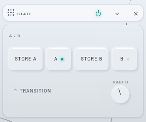
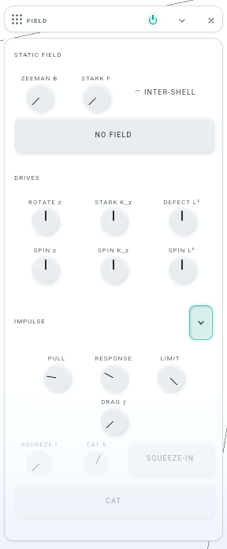
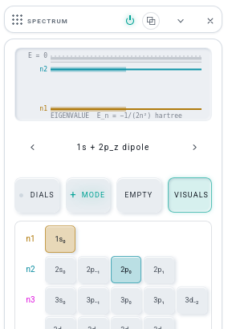

# S · THE STATE CARD — build note (iteration 008, branch `it008-state`, from `24648c7`)

Josh: "States should simply be the A to B and Store A/B with transition on and 'rabi' knob? Everything else has to go or be reworked into
other windows." Built as S-BRIEF.md asks, with the decisions below where the brief's table was silent or wrong.

## The three faces

| STATE | FIELD (IMPULSE fold open) | SPECTRUM's head |
|---|---|---|
|  |  |  |

(The readouts — A / B, H IN FORCE, INTER-SHELL, METERS' IMPULSE — are there; the shots are taken with HELP off, which hides readouts and notes.)

## The move table, as built

| what STATE held | where it is now | code |
|---|---|---|
| STORE A · A · STORE B · B · TRANSITION · Ω RABI · the A / B readout | **stays** — the whole card; the knob reads **RABI Ω** | `lab/windows/state.js` (213 → 84 lines) |
| the PRESET select · RELOAD | SPECTRUM, under the ladder: the kit's `stepper` ‹ PRESET › in PALETTE's preset look (`mol-step`); ← → and a pick load by the hand's road (THE FADE announces); a pick of the preset already shown is RELOAD; a register that is no preset reads `—` | `lab/spectrum.js` (`preset`, `ui.presetSel` keeps `.value`), controller `api.presets` / `api.loadPreset` |
| PRESET VISUALS | SPECTRUM's head row, `VISUALS` beside DIALS · + MODE · EMPTY (same `app.state.applyVisuals`) | `lab/spectrum.js`, `api.visuals` |
| SAVE · LOAD | already FILE's quick SAVE / LOAD rows and FOLDERS — the buttons go | — |
| COPY JSON · COPY LINK | EDIT, beside COPY the state as LaTeX (moved out of FILE, so each act has one row); the link's note (`ui.linkNote`) stays under STATE's status line, which is still the lab's one status sink | `lab/shell/notebook.js` |
| CLEAR | SPECTRUM's **EMPTY ↔ FILL ALL** (one two-state button in the head row: a register with anything in it shows EMPTY = c ↦ 0, SPECTRUM's old CLEAR; an empty one shows FILL ALL = all 91 labels at clock.t, equal and in phase, normalised). STATE's clock-resetting CLEAR stays as EDIT › CLEAR the register (`clearRegister`, still STATE's module) | `lab/spectrum.js` `fillBtn`, `api.fillAll` |
| NORMALIZE (and SPECTRUM's NORM) | gone as buttons. A HAND stroke on SPECTRUM's grid normalises at its end, inside the same undo row (a keyboard Enter on a chip too); a modulator never does. EDIT › NORMALIZE stays | `lab/spectrum.js` (picker pointerup → `api.settle()`) |
| ZEEMAN B · STARK F · INTER-SHELL · NO FIELD · H IN FORCE · the INTER-SHELL readout | **FIELD** › STATIC FIELD | `lab/windows/static-field.js` (new, id `staticfield`) |
| ROTATE z · STARK K_z · DEFECT L² (jog wheels) · SPIN z · SPIN K_z · SPIN L² | **FIELD** › DRIVES, the same 3 × 2 rotor grid (`.native-rotors`); targets `state.rot.z` · `state.stark.kz` · `state.defect.l2` unchanged | same |
| PULL · RESPONSE · LIMIT · DRAG γ · SQUEEZE r · SQUEEZE-IN · CAT | **FIELD** › IMPULSE, behind one chevron (`lab/fold.js`); CAT got its own `CAT k` knob (it used STATE's STRENGTH) | same |
| STRENGTH · ALONG · RELEASE | the K key: e^{ik·x} with k = 0.2 (Shift finer) along the axis X · Y · Z pick — its keyboard label and FIELD's IMPULSE note say so; SQUEEZE-IN and CAT take the same axis | `lab/shell/keys.js` (label), `app.hooks.slap` now lives in static-field.js |
| LAST IMPULSE · escaped / momentum | METERS, one line `IMPULSE escaped · Δp`, its sub `k = … · λ = 2π/k … a₀ along …` (the bow's writer in kepler.js gained λ) | `lab/windows/readouts.js` (`ui.kickRo`), `lab/windows/kepler.js` (two strings) |

FIELD: closed on a first run (the first-visit furniture lists it nowhere), seated on the right rack after SPECTRUM's seat (it lands under
the EQUALIZER, above PALETTE), listed in + and WINDOW like every card, KIND `core`, `native-clean`, and an ATOMS window (MOLECULES mode hides
it — one entry added to `moleculeMode`'s list in molecules.js). rack-deps: `staticfield` is a planned module (forward + shared **1**);
STATE fell to **2**; SPECTRUM stays at **25** (the limit) because everything new on its head went through the controller's `api` into
`lab/spectrum.js`, not through `windows/spectrum.js` (one line there: `ui.presetSel = spectrum.preset`).

## The laws, measured

- **serialize bytes** (`tools/serialize-bytes.mjs`, base tree `git archive 24648c7` on 9632 vs this tree on 9631, eleven readings): every
  `scope: 'edit'` sha **identical**. The full bytes gain 86 B in every reading, and that is exactly one WORKSPACE layout row,
  `{"id":"staticfield","side":"R","folded":false,"closed":true,"off":false,"float":null}` — with it removed, all eleven are byte-identical
  (as RENDER, CURVES and INFORMATIONAL did).
- **an old project with a field**: written by the base tree (STATE's ZEEMAN B 0.012, STARK F 0.0015), restored here — the register holds
  both and FIELD's dials read 0.012 / 0.0015. No PROJECT key moved; persist.js and links.js are untouched (every `ui.*` name they write is
  the one STATE made).
- **the facade**: `tests/lw-facade.browser-test.mjs` is GREEN without `--write` — 178 members, names, kinds, order unchanged. The brief
  expected the pin to change; it does not, because `__LW` never named STATE's controls (they ride `ui.*`, `app.hooks.ab/slap`), so nothing
  was re-captured and there is no diff to state.
- **settings-probe**: 4 of 6 scenes red — and the base tree is red in the same four scenes the same way (the WAVE DANCER `modwin` row and
  the `closed[]` order after a demo open, both WORKSPACE). Pre-existing, not this row's.

## The walk (one light check, `.tmp/walk.mjs`, real pointer drags)

STORE A → a hand stroke across 3s₀ → 3p (6 populated, ‖c‖ = 1.000000, **one** undo row) → STORE B (both slots lit) → RABI turned by a drag
(Ω 0.05 → 0.212) → TRANSITION on, played 1.5 s (mix angle 0.389, clock running) → STARK F dragged on FIELD (Fz 2.27e-3) → the base-tree
project reopened (field lands, dials follow) → SPECTRUM's › announced once (`2p₊ = (2p_x + i·2p_y)/√2`) → EMPTY → FILL ALL (91 labels,
norm 1) → EMPTY. No page errors.

## Decisions (the brief was silent or wrong)

1. **The brief's table missed STATE's IMPULSE feel knobs, DRAG γ, the K_z / L² wheels and rates, SQUEEZE-IN and CAT.** All are PROJECT
   (`mat.bow.*`, `damping`) or modulation targets, so none could just go: the rotors joined DRIVES (the brief's "ROTATE z · SPIN z" row), the
   rest sit behind FIELD's IMPULSE fold.
2. **"RABI (STRENGTH renamed)"**: STATE's STRENGTH was the kick's k, not the drive's; the Rabi knob was already Ω RABI. Kept Ω, relabelled
   RABI Ω; the modulation target `state.rabi` (label 'Ω RABI' in the defs) is unchanged. STRENGTH's other user, CAT, got `CAT k`.
3. **EMPTY is SPECTRUM's c ↦ 0** (no clock reset), the CLEAR it replaces in that row; STATE's CLEAR (with the clock reset) is EDIT › CLEAR the
   register. The button reads the register at the press, because its label is repainted by the ladder's rebuild, which a folded card skips.
4. **An older profile meets FIELD open.** `closed[]` is the remembered set exactly and there is no signal that tells "older than FIELD" from
   "has FIELD open" without a new PREFERENCE key (INFORMATIONAL used its own record). A first run keeps it closed, as asked; an old user who
   had STATE's field and drives on screen finds them on screen after SPECTRUM. Josh may want the INFORMATIONAL rule instead — it would need
   a key in the settings store.
5. No icon for EMPTY ↔ FILL ALL: they are the head row's words, like DIALS and + MODE. Row U's Gemini glyphs (registry) can be shared at the
   merge if Josh wants one look.
6. COPY JSON / COPY LINK **moved** from FILE to EDIT (not duplicated); `tests/menubar.browser-test.mjs` follows.

## Files

`lab/windows/state.js` (cut to A / B) · `lab/windows/static-field.js` (new) · `lab/rack.js` (import + seat) · `lab/spectrum.js` (‹ PRESET ›,
VISUALS, EMPTY ↔ FILL ALL, the stroke's normalisation) · `lab/windows/spectrum.js` (one line) · `lab/shell/controller.js` (`api` rows, the preset
note) · `lab/windows/readouts.js` (METERS' IMPULSE line) · `lab/windows/kepler.js` (λ in two strings) · `lab/native-ui.js` (FIELD clean; the
rotor reshuffle left with STATE) · `lab/shell/notebook.js` (EDIT rows) · `lab/shell/keys.js` (K's label) · `lab/shell/settings.js` (KIND) ·
`lab/windows/molecules.js` (FIELD hidden in MOLECULES mode) · `lab/lab.css` (§ iteration 008 S, four rules) · `tools/rack-deps.mjs` (the plan) ·
`tests/rack-deps.test.mjs` (23 → 24 planned modules) · `tests/stage-text`, `tests/history`, `tests/menubar` (the preset is SPECTRUM's stepper;
COPY rows are EDIT's) · `lab/sw.js` (pwa --write). Row A repaints `lab/spectrum.js`' ladder lines — my edits there are the head (`sp-preset`,
`sp-head`) and the picker's listeners, not `paintLadder`.

## Tests

`./test.sh node` exit 0 (after `pwa --write` and the rack-deps count) · rack-deps `--classes` HOLDS (spectrum 25, staticfield 1, state 2) · `node tools/new-project.mjs --check`
in step · browser: lw-facade GREEN (unchanged), stage-text GREEN, menubar GREEN, history GREEN (one rerun: its MOLECULES ON scene waited 1 s
for a solve under the three solvers' load and read `orbital: null` once), new-project GREEN, project-formats GREEN 5/5, lw-links GREEN ·
serialize-bytes as above · settings-probe red as on the base.
