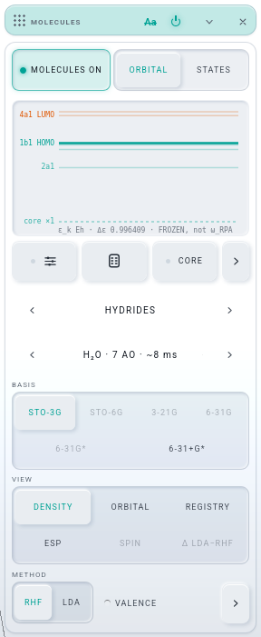
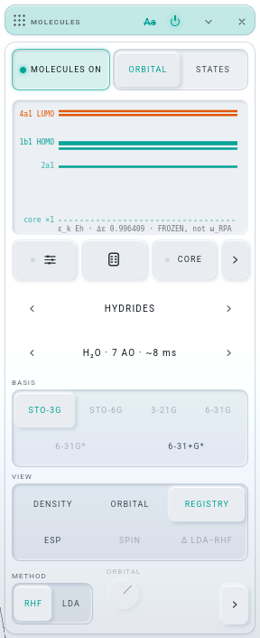
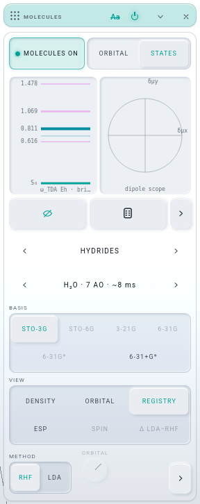
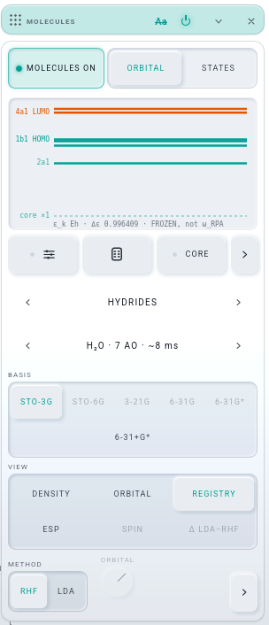
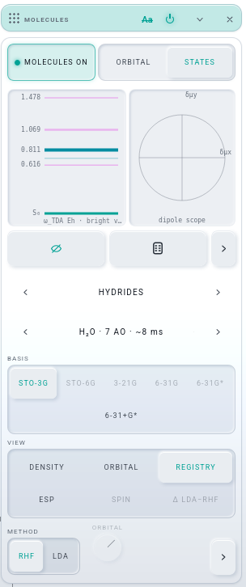

# U-BUILD · THE ONE CARD: MOLECULES ∪ MO-REGISTRY (iteration 008, row U)

Builder: Opus 5.5. Worktree `.claude/worktrees/agent-ad40e13855fe0e9b4`, branch `it008-one` from `24648c7`. Gate server 9601 / GD 5601, stopped
by pid when done. NOT pushed.

## What Josh gets
MO-REGISTRY is no longer a window. Its two panes now sit inside MOLECULES, and the card reads top to bottom:

1. **MOLECULES ON · ORBITAL | STATES** (`.mol-top`). The switch keeps its words, and the register's pane seg takes the rest of the line.
2. **The ladder**, directly under that row (`.mol-reg`), with its foot underneath:
   - ORBITAL pane: DIALS · EMPTY/FILL ALL · CORE · ›
   - STATES pane: HIDE · EMPTY/FILL ALL · ›
3. ‹ SECTION ›, ‹ MOLECULE ›, BASIS, VIEW, METHOD and the fold, as row M left them.

| desktop · ORBITAL pane, VIEW DENSITY (the register holds HOMO) | desktop · after a stroke: VIEW REGISTRY | desktop · STATES pane | 300 px · ORBITAL | 300 px · STATES |
|---|---|---|---|---|
|  |  |  |  |  |

Water, STO-3G, light theme, Firefox headless at 1500 × 1150. The "300 px" shots are the card forced to 300 px wide, the measure row M used:
headless Firefox will not open a window narrower than 500 px.

## The brief, item by item
1. **One card.** `lab/windows/molecules.js`' second seat no longer makes a device. It builds the register into chemview's two new slots:
   `slots.top` (the ON row) and `slots.register` (`.mol-reg`, the row right under it). `app.w.wOrbs` names the card the register lives in,
   which is now `wChem`, so the frame loop's `canPresent(wOrbs)` and `powered(wOrbs)` read the right card without being edited. The other
   changes:
   - `RETIRED_WINDOWS` gains `orbitals: 'chem'`. The kit's `readLayout` drops an old `orbitals` record when the layout names `chem`, and
     otherwise opens `chem` in its seat. Measured: a layout with `orbitals` on the left and no `chem` opens MOLECULES on `rackL`.
   - `first-run.js` `FOLD_ALL` and the first-run left rack drop `orbitals`. `tests/first-run.test.mjs` now counts 9 rows.
   - `readouts.js`' `devopen` hook moved onto MOLECULES.
   - `persist.js` drops `wOrbs`.
   - `moleculeMode` hides one card.

   MOLECULES' `.orb-core-toggle` now lives in the chem card, so the chem row of a captured layout carries `core` (MO-REGISTRY's CORE fold) as
   well as `more`. `new-project --check` is in step.
2. **One switch.** A register has the field exactly when MOLECULES is ON, VIEW reads REGISTRY, and its pane is the one shown.
   `registerview.js` reads that one state (`want`) and follows it (`follow`) whenever ON, VIEW, the pane or a landing moves. Details:
   - **Verbs.** Each pane's claim machinery is kept (setOn, the refusals, STATES' parking and one re-arm seat). The panes' public verbs
     (`__LW.orbitals.setOn`, `__LW.states.setOn`, a TDA stick's press, DRIVE, a pane `load({ on: true })`) reach the one switch through
     `api.one`. ON means MOLECULES ON plus VIEW REGISTRY plus that pane; OFF means MOLECULES OFF ("both reach it").
   - **Saved `on`.** A saved `instruments.orbitals.on` / `instruments.states.on` is now the derived state. Undo rows and project bytes
     therefore never flip when a solve lands, and a file means what it meant.
   - **Older files.** A file that saved MOLECULES and the register apart opens with MOLECULES ON when either was. A file with the register
     ON opens on VIEW REGISTRY and its pane.
   - **Status.** There is one status line: a register writes to the card's status only while it is what the field draws.
3. **The ladder under the ON row, plain lines.** The glow was in the two canvas painters:
   - ORBITAL drew a 6 px band behind every occupied level, an 8 px |c| bar on a lit level, and a box round the selected one.
   - STATES drew a population bar and the same box.

   All of that is gone. Now one stroke per level: dark when off (the level's ink at 0.26), the full vivid ink when on, 2.5 px (STATES keeps
   its oscillator-strength weight + 1). Occupied levels stay ACCENT A and virtual ones B. The DIALS and lanes carry |c| and |b|.

   SPECTRUM's grid does **not** share a painter with these ladders. It is buttons in `lab/spectrum.js`, so it is row A's. The rule is
   written once per canvas.
4. **VIEW REGISTRY.** The VIEW seg is DENSITY · ORBITAL · REGISTRY / ESP · SPIN · Δ LDA−RHF.
   - REGISTRY puts the pane's packet on the field (session rank `orbital-packet` / `states` over `ground`).
   - ORBITAL draws the dial's one orbital whatever the ladder holds (measured: six levels in the register, session `ground`, product
     `orbital`).
   - A hand stroke on either ladder turns VIEW to REGISTRY at the stroke's end, inside its one undo row, and the stage says
     `VIEW · REGISTRY` as the seg would.
   - **Δρ** is now a switch beside KICK in the fold (`delta`). It is the same signed road (`deltaD`, a reference stored at the press on a still
     molecule), drawn over whatever VIEW the card shows. It is saved default-absent (`instruments.chem.delta`, documented in
     `docs/STATE-SCOPES.md`). A file saved on `view: 'diff'` opens on DENSITY with the switch on. `chem.setView('diff')` presses the switch.
   - REGISTRY is allowed on a FRONTIER record (C₆₀, no D), as ORBITAL is.
5. **EMPTY ↔ FILL ALL.** One button per pane.
   - Glyph and state: an empty register shows FILL ALL, anything else shows EMPTY.
   - ORBITAL: FILL ALL takes every carried orbital at |c| = 1/√n, arg 0 (C₆₀: its carried columns only). EMPTY is c ↦ 0.
   - STATES: FILL ALL takes S₀ and every state the ladder shows (BRIGHT's filter), up to the eight lanes, equal and in phase. EMPTY is S₀
     alone. A ladder that has not landed (or that the worker refused) stands the button down, and the refusal's sentence is its hover.
   - Each press is one undo row (a press is one pointer hold).
6. **NORM is gone** from both heads; `norm()` stays as an API verb. A HAND stroke normalises at its end.
   - **Mechanism.** `paint-stroke.js` gains an optional `onEnd(add)`, called inside the pointerup only when the stroke painted something,
     so it joins the stroke's one undo row (history commits on the next task). A modulator's write (`reg.amp*`, `reg.omorph`,
     `chem.orbital`) never comes near it.
   - **Even registers stay even.** A painted level joins at the register's mean |c| (1 when empty; STATES: the mean over its lanes past S₀,
     0.45 when S₀ is alone). Measured: a stroke down water's ladder gives six levels at 0.4082 = 1/√6, Σ|c|² = 1.
   - **The presets** already set unit norm on ORBITAL. HOMO, LUMO, HOMO SET and LUMO SET are one level at 1; HOMO + LUMO and WINDING are
     two at 1/√2; FRONTIER FOUR is four at 1/2; OCCUPIED is √(1/n) each. STATES' presets are near it: BEAT and DARK (0.8 / 0.6) are exactly 1, while RING
     and LISSAJOUS (0.8 / 0.42 / 0.42) are 0.9928. The STATES field always plays b/‖b‖, so nothing on the stage changes.
7. **The rest of the head.**
   - The brief's "presets ⚙" is the DIALS toggle (the kit's `sliders` glyph). The presets live behind the head's chevron. DIALS · CORE · ›
     keep their seats in the ladder's foot, so nothing is lost.
   - In STATES, VIEW CHANGE|DENSITY · REF · FLOW · FLOW SOURCE (and REPAIR) moved into the pane's fold beside the presets and A ↔ B, and the
     lanes start hidden as ORBITAL's DIALS do (HIDE shows them). Without that, two lanes and two seg rows sat between the ladder and the
     pickers (measured: the card was 974 px tall to METHOD). The STATES pane's own VIEW (CHANGE / DENSITY) is its observable and is not
     MOLECULES' VIEW.
   - `Aa` is untouched.
8. **The hinge.** `windows/molecules.js` is 16 → **15**, since `app.w.wOrbs` is no longer read across. persist stays at 24 and the largest
   module is spectrum at 25. G-G holds. The facade is unchanged: `__LW.orbitals`, `__LW.states`, `__LW.register` and `__LW.chem` keep their
   names, and `lw-facade.browser-test` is green with no `--write`. New members ride inside existing objects: `chem.view`, `chem.delta`,
   `chem.setDelta`, `chem.slots`, and the panes' `fill`.

INSTALLED left the top row. `keepSw` stays unseated, and `__LW.chem.keep()` is still its verb, for row V's road. A record-only molecule that is
not on this device now shows the kit's `download` glyph inside the MOLECULE stepper's name, beside the `<select>`. Its hover gives the record's
size. A press fetches the record (sha-256 checked, persist asked once) and opens it: `handPick`, the road a DOWNLOAD row's pick already takes.
The glyph is hidden in a Safari tab, as INSTALLED was.

## The icons (Gemini through `agy`)
First call: `agy -p … --model gemini-3.8-flash-high --print-timeout 280s` run in the worktree. It timed out after 4 m 40 s with an empty answer
(agentic mode, apparently exploring the workspace). The second call was run from an empty directory, with "Do not use any tools or read any
files" appended and `--print-timeout 0`. It answered in about a minute.

**The prompt** (verbatim):
> Design two UI icons for a scientific instrument app (a quantum-chemistry orbital "register": a ladder of horizontal energy-level lines a user lights up).
> The icons belong to ONE two-state button:
>   1. FILL ALL — "light every level of the ladder" (shown when the register is empty).
>   2. EMPTY — "clear every level" (shown when the register holds something).
> Style constraints (match the existing kit exactly):
>   - SVG, viewBox="0 0 24 24", drawn for 20 px display.
>   - Outline style: fill="none" stroke="currentColor" stroke-width="1.9" stroke-linecap="round" stroke-linejoin="round". currentColor only; at most one small solid element if it really helps.
>   - Round, quiet, geometric, no text, no gradients, no perspective. 1-2 px padding inside the box.
>   - The two must read as a pair (same frame, one difference), and must not look like a trash can, a backspace key, or a checkbox.
>   - Suggested idea (you may improve it): three short horizontal level lines stacked in a frame; FILL ALL adds emphasis/fill to all three, EMPTY shows them hollow/dashed or swept away.
> Answer with ONLY the two SVG body strings (the inner markup, no <svg> wrapper), each on its own line, prefixed "FILL:" and "EMPTY:", then one sentence of rationale. Do not use any tools or read any files: answer directly from your own design sense.

**The answer** (verbatim):
> FILL:`<rect x="5" y="3" width="14" height="18" rx="3"/><path d="M8 8h8M8 12h8M8 16h8"/>`
> EMPTY:`<rect x="5" y="3" width="14" height="18" rx="3"/><path d="M8 8h8M8 12h8M8 16h8" stroke-dasharray="2 4"/>`
> Both icons share an identical rounded register frame housing three quantized energy rungs, where FILL ALL renders the levels as continuous
> solid lines to denote fully illuminated occupancy and EMPTY breaks each level with a clean central void to signal cleared, unpopulated states.

The glyphs are used as given: the kit's stroke block is added to each element (`lab/orbitalsview.js` `GLYPH`), because the kit's glyph
registry is not ours to extend. At the head's 15 px, whole rungs and broken rungs read close, so `skin.css` draws this one button's glyph at
18 px. Tried, not shipped: dasharray `1 6` and `0 8`.

## Decisions
- **The panes' OFF is MOLECULES OFF.** The brief says the registry's `on` verb reaches the one state. So in the two re-aimed suites, a step
  whose intent was "the register off the field, the molecule kept" now reads `__LW.chem.setView('density')`. `setOn(true)` still answers as it
  always did: whether the register holds the field now. A solve in flight answers false.
- **The landing follow is ORBITAL's only.** STATES arms its own one re-arm seat when an ON is refused. Following it on every landing would turn
  a hand's arm (2, which plays BEAT over S₀ alone) into a restore's (1). `register` R12 measured this and is green.
- **A STATES OFF while it is parked also disarms** (`else { if (!want) armed = 0; … }`). Otherwise VIEW leaving REGISTRY before the ladder
  lands would let the ladder's landing claim the field anyway.
- **No CLAUDE.md edit.** The MOLECULES paragraph will need these sentences. Proposed for the integrator, replacing "INSTALLED · MOLECULES ON
  (`.mol-top`), then … the two pickers" and the MO-REGISTRY clauses: *"Since iteration 008 U MOLECULES is the one card: MOLECULES ON ·
  ORBITAL | STATES (`.mol-top`), the register's ladder right under it (`.mol-reg`; the `orbitals` seat retired through RETIRED_WINDOWS), then
  ‹ SECTION ›, ‹ MOLECULE › (a record-only molecule's download glyph in its name), BASIS, VIEW (DENSITY · ORBITAL · REGISTRY / ESP · SPIN · Δ
  LDA−RHF), METHOD and the fold. MOLECULES ON IS REGISTRY ON: a register has the field under VIEW REGISTRY and its pane; Δρ is a switch beside
  KICK; a hand stroke normalises the register at its end and picks VIEW REGISTRY; EMPTY ↔ FILL ALL is one button."* The TWO MODES sentence
  ("MOLECULES: MOLECULES and MO-REGISTRY") becomes "MOLECULES: the MOLECULES card".

## Tests (gate 9601 / GD 5601; the RTX shared with the three solvers)
| check | result |
|---|---|
| `./test.sh node` | **exit 0**, after `node tests/pwa.test.mjs --write`. Before that, red only on the precache hashes and on `first-run.test`'s row count (9 now, re-aimed). |
| `node tools/rack-deps.mjs --classes --no-write` · `tests/rack-deps.test.mjs` | molecules **15** (was 16), G-G holds (spectrum 25) · PASS |
| `node tools/new-project.mjs --check` · `tests/new-project.test.mjs` | in step (16117 B) · GREEN |
| `tests/register.browser-test.mjs` | **22 / 22**, re-aimed: the `chem` card, VIEW REGISTRY as the real press, R12's sentence on the status line and FILL ALL. R12 was red once on the landing follow (decision 2), and is green now. |
| `tests/orbitals.browser-test.mjs` | **23 / 24**, re-aimed. L9 (≥ 10 volume dispatches in 700 ms) read 7, twice: the GPU-load row B-BUILD measured red at its base too |
| `tests/chem.browser-test.mjs` | 54 / 56: L5 (MORE folded on a first run, stale since iteration 001) and L7 (glycine timing under load) are the same two reds M-BUILD reported |
| `tests/history.browser-test.mjs` · `tests/new-project.browser-test.mjs` · `tests/lw-facade.browser-test.mjs` | exit 0 · exit 0 · green (no pin change) |
| the light check (`.tmp/u-probe.mjs` and `u-probe2.mjs`, scratch, not committed; real taps and a real drag) | **13 / 13**, desktop and at 300 px. The steps: ON from the top row → the solve lands, VIEW DENSITY, session `ground` → a drag down the ladder: six levels, Σ\|c\|² = 1, VIEW REGISTRY, session `orbital-packet`, the button EMPTY → VIEW ORBITAL tapped: session `ground`, product `orbital`, the ladder kept → EMPTY tapped (0 levels, FILL ALL) → FILL ALL tapped (7 of 7, Σ = 1, EMPTY) → STATES tapped: VIEW REGISTRY draws `states` (BEAT) → a project serialised, scrambled and restored: VIEW REGISTRY with its two levels on the field. Then: an old layout with an `orbitals` seat opens MOLECULES; an old project with MO-REGISTRY ON beside VIEW ORBITAL opens on VIEW REGISTRY; one with MOLECULES OFF and the register ON opens ON; one on VIEW Δρ opens on DENSITY with the Δρ switch on and a signed product. 0 page errors. |

## What the brief got wrong
- **"the presets ⚙"**: the ⚙ in Josh's screenshot is DIALS (sliders). The presets were already behind the head's chevron.
- **"write the rule once if the two share a painter"**: they do not. SPECTRUM's grid is buttons, a row A surface. The register's two ladders
  are canvases.
- **"`__LW.chem.setOn` and whatever the registry's `on` verb is both reach it"** reads cleanly for ON. For OFF it means a script that used
  `orbitals.setOn(false)` to hand the field back to the card now switches the molecule off. Two existing suites did exactly that and were
  re-aimed (VIEW DENSITY). Josh may prefer OFF to mean "VIEW back to DENSITY". That is one line in `molecules.js` `one`.
- **"`register` (R12's stale label is known)"**: R12 is green after re-aiming. Its label assertions moved to the status line.

## Next
- The integrator merges `it008-one`, runs `node tests/pwa.test.mjs --write` and `./test.sh node`, and edits CLAUDE.md's MOLECULES paragraph
  (proposal above).
- Row V builds the library road onto the steppers. `keepSw` / `__LW.chem.keep()` are left for it.
- Polish seen, not built:
  - The register's pop ("+ 1b1 · HOMO") fires for a stroke's adds whether or not VIEW was REGISTRY before it.
  - The STATES pane's own CHANGE / DENSITY now hides in its fold. If Josh uses it often, it could take a seat in the foot.
