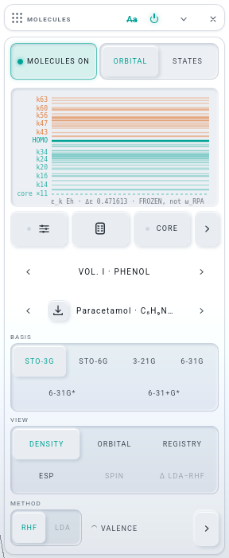
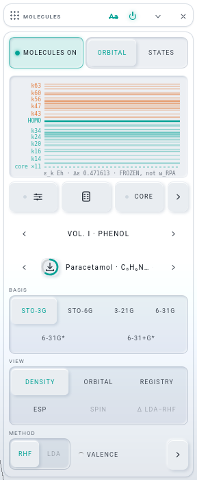
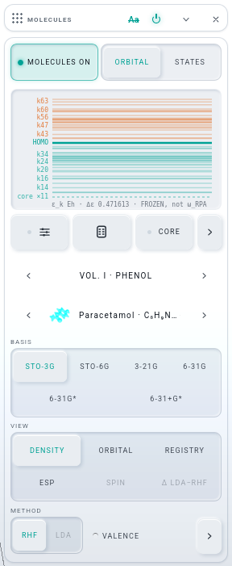
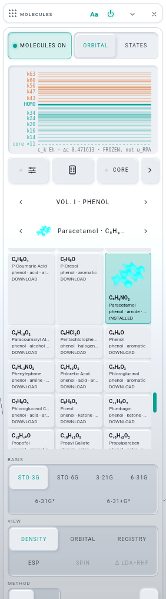

# V-BUILD · THE LIBRARY ROAD (iteration 008, row V)

Builder: Opus 5.5. Worktree `.claude/worktrees/agent-ab37ca72bc33cafde`, branch `it008-library` from `34f70c7` (after U's merge). Gate server 9611 / GD 5611,
stopped by pid when done. `lab/volumes` is the git-ignored dev link to `~/Documents/LAMBDAWAVES-VOLUMES/dist`, which was only read. Nothing was
packed and no solver was run. NOT pushed.

## What Josh gets
A downloaded volume is now a set of pages in MOLECULES' own pickers. The whole volume still installs from the Picker. The card can keep any single molecule.

| a volume page, the molecule not on this device: the download glyph in the picture's seat | the glyph wearing the kit's ring (staged at 60 %; a local press takes < 100 ms) | after the press: the molecule's picture | SECTION's name opens the page as tiles, with pictures | the Picker's REMOVE, said on the card |
|---|---|---|---|---|
|  |  |  |  |  |

Firefox headless, 1500 × 1150, light theme, the first-run card unfolded. Paracetamol, VOL. I · PHENOL. All three steps are real presses.

## The brief, item by item
1. **A downloaded volume is a set of sections.** After the catalogue's six, ‹ SECTION › turns VOL. I's pages: ‹ VOL. I · ACID ›, ‹ VOL. I · ALCOHOL ›, … ‹ VOL. I · TERPENE ›.
   - VOL. I gives 34 pages, alphabetical. A page holds the molecules whose **primary tag** (the catalogue's first) is its tag. The largest is AMIDE at 252 molecules and the smallest is PEPTIDE at 2.
   - The `<select>` lists the page's molecules by name, as `Paracetamol · C₈H₉NO₂`. Each option's hover gives the volume, its tags, the point group, the STO-3G AO count and the number of rungs.
   - The select's native keys are kept, and ‹ › and ← → walk the page.
   - Which volumes get pages: a shelf volume whose catalogue this device can read, either because it is on the device or because it is fetchable (the dev link). An archive volume (a Drive `.lwv` with no `index`) gets pages once its file is installed.
   - When the pages are read: when the hand comes near the two pickers (pointerenter or focusin), when a hand opens a volume molecule, and again after `volumes.js` reports a change. Never at boot.
   - The molecule on screen turns the stepper to its own page. The page is never saved.
2. **The row feels like a library.** The MOLECULE stepper's name row is [picture | glyph] [select].
   - **Picture.** A volume molecule's picture comes from `V.picture` → `t/<id>.webp`: an object URL from the device's copy, else the network. A catalogue molecule's is `img/menu/<id>.webp`, the Picker's own. Only the chosen molecule's picture is read, and only after the hand has come near or picked (see the decision on `near` below).
   - **Glyph.** A molecule not on this device shows the kit's `download` glyph in the picture's seat. A press keeps THAT molecule with the kit's ring (`arcRing`), which follows its bytes.
     - It goes through the new `volumes.js` `installMolecule`. The `.lwm` is sha-256 checked, and the picture is stored under exactly the fetch road's keys. The catalogue and the shelf entry are kept beside it, so it reads offline, and so are the ladder's basis records.
     - Afterwards `statusOf` says partial. Measured: `{ state: 'partial', n: 1, N: 2815 }`.
     - The status line says: `Paracetamol is on this device — VOL. I: 1 of 2,815 molecules here (partial)`.
   - **A pick** of a row opens the molecule through `openVolume`, from the device or else the network. It does not keep it: keeping is the glyph's job.
   - **Shelf tiles.** SECTION's name opens a volume page as tiles: picture, formula, name, tags, and an INSTALLED / DOWNLOAD lamp. The tiles scroll inside 340 px, open at the molecule on screen, and read their pictures as they scroll into view (an IntersectionObserver).
3. **INSTALLED has left the card.**
   - The unseated `keepSw` and its lamp are deleted. `__LW.chem.keep(v)` stays as a verb, the section install the Picker's MOLECULAR deck now owns.
   - `chem.section()` still answers `keepOffered` and `lamp`, computed from the records, so `library.browser-test` reads the same shape.
   - A catalogue record-only molecule keeps its DOWNLOAD state through the same glyph. Its press is the existing record road (`handPick` → `fetchRecord`, kept and opened), now with the ring following the record's bytes.
4. **One-atom entries are not molecules.**
   - A formula that is one bare element symbol (`/^[A-Z][a-z]?$/`) is on no page. Measured: 2,809 of 2,815 listed, and none of iron · krypton · zinc · chromium · nickel · titanium.
   - `tools/volumes/pack.mjs` now skips a candidate whose raw meta holds one atom, with the sentence "one atom: an atom is the ATOMS road's, not a volume molecule (iteration 008 V)" in the skip report. The next `--incremental` pack therefore drops the six from VOL. I and removes their `.lwm` / `.webp`, under the shelf-follows-the-catalogue rule.
   - **Not run tonight.** The solvers hold the machine.
5. **Unchanged.** `openVolume`, the project's `instruments.chem.volume`, the saved page rule (never saved) and `chem.row()`. A project naming a volume molecule reopens through `openVolume` as before. `openVolume` only gains the page turn and the first `readPages()` on a hand open.

### The REMOVE road
`volumes.js` gains `watch(fn)`. `install`, `installFile`, `installMolecule` and `remove` tell every watcher `{ volume, what, id }` when they finish. MOLECULES follows that: the lamps, the pages, and, for a removal, one sentence on its status line:

> VOL. I was removed from this device — its molecules wear the download glyph and open from the network; Paracetamol stays on the stage until the next pick

For an archive volume the sentence instead ends "its pages have left ‹ SECTION ›". There is no poll and no timer.

### The four past K = 192 (fixed: a small, contained change)
`lab/field.js` `setMoleculeMatrix('factor')` refused any factor whose padded K exceeded `MOL_LIMITS.cols` (192). FACTOR_WGSL has no ceiling of its own on K: it walks K in blocks of 32 (`k0 < P.r0`). The only real bound is the matrix buffer, which is `ao × cols` = 768 × 192 floats (576 KiB).

The check is now `n × Kp ≤ ao × cols`. Colfosceril palmitate (334 AO, 203 occupied columns, padded to 224 = 74,816 floats) opens and draws its density: nAO 334, nocc 203, 0 page errors (`v-shots/v-big-stage.png`). The other three are 309–322 AO with fewer electrons, so they are inside the same bound. Their 3-21G rungs (568–614 AO × 224) fit too.

Their 6-31G* and 6-31+G* rungs are 868–1,114 AO. Those are past the ORBITAL kernel's `ao` 768 and still refuse with `field: nAO … is outside 1..768`. That is a separate limit, and it was not touched.

The dense `set(re, im)` road the brief mentions is the FLOW evaluator's, not the field's. It is no fallback for a density past the 128-AO χ tile, so the bound was moved instead.

## Decisions
- **One page per primary tag, not one page per volume.** The brief says "a volume with no theme is one page". VOL. I as the shelf has it today is one volume, "All the Molecules", with no theme inside it. In THE SHELF's themed pack each volume IS one theme. One page would therefore have been a 2,809-row select and a 2,809-tile shelf. Tags make it a set of sections, which is the brief's own headline, and they are the shelf's own vocabulary. The volume's title rides each page's hover line (`… · VOL. I · All the Molecules`). In a themed pack the pages read ‹ VOL. II · AMIDE › and so on, with the theme as the volume's title.
- **Pick opens, glyph keeps.** A volume molecule opened from a page streams from the network (`openVolume`'s `network: true`) and is not kept. The glyph is the keep. So walking a page with ‹ › never fills the device, and the glyph means exactly one thing.
- **`near`: no picture before the hand.** The service worker's DATA road answers with `caches.open('lw-data-v1')`, which creates the store. A catalogue picture fetched at boot therefore created `lw-data-v1`, and `library.browser-test` L1 ("looking at the store created lw-data-v1 at boot") caught it. Pictures now load only after the hand has come near the pickers, picked, or opened a volume molecule by hand.
- **The kit's parts.** The ring is the kit's `arcRing` (colour-controls.css `.k-arc`), seated through its own three custom properties on `.mol-dl`. The glyph is the kit's `download`. MIR has no thumbnail seat: the picture is a plain 28 px `` in the stepper's name, with four lines of `lab.css`. The Picker's ring (`picker-fx.js` `installRing`) is λWAVES' own and is scoped to `#lwMenu`, so it was not reused.
- **No CLAUDE.md edit.** Proposed for the integrator: in the MOLECULES paragraph, replace "INSTALLED, whose lamp says … beside MOLECULES ON" with:
  > *"since iteration 008 V ‹ SECTION › turns, after the six, every readable volume's pages — one per primary tag (‹ VOL. I · AMIDE ›; a one-atom entry on none) — and the MOLECULE stepper's name carries the molecule's picture or, off the device, the kit's download glyph whose press keeps THAT molecule with the kit's ring (`volumes.js` installMolecule, statusOf partial); `volumes.js` `watch` tells the card of the Picker's INSTALL / REMOVE"*

  In THE VOLUMES paragraph, add `installMolecule · kept · watch` to the store's verbs.

## Tests (gate 9611 / GD 5611; the RTX shared with the three solvers)
| check | result |
|---|---|
| `node tests/pwa.test.mjs --write` then `./test.sh node` | **exit 0** |
| `node tools/rack-deps.mjs --classes --no-write` · `tests/rack-deps.test.mjs` | molecules **15** (unchanged), G-G holds (spectrum 25) · PASS |
| `node tools/new-project.mjs --check` · `tests/new-project.test.mjs` | in step (16100 B) · GREEN |
| `tests/new-project.browser-test.mjs` · `tests/molecule-head.browser-test.mjs` · `tests/lw-facade.browser-test.mjs` | exit 0 · exit 0 (3 PASS) · green, no pin change |
| `tests/chem.browser-test.mjs` | 54 / 56. L5 (MORE folded on a first run) and L7 (glycine timing under load) are the same two reds U-BUILD and M-BUILD reported. |
| `tests/library.browser-test.mjs` | 4 / 5 green, then step 5 red ("the refusal is not named": an offline restore of a project naming an evicted record does not apply). **Red identically at the base `34f70c7`**, run in a scratch worktree of the base on 9612 with the same message: pre-existing and not this row's. Run before the `near` decision, L1 was red as described above. It is green now. |
| the light check (`.tmp/v-probe.mjs`, scratch, not committed; real presses) | Every step held, with 0 page errors:  • `openVolume('vol-1', 'glycine')`: the BASIS seg carries all six rungs.  • `chem.library()`: 34 pages, 2,809 molecules, no one-atom entry.  • The SECTION stepper's real › goes AMINO ACID → AROMATIC.  • A dropdown `change` on VOL. I · PHENOL opens paracetamol from the network: glyph shown, status `absent`.  • The glyph's real click: the ring's dash goes 7.2 → 360, then the picture is a blob URL, `kept` = [paracetamol], statusOf `partial 1 / 2815`.  • SECTION's name opens 193 tiles in a 340 px scroller at the molecule.  • `remove('vol-1')` called in the app's own realm (the Picker's road; see below): the glyph is back and the status line says the sentence above.  • Colfosceril palmitate opens (334 AO) and draws.  • Water's row shows `img/menu/H2O.webp`. |

## What the brief got wrong (or could not know)
- **"a volume with no theme is one page"**: see the first decision. Taken literally, that page would be 2,809 rows.
- **"the kit's thumbnail seat"**: MIR has none. **"the ring … kit parts"**: the Picker's ring is λWAVES' `installRing`. The kit's ring is `arcRing`, and that is the one used here.
- **"t/<id>.webp, being rendered tonight"**: the pictures are on disk (2,811), but VOL. I's `index.json` was packed before the render and names `thumb` for only **28** molecules. `V.picture` returns null for the other 2,781, so their rows and tiles show no picture until the next pack, which writes `thumb` wherever `t/<id>.webp` exists (`pack.mjs:380`). No app change is needed. That is why the screenshots use paracetamol, one of the 28.
- **"REMOVE from the Picker"**: the Picker's volume button removes only a WHOLE volume (state `installed`). A volume with molecules kept one at a time reads `RESUME · n / N`, and its press resumes the whole install. The walk therefore drove `volumes.js` `remove` in the app's realm, the exact call the Picker's REMOVE makes. A WebDriver sandbox's dynamic `import()` is a second module instance whose watchers the app never hears, so the probe injects a module script. **Next (a Picker row):** offer REMOVE for a partial volume, so one kept molecule can be taken back off the device from the UI.

## Next
- The integrator merges `it008-library`, runs `node tests/pwa.test.mjs --write` and `./test.sh node`, and takes the CLAUDE.md sentences above.
- At the next pack (after the solvers): `pack.mjs --incremental` (the six one-atom entries drop out; all 2,811 pictures get named in the index).
- The Picker: REMOVE for a partial volume (above).
- `library.browser-test` step 5 is red at the base: an offline restore of an evicted record leaves the project unopened. It needs its own look.
