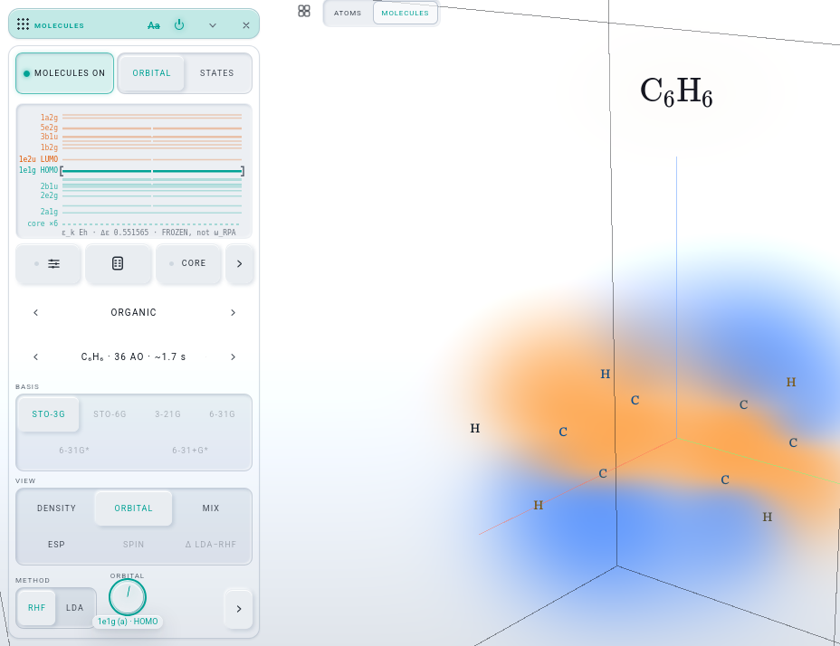
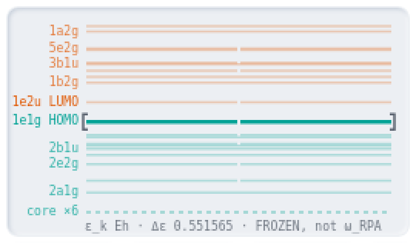
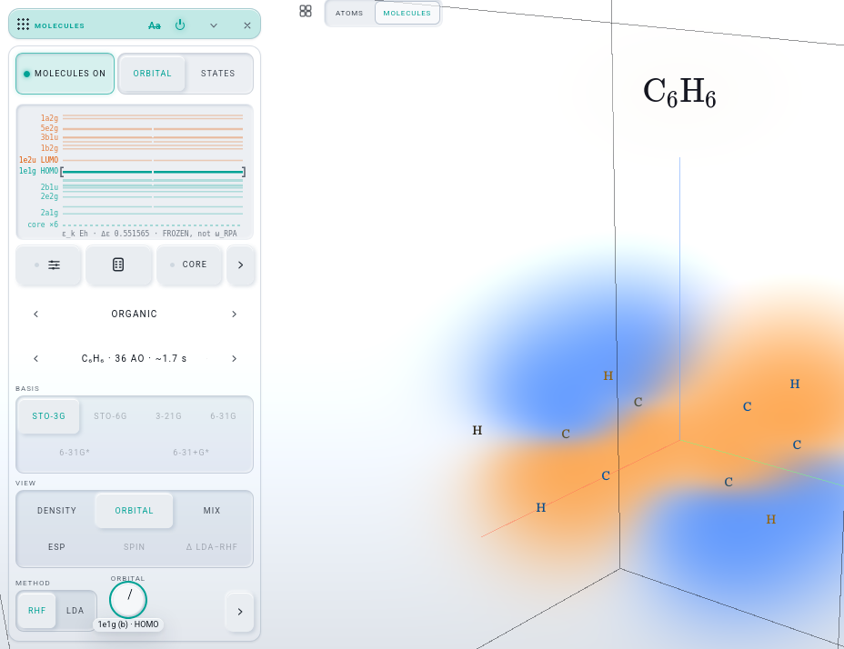
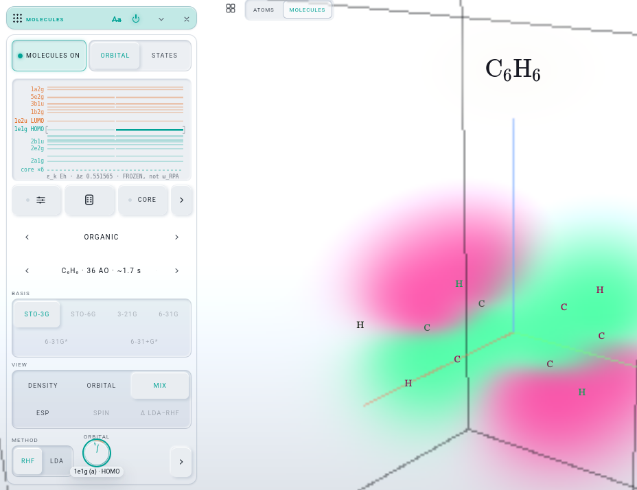
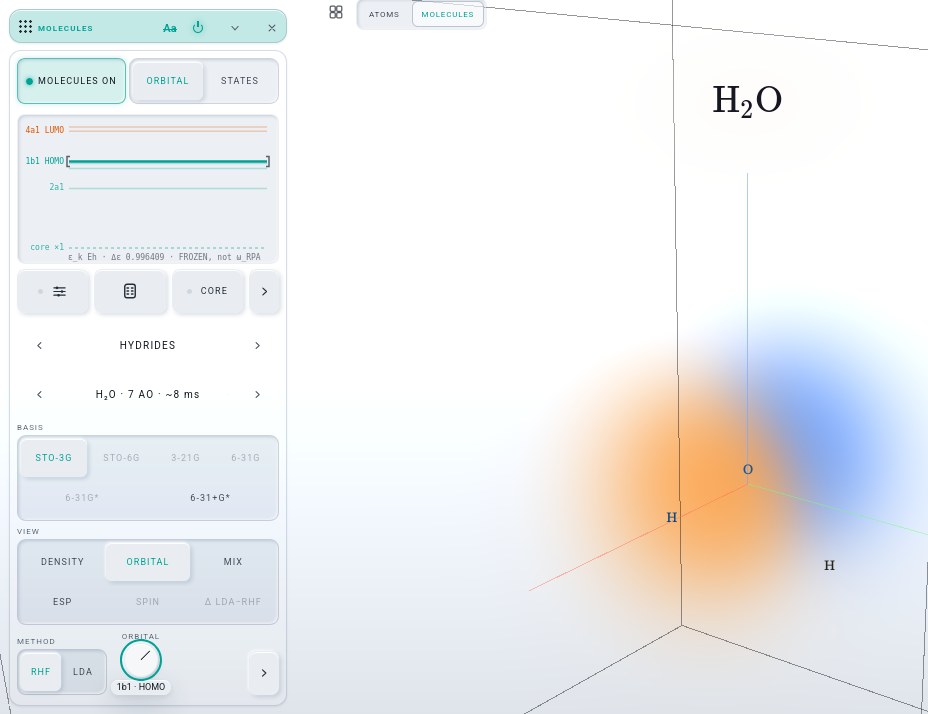

# D-BUILD · THE PAIR (iteration 009, row D)

Builder: Opus 5.5. Own worktree (`.claude/worktrees/agent-af27a1997921f554a`), branch `it009-pair` from the integration tip `033424d`.
Gate server 9301 / GD 5301, both stopped by pid when done. NOT pushed.

Josh (2026-10-19, call 1): "when the knob lands on a degenerate pair, light both lines". MIX stays the word.

## What Josh gets
- **When the ORBITAL dial lands on one member of a degenerate level, every member's line lights up.** On benzene, for example, the dial on
  1e1g (a) or on 1e1g (b) lights both 1e1g lines. The same holds for every degenerate row: 3e2g, the LUMO pair 1e2u, and so on.
  - This is THE PAINT GESTURE's precedent: a crossed degenerate row is taken whole.
  - The bracket already spanned the whole row (R). Now the lit lines match it.
- **The stage still shows one orbital, the one the dial names.** VIEW ORBITAL is one ψ_k. With the dial on (a), the field draws (a). With
  the dial on (b), it draws (b). The field, the session product and the dial's readout are unchanged.
- **The hover says why the partner is lit.** For example: "degenerate with the ORBITAL dial's 1e1g (b), so lit with it — VIEW ORBITAL draws
  that one". The canvas title now reads: "a degenerate row bracketed and lit whole: the dial on either member of a pair lights both lines".
- **A modulator brackets and lights the row in the same way.** An LFO on `chem.orbital` crossing the pair lights both lines, and it never
  changes the VIEW (R's law, untouched).
- **Under MIX and every other VIEW nothing changes.** The register leads, the lines the register lit stay lit, and the bracket steps back
  round the whole row (R).
- **A non-degenerate level still lights one line.** Water has no degenerate level, and so does benzene's 1a2u: one line, as before.

| benzene · dial on 1e1g (a): both lines lit, field draws (a) | the ladder, ×3 (same moment) | dial on 1e1g (b): both lit, field draws (b) |
|---|---|---|
|  |  |  |

| VIEW ORBITAL, an LFO on chem.orbital standing on the pair (VIEW held) | VIEW MIX, the same LFO (register leads, bracket whole, VIEW held) | water · 1b1 HOMO: one line |
|---|---|---|
|  |  |  |

All shots: headless Firefox at 1500 × 1150, light theme, STO-3G. Each is cropped to the MOLECULES card and the stage beside it; the zoom is
the ladder canvas at ×3.

## What changed (one file: `lab/orbitalsview.js`)
- `:487` — the cursor's lit test changed from `lead && lv.k === kc` to `lead && i === curRow`. In VIEW ORBITAL every line on the dial's row
  is lit. `curRow` is the row from `rowsOf()` (`:414`), the ladder's own grouping of levels with |Δε| < `DEG` = 1e-6 (`:32`). That is the
  same grouping that draws a degenerate level side by side and that the stroke takes whole. No second rule is added.
- `:463–:466` — the paint() comment has the law and Josh's sentence.
- `:495–:496` — the partner line's hover sentence.
- `:503–:504` + `:412` — the cursor as last painted (`marks`: the dial's k, its row's members, the lines it lit, whether it leads), read
  as `orbitals.state().cursor` (`:648`). `state()` gains one key. The `__LW` facade is untouched, so the lw-facade pin does not move.
- `:58–:59` — the canvas title.
- Not touched: the field, `chemview.js` (the dial, `toView`, `stepApply`), `statesview.js`, the saved ids, the `chem.*` / `reg.*` targets,
  the `mol-*` / `reg-*` hooks, `lab/rack.js`, `lab/mir/**`. `lab/sw.js` was rewritten by `pwa --write`.
- The repaint road is R's: chemview's `cursor()` key (`view:orbital:on`) repaints the ladder whenever a hand, a modulator or a load moves
  the dial.

## The proof (`.tmp/d-probe.mjs`, scratch and not committed; headless Firefox on 9301 / 5301)
The dial is driven by real input. A real tap lands on the dial, then the dial is focused, because the kit's pointer road does not focus a
knob. After that, real ArrowUp / ArrowDown keys from the driver turn it. The LFO is real: `mod.addSource('lfo')` → macro → route on
`chem.orbital`, with THE play running, sampled every 100 ms for 9 s.

| step | result |
|---|---|
| D1 benzene STO-3G: 1e1g (a), (b) = k 19, 20 at one ε (Δε 2e-15), VIEW MIX to start | GREEN |
| D2 two real keys put the dial on 1e1g (a): VIEW ORBITAL, ORBITAL pane, `cursor.lit` = [19, 20], `row` = [19, 20], session product `orbital` (one ψ), readout "1e1g (a) · HOMO" | GREEN |
| D3 keys on to 1e1g (b): lit = [19, 20], readout "1e1g (b) · HOMO", product `orbital` | GREEN |
| D4 keys down to 1a2u (single): lit = [16], so one line again | GREEN |
| D5 VIEW ORBITAL + LFO over orbitals 17–23: on (a) or (b), lit = both 1e1g lines (22 samples). Every sample lit exactly its level's row: 1a2u one line, 3e2g and 1e2u both. VIEW stayed `orbital` and the product stayed `orbital` on every sample | GREEN |
| D6 VIEW MIX + the same LFO: on the pair the bracket's row = [19, 20], the cursor lights nothing (the register leads), VIEW stayed `registry` on every sample | GREEN |
| D7 water: real keys walk 3a1 → 1b2 → 4a1 LUMO → 1b1 HOMO. Each time one line is lit (the dial's own) and the row has one member, VIEW ORBITAL | GREEN |
| D8 page errors | 0 |

## Gate (9301 / GD 5301)
| check | result |
|---|---|
| `node tests/pwa.test.mjs --write` | exit 0 (`lab/sw.js` re-pinned for `orbitalsview.js`) |
| `./test.sh node` | **exit 0** |
| `node tools/rack-deps.mjs --classes --no-write` | HOLDS; molecules **15** (F's number, unchanged), spectrum 25, bare writes 0 |
| `node tools/new-project.mjs --check` | in step (16098 B) |
| `register` | **22 / 22** |
| `orbitals` | **24 / 24** |
| `chem` | 55 / 56: **L5** (benzene's MORE fold), the listed pre-existing red. It was red again on a rerun alone; this row touches nothing in chemview's layout |
| `molecular-names` | stops at its first assertion (`:32`, `names` of the cards `chem` + `orbitals`). The `orbitals` card was folded into MOLECULES by iteration 008 U, and the suite was last edited in 0.7.4, before U. It was red again on a rerun alone; this is a pre-existing red, not this row's |
| the light check `.tmp/d-probe.mjs` | **9 / 9 GREEN**, 0 page errors |

## Proposed CLAUDE.md sentences (for the integrator)
In THE ONE LADDER sentence, replace "(a degenerate row bracketed whole, the line the dial names lit)" with:

> (a degenerate row bracketed AND lit whole — iteration 009 D, Josh: "when the knob lands on a degenerate pair, light both lines" — while
> VIEW ORBITAL still draws the one orbital the dial names; a modulator on `chem.orbital` lights the row the same way and never moves the VIEW)

and add: "The cursor as last painted is `orbitals.state().cursor` ({ k, row, lit, lead }), the ladder's own `rowsOf()` grouping (|Δε| < 1e-6)
— never a second degeneracy rule."

## Next
- The integrator merges `it009-pair`, runs `node tests/pwa.test.mjs --write` and `./test.sh node`, and takes the sentences above.
- Kit line (call 9, already on Sos's MIR list): on benzene one arrow key is 0.35 of an orbital, so two keys move one orbital. The probe
  presses until the dial names the target.
