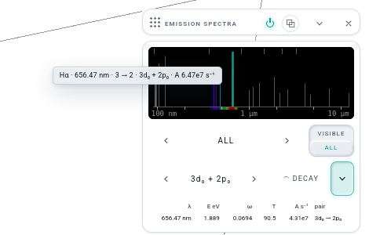
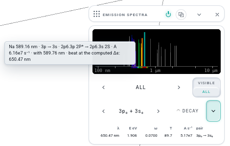

# E THE EMISSION SPECTRA — built (row E, Opus builder, 2026-10-25; no kit change)

Josh's answers to the plan's calls: 1 yes (RADIATION's line list moved whole into the new window's fold), 2 yes (NIST ASD fetched today),
3 press = the steady beat, Shift + press or DECAY = the Rabi TRANSITION, 4 σ pairs after π pairs.

(full frames: `e-shots/E1-hydrogen-halpha.png`, `e-shots/E3-atom-sodium.png`; headless Firefox on the gate server.)

## What was built
- **E1 THE STRIP** — `lab/emissionview.js` `createEmission(host, api)`, seated in readouts' third seat right after RADIATION (`device({ id: 'emission',
  eyebrow: 'EMISSION SPECTRA' })`, CLOSED). One black canvas (92 px): the catalogue dim, coloured by wavelength (CIE 1931 multi-lobe fit → sRGB,
  grey outside 380–750 nm), height = log A over what is drawn; the eye's band under the axis; hydrogen's series limits as ticks; the prepared state's
  lines lit in ACCENT A (`stateLines`, rebuilt on `reg.version`, never per frame; an off-range lit line is an edge arrow). Row 2 ‹ SERIES › (HYDROGEN:
  ALL · LYMAN … HUMPHREYS; ATOM: ALL · VISIBLE · ONE-ELECTRON) · RANGE VISIBLE | ALL (a knob-sized seg; ALL = 90 nm – 12.5 µm log, the default).
  Row 3 ‹ PAIR › (π first, then σ, each strongest A first; the default the strongest π) · DECAY · the fold (the line table: λ, E eV, ω, T, A, the
  pair — RADIATION's EMISSION LINES, moved). Hover: a highlighted line and the kit's graph tip (`showGraphTip`), e.g.
  `Hα · 656.47 nm · 3 → 2 · 3d₀ + 2p₀ · A 6.47e7 s⁻¹`; the wheel over the strip and ← → step the hover line by line, Enter presses.
  A press (pointer, Enter, a PAIR pick, the facade) is THE HAND: `loadPreset({ id: 'emission:…', label, modes, visual }, { hand: true })` — THE FADE
  names the pair, the window is one period, RATE T/4 — held as ONE history row `EMISSION · Hα` (the verbs.js hold pattern); with Shift or DECAY the
  A ↔ B stores become the upper label alone and the lower alone and the TRANSITION plays (`app.hooks.ab.setStores` + `set(true)`, the clock
  played as STATE's switch plays it). A restore, an undo, a project or link open never presses (only the canvas, the PAIR stepper and `__LW.emission.pick`
  reach `load`). Hidden in MOLECULES mode (moleculeMode's list), in + / WINDOW / the WINDOW PICKER by the rack's own registration, KIND `info`.
- **E2 HYDROGEN, EXACT** — `lab/dynamics.js`: `lineList(H)` (every Δl = ±1 subshell pair of the 140 under the operator in force, λ_vac, the tabulated
  A = (4/3)α³ω³·max(l,l′)/(2l+1)·R²), `linePairs(upper, lower)` (the m-pairs, state-to-state A), `stateLines(re, im, ids)` (the state's own lines, π and
  σ — `dipoleLines` keeps the z channel for its test), `angularDipole2` (the full vector |⟨l′m′|r̂|lm⟩|²), `lineMass` (¹H's reduced mass once under the
  register's μ = mₑ hydrogen, as radiation.js), `lambdaNm`. `lab/emission-map.js` (pure): `hydrogenStrip` (one strip line per shell pair, Lyα … Huα).
- **E3 THE ATOMS, MEASURED** — `tools/nist-lines.py` ran against NIST ASD today: one GET per element,
  `https://physics.nist.gov/cgi-bin/ASD/lines1.pl?spectra=<El>+I&…&line_out=1&show_av=3&unit=1&format=3&unc_out=1…` (tab, vacuum at every λ, nm, lines
  with A only; `unc_out=0` is refused by the form with "Invalid Column Setting", so it is sent as 1). Kept: A known, both configurations, relative
  intensity ≥ the element's median (else A ≥ its median), ≤ 160 per element. **4,519 lines from 78 neutral spectra, 337,618 B** in
  `lab/vendor/nist/lines.json` (`[Z, λ_vac_nm, A_ki, rel_int, lower_conf, lower_term, upper_conf, upper_term]` + source, query, date). The ASD answered
  "No lines are available … with the parameters selected" for 40 spectra (Se, Zr, Nb, Pr, Pm, Tb, Re, Os, Po, At, Rn, Th–Og) — written as `none`, never
  filled in; the window says so for such an element. Smaller than the plan's ≈15k/1 MB because of the median cut and the cap. `emission-map.js`
  `parseConfig` / `activeElectron` (the one orbital the upper configuration holds once more and the lower once less, Δl = ±1; H I's shell-only "2", "3"
  read as the strongest subshell pair; else "not a one-electron line", grey and unpressable; n > 7 "past the register"), `atomStrip` (grouping by orbital
  pair: Na D₁ + D₂ one picture, listed together in the hover). The pair loads as the atom's own labels; the beat runs at the computed Δε and the hover says
  so (`beat at the computed Δε: 650.47 nm` for Na's 589.16). DATA, never precache: `sw.js` DATA gains `vendor/nist/`, read on the first ATOM landing
  and kept by `library.js keepData`; HYDROGEN never fetches it. The citation is in ABOUT (index.html, `ab-fine`).
- **E4 THE LOOP** — nothing added: a pressed pair is a two-level state, so PLACE ONE PERIOD reads it as any; the preset's window is the one period
  (Hα T = 90.48 a.u.). No shader line, no style.
- **E5 WHAT IT IS NOT** — said once in the window's note and once in the MODEL sheet's new EMISSION paragraph (no radiation reaction, fine structure,
  Lamb shift or widths; an atom's multiplets one picture per orbital pair). STATUS: `status.js` `EMISSION_STATUS` (the plan's two lines), set on the card.

## Files
New: `lab/emissionview.js` · `lab/emission-map.js` · `lab/vendor/nist/lines.json` · `tools/nist-lines.py` · `tests/emission.test.mjs` ·
`tests/emission.browser-test.mjs` · `research/iteration-016/e-shots/` (4 PNG).
Edited: `lab/dynamics.js` (the line list) · `lab/windows/readouts.js` (the seat and `load`) · `lab/rack.js` (the `emissionView` slot in `app.w`, the seat
destructure, READERS, the CPU tick) · `lab/shell/controller.js` (`perf.profile.emission`) · `lab/windows/molecules.js` (moleculeMode's list) ·
`lab/shell/settings.js` (KIND, `older.emission`, the blob's `gen: 16`) · `lab/shell/facade.js` (`__LW.emission`) · `lab/radiationview.js` (EMISSION
LINES left) · `lab/status.js` · `lab/index.html` (MODEL sheet, ABOUT) · `lab/lab.css` (§ EMISSION SPECTRA, appended) · `lab/sw.js` (DATA + precache) ·
`tests/pwa.test.mjs` (the DATA list and its rule string name `vendor/nist/`) · `research/release-0.5.2/lw-facade.json` (re-captured).
Deviation from the plan's file name: the view is `lab/emissionview.js` (the house's `<x>view.js`, beside radiationview.js) seated in readouts.js,
not a new `lab/windows/emission.js` module — a new module file needs a PLANNED row and a cut anchor in `tools/rack-deps.mjs`, and readouts' third seat
already holds RADIATION's neighbours (readouts 13 → 14 under the hinge).
THE OLDER PROFILE: no key the blob already wrote could say "this profile met EMISSION SPECTRA", so `saveSettings` now writes `gen: 16` (PREFERENCE,
constant) and `older.emission = !(s.gen >= 16)`; a later card can reuse it (`gen >= N`).

## The oracle numbers (tests/emission.test.mjs, 10/10 GREEN, 0.1 s)
| | measured | oracle |
|---|---|---|
| Hα vacuum, μ_H | 656.4696 nm | 656.47 (NIST blend 656.46) |
| Hα infinite mass | 656.1123 nm | 656.11 |
| Lyα · Hβ | 121.5684 · 486.2738 nm | 121.567 · 486.27 |
| A 3d→2p · 3p→2s · 3s→2p · 2p→1s | 6.46510e7 · 2.24483e7 · 6.31358e6 · 6.26490e8 s⁻¹ | NIST 6.4651e7 · 2.2448e7 · 6.3134e6 · 6.2649e8 (worst 2.8e-5) |
| selection rule, 140 × 140 | forbidden max 0, max \|ours − radiation.js vector\| 4.5e-13 | 1e-12 |
| sum rule Σ_m′, l ≤ 6 | 1.1e-16 | — |
| positronium Balmer α | 1312.22 nm | 2 × 656.11 (the plan's 1312.9 was 2 × the μ_H line; Ps carries no proton mass) |
| 3d₀ + 2p₀ lit line · T | 656.47 nm · 90.478 a.u. | — |
| 14 NIST configurations | all read | by hand |
| Na I D pair | 589.158 / 589.756 nm → 3p → 3s, grouped | NIST vacuum |

## Gates
- THE LOCK (headless Firefox, gate server 8761 / geckodriver 5262): `digest-lock.mjs --check --query gastab=0` **843 values · 0 differences**; with
  `--fixture research/release-0.4.0/measure/digest-lock-s4a.json` **987 · 0** (page errors 0 both).
- `tests/emission.test.mjs` 10/10 GREEN · `tests/emission.browser-test.mjs` GREEN (4 scenes: shipped closed and in +; a pointer press on Hα loads
  2p₀ + 3d₀ as one row `EMISSION · Hα`, the lit line at 656.47 nm; Shift + press on Lyα sets the TRANSITION A = 2p₀, B = 1s, one row; MOLECULES hides the
  card, HYDROGEN shows it) · `tests/lw-facade.browser-test.mjs --write` → the fixture's one diff is `+ ["emission","value"]` (179 members), then GREEN
  without `--write` · `tools/settings-probe.mjs` 0 of 3 scenes red (the blob's new `gen` moves nothing on an open) · `__LW.period` after Hα = 90.4779 a.u.
  (E4: PLACE ONE PERIOD reads the pair as any state).
- `node tools/rack-deps.mjs --classes --no-write`: THE HINGE HOLDS (readouts 14, facade 21; the largest moving module spectrum at 25); G-A `app.w` 71 keys.
- `bash test.sh node`: every suite of this row GREEN; three reds belong to concurrent rows' uncommitted edits, not to E — `mir-manifest`
  (`lab/mir/modulation/window.js` changed without re-adoption), a timer in `lab/mod-port.js` `routeDots` reading `document` under node (the flash-routes
  suite), and `pwa` precache hashes for `picker.js` / `skin.css` edited after this row's `--write` (re-written with `--write` again at the end: GREEN).

## Not done, and why
- The strip never draws a measured line UNDER HYDROGEN (the computed ones are exact to the model's own resolution); NIST's H I lines appear only under
  ATOM · Z = 1.
- U I and a few heavy spectra have A values but no configurations in the ASD: they are dropped by the "both configurations" rule, not drawn grey.
- No line widths, no intensity model beyond log A, no multiplet splitting (E5).
- RANGE / SERIES / PAIR are never saved (the plan's page law); the card's open / closed / fold is WORKSPACE as every card.
