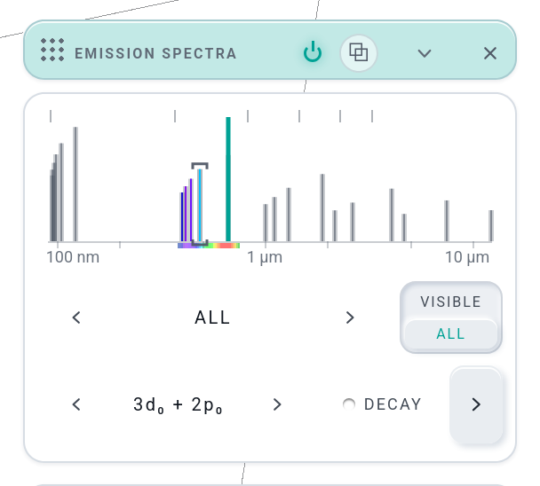
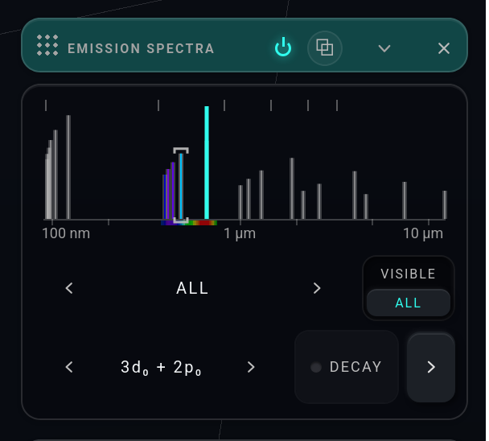
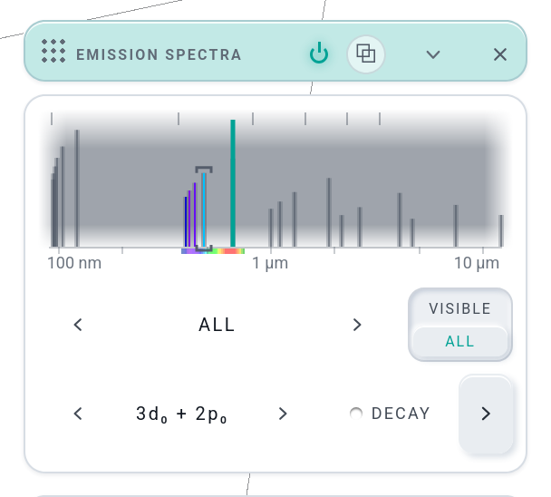
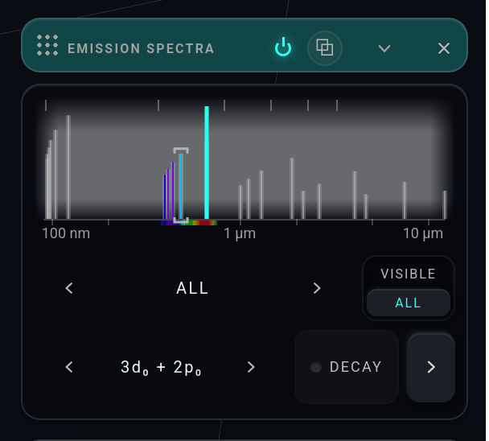
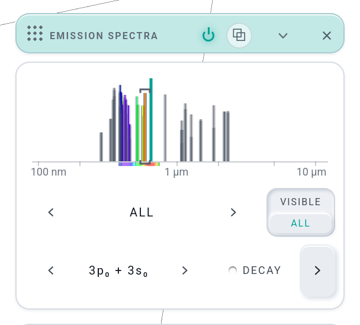

# E6 THE STRIP IN LATTICE'S STYLE — built (Opus builder, 2026-10-25; no kit change)

Josh 10-25: "perhaps the code of 'lattice' (because the UI on that looks gorgeous) … Let's try it!"  Only the EMISSION SPECTRA strip canvas was
repainted. Nothing else in the window moved (THE HAND law), and no data or physics changed. The hover tip, the wheel, ← →, Enter, a press and
Shift + press work as before. The 6 px gutters are unchanged, so every hit-test x and the browser test's press geometry still hold.

 
 

(Each shot also has a 1500 × 865 full frame, `E6-<tag>-full.png`. The cards were taken at device pixel ratio 2 in headless Firefox on the gate server, port 8773 with
geckodriver on 5273. The graph tip is hidden in the crop so the Lyman lines show. The scratch driver is `.tmp/e6/shots.mjs` + `run.sh`, which is gitignored.)

## What changed
- **No black box.** `paint()` clears the canvas (`clearRect`), so the card's glass is the ground, as in `lattice.js`. `lab.css`'s
  `.em-strip` drops `background: #000` (now `transparent`).
- **The axis** is drawn in the theme's ink from `themeInk(g)`: the rule and the ticks at `T.ink(0.3)`, the labels at `T.ink(0.85)`, and the series limits at `T.ink(0.45)`.
  The labels and the message line are set in the kit's UI face, read from `--font-ui` (Roboto …) at 9 / 10 px. There is no monospace left.
- **The catalogue is a comb.** Each line is a 3 px stroke in `T.ink(0.3)` with a 1 px core in its spectral colour (`waveRGB`, at α 0.9). A pressable line past
  the eye (UV / IR) gets an ink core at 0.6. A line no picture can make (past the register, or not a one-electron jump) is the ink stroke alone, 2 px at 0.16.
  Height is still log A over what is drawn.
- **The register's lit lines** go through `paint-stroke.js` `levelLine`, which gains a minimal 9th argument `vertical` (then
  (x0, x1) are the y ends and `y` is the x). They are drawn in ACCENT A (`accentRGB(g, 1)`), lit, at w 1.5, so they come out 2.5 px wide like the old ones. A pressed line reads as an occupied rung.
  Existing callers pass 6–8 arguments, so they are unchanged.
- **The hover** is the ladder's cursor bracket set upright: a cap over the line and a cup at its foot, in `T.ink(0.95)` at 1.5 px. The cap
  rises over a lit line standing at the same x. It replaces the old thicker hairline.
- **`STRIP_SHADE`**, a module constant: 0 = A, the colour straight on the glass (shipped); 1 = B, a feathered `T.ink(0.55)` shade behind the lines,
  soft at the top, the bottom and both ends (a vertical gradient masked by a horizontal one through `destination-in`).

## The variant: A
A ships. B, built exactly as briefed (`T.ink(0.55)`), is **less** legible in both themes. The ink-on-ink comb loses its contrast against
an ink slab: grey teeth on a grey band. On the light theme the slab reads as the old black box half-returned, and on the dark theme as a fog over the lines.
In A the spectral cores and the ACCENT A line read directly on the glass, as LATTICE's bars do. If B is wanted later, the kit's informational layer
shades with the *opposite* ink (paper, not ink). That would be a one-line change in the B branch, but it was not tried here.

## Files
`lab/emissionview.js` (the paint, `STRIP_SHADE`, imports `themeInk` and `levelLine`) · `lab/paint-stroke.js` (`levelLine` `vertical`) ·
`lab/lab.css` (`.em-strip` background) · `lab/sw.js` (precache hashes of exactly those three files, `pwa.test.mjs --write`) ·
`research/iteration-016/e-shots/E6-*.png` (5 cards + 5 full frames, 1.7 MB).

## Gates
- `node tests/emission.test.mjs`: 10/10 GREEN.
- `LW_PORT=8773 GD_PORT=5273 node tests/emission.browser-test.mjs`: GREEN, all 4 scenes, run once after the change and again in the final state.
- `node tests/pwa.test.mjs`: GREEN after `--write`. The sw.js diff is the three hashes above and nothing else.
- THE LOCK was not run, as briefed: it does not read this canvas.

## Note for the integrator
CLAUDE.md's EMISSION SPECTRA paragraph still says "draws a black strip of lines coloured by wavelength". It should now read that the strip is drawn on the
card's glass in LATTICE's vocabulary (comb, upright level line, cursor bracket). CLAUDE.md was not edited.
