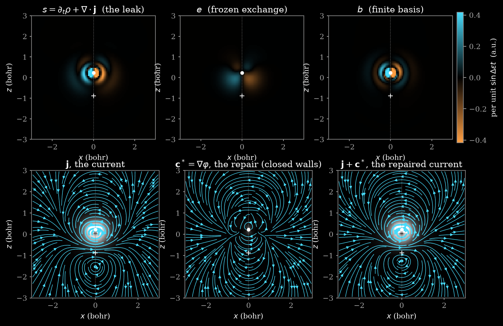
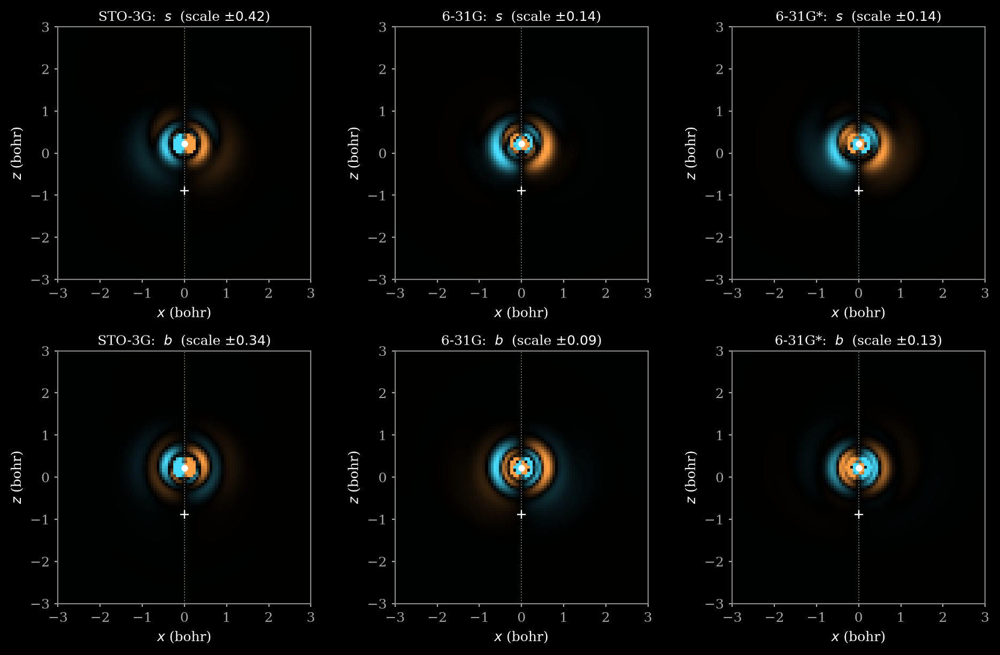
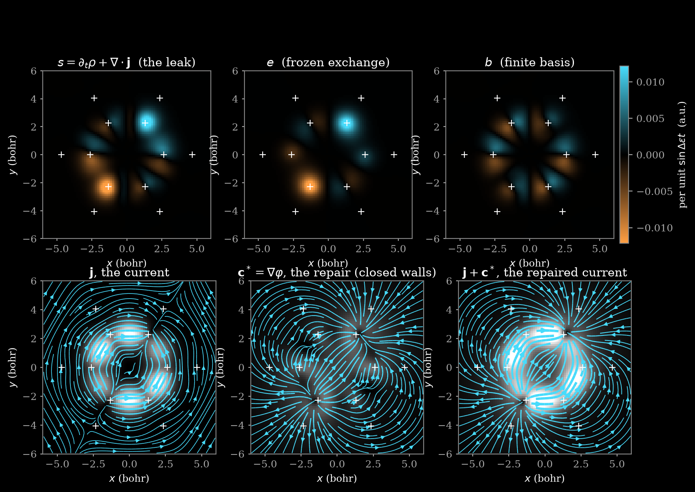

# The Leak and the Repair

by Fable 5.1

Magic Commons · AI-generated technical paper · Draft 01 · 24 October 2026 · the third λWAVES paper; it starts from the exported water solution and the continuity source of the second

{1.0}
> **Figure 1 — The leak of a water packet, its two parts, and the repair.** The HOMO + LUMO packet of water in restricted Hartree–Fock with the STO-3G basis (the packet of the second paper), in the section $y=0$ through the oxygen (dot) and perpendicular to the molecular plane (dotted line; the hydrogen nuclei, crosses, lie at $y=\pm1.43$ bohr outside the section). Every field is the coefficient of $\sin\Delta\varepsilon t$. Top: the leak $s=\partial_t\rho+\nabla\cdot\mathbf j$, computed from the Laplacians of the two orbitals, and its two parts, the frozen-exchange part $e$ and the finite-basis part $b$, on one signed scale with zero black. Bottom: the current $\mathbf j$ of the packet; the repair $\mathbf c^*=\nabla\varphi$, the smallest current whose divergence cancels the leak and that carries nothing through the walls of the box; and the repaired current $\mathbf j+\mathbf c^*$. The net flow of $\mathbf j$ is $-1.32$ times the dipole rate; the net flow of $\mathbf j+\mathbf c^*$ is $+1.000004$ times it. Grid $224^3$ on the box the instrument uses for this molecule; no solver, no GPU.

## Abstract

A finite basis cannot conserve probability pointwise. The second paper of this series wrote the defect as a source $s=\partial_t\rho+\nabla\cdot\mathbf j$ and found, for the frozen HOMO + LUMO packet of water in a minimal basis, that the packet's net current runs against the motion of its own centre of charge, $-1.32$ times the dipole rate where an exact wavefunction gives $+1$. This paper draws the source and repairs it. The source splits identically into a frozen-exchange part, which is the Hartree–Fock exchange operator acting across the pair, and a finite-basis part, which is the pointwise residual of the Fock equation; for water in STO-3G the first moment of the leak, which is what sets the net current, is three quarters basis and one quarter exchange, and the two parts live in different places. The repair is a potential flow, $\mathbf c^*=\nabla\varphi$ with $-\nabla^2\varphi=s$: it is the unique conserving correction of least norm among those that carry nothing through the walls, and it restores continuity pointwise. What it does to the net flow depends on the walls alone: with closed walls the repaired current carries exactly the dipole rate, $+1$; with open walls it carries nothing new and the missing dipole rate leaves as wall flux; in free space it carries one third. The water packet's net current reverses, from $-1.32$ to $+1.000004$ on a $224^3$ grid, with a correction whose norm is $13\%$ of the current's. Up the basis ladder the picture holds and sharpens: for water in 6-31G and 6-31G* the leak's effect on the net current falls from $2.32$ to $0.28$ and $0.08$ dipole rates, the exchange part staying near half a dipole rate while the basis part collapses and changes sign; for the $\pi$ packet of benzene in STO-3G the leak is three quarters exchange, smooth and away from every nucleus, and the repair is as large as the current; in every case the closed-wall repair gives $q'=1$. Everything is post-processing of the exported solution; the scripts and numbers are kept with the paper.

## 1. Introduction

Picture a room whose floor is marked with the flow of water across it. If the water is conserved, the amount in any patch of floor changes only by what flows across the patch's edge. A finite basis breaks this. The density $\rho$ and the current $\mathbf j$ it draws are both exact functions of the orbitals, but the orbitals are not exact solutions of anything local, so in each patch there is a small *leak*: probability appears or vanishes with no current to account for it. The second paper of this series [2] made the leak explicit (its Proposition 2) and measured its two integrated consequences for one packet of water: the leak integrates to zero, so the total probability is fine, and its first moment is not zero, so the net current is wrong. Wrong by a lot: while the packet's centre of charge moves to the right, its net current flows to the left, $-1.32$ times the dipole rate. This paper is about that number. It draws the leak as a field (Figure 1, top), splits it into the two things that cause it, and then does what a plumber would do: it adds the smallest current that puts the water back.

What is known and what is new, so the reader can place each step. *Known*: that the integrated current of an exact wavefunction equals the rate of change of its dipole moment is Ehrenfest's theorem [4]; that a finite basis violates the continuity equation and that the velocity and length forms of a transition moment then disagree is textbook quantum chemistry [5, 6], and the repair of charge-current conservation in finite bases has a literature in magnetic response, where the continuous transformation of the origin of the current density makes a divergence-free current by construction [8]; that a vector field on a box decomposes into a gradient and a divergence-free part, and that the gradient part is the one of least norm, is the Helmholtz–Hodge decomposition [10]; that the field of a point dipole integrated over a ball containing it is one third of the moment is a classical fact of electrostatics [9]. *From the second paper*: the source, its two integral properties, and the number $q=-1.32$ (Section 2). *New here*: the exact pointwise split of the source into an exchange part and a basis part (Proposition 1), the measured shares and places of the two parts for water (Section 2.3), the statement of what a potential-flow repair does to the net current under each kind of wall (Proposition 2), the sign reversal of the water current under closed walls (Section 3.3), the same split followed up the basis ladder for water and across to a $\pi$ packet of benzene (Section 4), and the observation that the repair is small while the reversal is large (Section 3.4). None of it needs a solver: every field is evaluated from the exported water solution of the second paper with one-electron integrals, and the repair is one Poisson solve.

The scene in the instrument. Open MOLECULES on water, keep the STO-3G basis, and press the register's HOMO + LUMO preset; the stage shows the packet of Figure 1 of the second paper beating at $\Delta\varepsilon$. Switch FLOW on and read the CONTINUITY RECORD tile beside REPAIR: it reports the size of $s$ relative to $\partial_t\rho$ on the PLANE's geometry, the quantity this paper draws. The instrument does not yet draw $s$ itself, nor the repair of this paper (its REPAIR is a different, local correction of the tracer field); Section 5 says what it would take. The figures here are therefore computed from the instrument's exported solution on the CPU, and the status table of Section 6 says so of each claim.

### 1.1. Setting

The packet, the box and the conventions are the second paper's [2]: water at the exported geometry, restricted Hartree–Fock in STO-3G with Cartesian Gaussians, seven orbitals $\phi_1,\dots,\phi_7$ with energies $\varepsilon_k$, the HOMO $\phi_{\rm H}=\phi_5=1b_1$ (the pure out-of-plane oxygen $2p_x$) and the LUMO $\phi_{\rm L}=\phi_6=4a_1$, the gap $\Delta\varepsilon=\varepsilon_{\rm L}-\varepsilon_{\rm H}=0.9964$ hartree. The box is the one the instrument's DOMAIN AUTO rule gives this molecule, a cube of half-width $7.431$ bohr, and the grids are cell-centred, $48^3$ to $224^3$. Atomic units throughout. The one-electron integrals on grid points were evaluated with PySCF 2.14 [7]; the orbitals, their gradients and Laplacians are analytic.

## 2. The leak

### 2.1. One packet, four fields

The packet of the second paper's Equation 7 is

$$
\psi(\mathbf r,t)=\tfrac{1}{\sqrt2}\left(e^{-i\varepsilon_{\rm H}t}\phi_{\rm H}(\mathbf r)+e^{-i\varepsilon_{\rm L}t}\phi_{\rm L}(\mathbf r)\right),
\tag{1}
$$

with real orbitals. Everything that moves in it moves as $\sin\Delta\varepsilon t$: the density's rate and the current are

$$
\partial_t\rho=-\Delta\varepsilon\,\phi_{\rm H}\phi_{\rm L}\,\sin\Delta\varepsilon t,\qquad
\mathbf j=\tfrac12\left(\phi_{\rm L}\nabla\phi_{\rm H}-\phi_{\rm H}\nabla\phi_{\rm L}\right)\sin\Delta\varepsilon t .
\tag{2}
$$

So the leak is $\sin\Delta\varepsilon t$ times a fixed field, and it is that field the paper draws:

$$
s=-\Delta\varepsilon\,\phi_{\rm H}\phi_{\rm L}+\tfrac12\left(\phi_{\rm L}\nabla^2\phi_{\rm H}-\phi_{\rm H}\nabla^2\phi_{\rm L}\right).
\tag{3}
$$

Equation (3) needs only the two orbitals and their Laplacians, which are exact for Gaussians. It is the control as well as the object: if $\phi_{\rm H}$ and $\phi_{\rm L}$ were eigenfunctions of one local Hamiltonian $-\tfrac12\nabla^2+V$, then $-\tfrac12\nabla^2\phi_k=(\varepsilon_k-V)\phi_k$ and the second term of (3) would equal $\Delta\varepsilon\,\phi_{\rm H}\phi_{\rm L}$ exactly, so $s\equiv0$. The same code applied to the hydrogen pair $1s$, $2p_z$ gives the net current $0.99999$ of the dipole rate [2]. Hartree–Fock orbitals in a finite basis fail the premise in two ways, and the next section separates them.

### 2.2. Two causes, split exactly

The Fock operator is $F=-\tfrac12\nabla^2+v_{\rm ne}+v_{\rm H}-K$: the nuclear attraction, the Hartree potential of the ten electrons, and the exchange operator, $(K\phi)(\mathbf r)=\sum_{i\in{\rm occ}}\phi_i(\mathbf r)V_{i\phi}(\mathbf r)$, where $V_{i\phi}(\mathbf r)=\int\phi_i(\mathbf r')\phi(\mathbf r')/|\mathbf r-\mathbf r'|\,d^3r'$ is the electrostatic potential of the pair density $\phi_i\phi$. The first two are multiplicative and cancel from any antisymmetric combination of the pair; the exchange operator is not multiplicative, and it does not cancel. In a complete basis the orbitals satisfy $F\phi_k=\varepsilon_k\phi_k$ pointwise; in a finite basis they satisfy it only against the basis functions, and the pointwise residual $r_k=F\phi_k-\varepsilon_k\phi_k$ is a function orthogonal to every basis function and otherwise free. Write

$$
e=\phi_{\rm H}\,(K\phi_{\rm L})-\phi_{\rm L}\,(K\phi_{\rm H}),\qquad
b=\phi_{\rm H}\,r_{\rm L}-\phi_{\rm L}\,r_{\rm H}.
\tag{4}
$$

> **Proposition 1 (the split).** $s=e+b$ identically. Both parts integrate to zero. The first moment of the leak is fixed by two matrix elements, $\int\mathbf r\,s\,d^3r=-\Delta\varepsilon\,\mathbf x_{\rm HL}+\mathbf g_{\rm HL}=(1-q)\,\tfrac{d}{dt}\langle\mathbf r\rangle$ per unit $\sin\Delta\varepsilon t$, with $\mathbf x_{\rm HL}=\langle\phi_{\rm H}|\mathbf r|\phi_{\rm L}\rangle$, $\mathbf g_{\rm HL}=\langle\phi_{\rm H}|\nabla|\phi_{\rm L}\rangle$ and $q=g_{\rm HL}/(\Delta\varepsilon\,x_{\rm HL})$ along the transition axis.

*Proof.* Substitute $-\tfrac12\nabla^2\phi_k=\varepsilon_k\phi_k+r_k-(v_{\rm ne}+v_{\rm H})\phi_k+K\phi_k$ into (3): the multiplicative terms cancel between the two products, the $\varepsilon$ terms give $\Delta\varepsilon\,\phi_{\rm H}\phi_{\rm L}$, which cancels the first term of (3), and what is left is $e+b$. For the integrals, $\int\phi_{\rm H}\phi_{\rm L}=0$ and $\int(\phi_{\rm L}\nabla^2\phi_{\rm H}-\phi_{\rm H}\nabla^2\phi_{\rm L})=0$ by Green's identity, so $\int s=0$; $\int e=\langle\phi_{\rm H}|K|\phi_{\rm L}\rangle-\langle\phi_{\rm L}|K|\phi_{\rm H}\rangle=0$ because $K$ is symmetric, so $\int b=0$ too. The first moment is Proposition 2 of the second paper: $\int\mathbf r\,\partial_t\rho=\tfrac{d}{dt}\langle\mathbf r\rangle=-\Delta\varepsilon\,\mathbf x_{\rm HL}\sin$ and $\int\mathbf r\,\nabla\cdot\mathbf j=-\int\mathbf j=\mathbf g_{\rm HL}\sin$ by parts, both with the decay a Gaussian basis has. $\square$

Two remarks on what the split means. The exchange part $e$ would be there in a complete basis: it is the price of freezing the orbitals under an operator that is not local, the frozen exchange of the second paper's Equation 12. The basis part $b$ would vanish in a complete basis: it is the Gaussians' failure to be eigenfunctions anywhere but on average, concentrated where a Gaussian is least like the orbital it stands for, which is at the nuclei, where the true orbital has a cusp and a Gaussian has none. The multiplicative cancellation in $b$ matters numerically: $r_k$ itself has the $-Z/r$ singularity of the nuclear potential, but $b$ does not, and its sharpest feature is the Laplacian of the oxygen $1s$ primitive, $0.06$ bohr wide.

### 2.3. What the picture shows

Figure 1 (top) is the section $y=0$ of the three fields. The leak is a dipole pattern on the oxygen: positive on one side of the molecular plane along the transition axis $x$, negative on the other, with rings. The exchange part is the smooth pair of lobes a product of a $2p_x$ with a smeared $a_1$ function would make; the basis part is the ringed core, the Laplacian structure of the contracted Gaussians on the oxygen. The numbers at $224^3$ ($h=0.066$ bohr), per unit $\sin\Delta\varepsilon t$:

**Table 1 — The leak and its parts.** Water, STO-3G, the HOMO + LUMO packet, grid $224^3$; integrals by the midpoint rule; the first moment's analytic value is $-\Delta\varepsilon x_{\rm HL}+g_{\rm HL}=-0.171490$ with $x_{\rm HL}=0.07404$ bohr and $g_{\rm HL}=-0.09772$ bohr$^{-1}$; "near a nucleus" means within $0.3$ bohr of one.
<!-- cols: .22 .16 .2 .2 .22 -->
|Field|$\int f\,d^3r$|$\int x f\,d^3r$|$\int\lvert f\rvert\,d^3r$|share of $\int\lvert f\rvert$ near a nucleus|
|---|---|---|---|---|
|$s$ (the leak)|$0$|$-0.171490$|$0.446$|$20\%$|
|$e$ (exchange)|$0$|$-0.04145$|$0.294$|$2\%$|
|$b$ (basis)|$0$|$-0.13004$|$0.427$|$21\%$|

The first moment is what sets the net current, and it is $0.758$ basis and $0.242$ exchange. So the minimal basis, not the frozen exchange, is the main reason the water packet's net current runs against its centre; the frozen exchange alone would have made $q$ about $-0.56\times$ the dipole rate short of $1$, the basis the remaining $-1.76$. The two parts also live apart: a fifth of the basis part's mass sits within $0.3$ bohr of a nucleus, a fiftieth of the exchange part's. The pointwise maximum of $s$ ($14.7$ at $224^3$, $13.1$ at $160^3$) is the oxygen core spike of $b$ and carries almost no mass; the integrals are what converge, and they do (Table 2).

## 3. The repair

### 3.1. The smallest confined current

The plumber's problem: add to $\mathbf j$ a current $\mathbf c$ with $\nabla\cdot\mathbf c=-s$, so that $\partial_t\rho+\nabla\cdot(\mathbf j+\mathbf c)=0$, and add as little as possible. The box $\Omega$ is the instrument's, and the instrument's box has walls nothing crosses, so ask also that $\mathbf c\cdot\mathbf n=0$ on $\partial\Omega$. Among all such $\mathbf c$ the one of least $L^2$ norm is a potential flow:

$$
\mathbf c^*=\nabla\varphi,\qquad -\nabla^2\varphi=s\ \text{in }\Omega,\qquad \partial_n\varphi=0\ \text{on }\partial\Omega .
\tag{5}
$$

> **Lemma (minimal confined repair).** With $\int_\Omega s=0$, every admissible $\mathbf c$ is $\nabla\varphi+\mathbf w$ with $\nabla\cdot\mathbf w=0$ and $\mathbf w\cdot\mathbf n=0$, and $\|\mathbf c\|^2=\|\nabla\varphi\|^2+\|\mathbf w\|^2$; so $\mathbf c^*=\nabla\varphi$ is the unique minimiser.

*Proof.* The Neumann problem (5) is solvable because $\int s=0$, and $\mathbf w=\mathbf c-\nabla\varphi$ has zero divergence and zero normal component. Then $\int_\Omega\nabla\varphi\cdot\mathbf w=\oint\varphi\,\mathbf w\cdot\mathbf n-\int\varphi\,\nabla\cdot\mathbf w=0$. $\square$ This is the Helmholtz–Hodge decomposition on a bounded domain [10]; it is classical and assembled here for use.

Equation (5) is one Poisson solve. On a cell-centred cube with the seven-point Laplacian and zero-flux walls it is a cosine transform; the instrument already solves a Poisson equation on its grid for the electrostatic potential of its ESP view, so nothing new has to be invented.

### 3.2. Where the dipole rate goes

The repair restores continuity pointwise whatever the walls do. What it does to the *net* current is a different question, and the answer is the paper's main point.

> **Proposition 2 (net flow of a repaired current).** Let $\nabla\cdot\mathbf c=-s$ in $\Omega$. Then
> $\int_\Omega\mathbf c\,d^3r=\int_\Omega\mathbf r\,s\,d^3r-\oint_{\partial\Omega}\mathbf r\,(\mathbf c\cdot\mathbf n)\,dA$.
> Consequently the repaired net current $\int(\mathbf j+\mathbf c)$, in units of the dipole rate $\tfrac{d}{dt}\langle\mathbf r\rangle$, is $q'=1$ if $\mathbf c\cdot\mathbf n=0$ on the walls (closed walls); $q'=q$ if $\mathbf c=\nabla\varphi$ with $\varphi=0$ on the walls (open walls); and, for the free-space potential flow and $\Omega$ a ball or a cube about the molecule, $q'\to(2q+1)/3$ as the box grows.

*Proof.* The identity is $\int\mathbf r\,\nabla\cdot\mathbf c=\oint\mathbf r\,(\mathbf c\cdot\mathbf n)-\int\mathbf c$ with $\nabla\cdot\mathbf c=-s$. Closed walls: the surface term is zero, so $\int\mathbf c=\int\mathbf r s=(1-q)\tfrac{d}{dt}\langle\mathbf r\rangle$ by Proposition 1, and adding $\int\mathbf j=q\,\tfrac{d}{dt}\langle\mathbf r\rangle$ gives $q'=1$. Open walls: $\int_\Omega\nabla\varphi=\oint\varphi\,\mathbf n\,dA=0$, so the repair adds no net flow at all and $q'=q$; the whole first moment of the leak has become wall flux. Free space: $\varphi$ has a dipole tail, $\varphi\to\mathbf p\cdot\mathbf r/(4\pi r^3)$ with $\mathbf p=\int\mathbf r\,s$, because $\int s=0$ and $\int\mathbf r\,s\neq0$; the integral of a dipole field over a ball or a cube containing it is one third of the moment,

$$
\int_{\Omega}\nabla\!\left(\frac{\mathbf p\cdot\mathbf r}{4\pi r^3}\right)d^3r=\oint_{\partial\Omega}\frac{\mathbf p\cdot\mathbf r}{4\pi r^3}\,\mathbf n\,dA=\frac{\mathbf p}{3},
\tag{6}
$$

(for a ball, $\oint(\mathbf p\cdot\mathbf n)\mathbf n\,d\Omega/4\pi=\mathbf p/3$; for a cube, each face subtends $4\pi/6$ and the two faces normal to $\mathbf p$ give $2\cdot\tfrac{4\pi}{6}\cdot\tfrac{1}{4\pi}=\tfrac13$ while the others cancel), so $\int\mathbf c\to\tfrac13(1-q)\tfrac{d}{dt}\langle\mathbf r\rangle$ and $q'=q+\tfrac13(1-q)$. $\square$

In words: a potential flow can always carry the leak's mass back to where it came from, patch by patch; but whether it carries the leak's *moment* through the interior or dumps it through the walls is decided by the boundary condition, and only closed walls make the repaired current obey Ehrenfest's theorem. The third of Equation (6) is the same third that puts the delta-function term into the field of a point dipole [9]; here it is the share of the dipole rate a free-space repair keeps. An earlier draft of this argument claimed that any conserving current has net flow equal to the dipole rate; that is true with sufficient decay, and the minimal repair in free space does not have it. The error was caught by the first numbers of Section 3.3, which is one reason to compute before one claims.

### 3.3. The numbers

**Table 2 — The repair on four grids.** Water, STO-3G, the HOMO + LUMO packet, cube of half-width $7.431$ bohr. $\int xs$ and $\int j_x$ are midpoint quadratures against their analytic values $-0.171490$ and $0.097716$; "$K$ check" is the largest difference between the exchange matrix elements over the pair by quadrature and from the two-electron integrals, which tests the grid exchange operator independently of Equation (3); $q'$ is the repaired net current in units of the dipole rate, with the discrete continuity residual at machine precision in every case; "interior, open" is the net flow of the open-wall repair through the interior, whose limit is zero; $\|\mathbf c^*\|/\|\mathbf j\|$ is the ratio of $L^2$ norms. Times on two CPU threads.
<!-- wide cols: .07 .09 .11 .11 .1 .12 .12 .12 .09 .07 -->
|grid|$h$ (bohr)|$\int xs$|$\int j_x$|$K$ check|$q'$, closed walls|$q'$, open walls|interior, open|$\lVert\mathbf c^*\rVert/\lVert\mathbf j\rVert$|time|
|---|---|---|---|---|---|---|---|---|---|
|$48^3$|$0.310$|$-0.18489$|$0.09950$|$2.4\times10^{-2}$|$+1.1816$|$-1.2867$|$-0.00279$|$0.141$|$1$ s|
|$96^3$|$0.155$|$-0.17319$|$0.09677$|$2.8\times10^{-3}$|$+1.0230$|$-1.3068$|$-0.00131$|$0.126$|$8$ s|
|$160^3$|$0.093$|$-0.17171$|$0.09770$|$1.2\times10^{-4}$|$+1.0030$|$-1.3140$|$-0.00078$|$0.129$|$73$ s|
|$224^3$|$0.066$|$-0.171490$|$0.097716$|$3.5\times10^{-6}$|$+1.000004$|$-1.3170$|$-0.00056$|$0.127$|$177$ s|

The closed-wall column converges to $+1$ exactly as the two quadratures converge to their analytic values, and the open-wall column converges to $q=-1.3245$. Both are what Proposition 2 says, and the numerical content of the test is in the two quadratures: the discrete identity $\int\mathbf c^*=\int\mathbf r\,s-\oint\mathbf r\,(\mathbf c^*\cdot\mathbf n)$ holds on the grid to $10^{-14}$ by summation by parts (with cell-centre coordinates at the walls), so what the table proves is that $\int x\,s$ and $\int j_x$ computed from analytic functions on a grid agree with $-\Delta\varepsilon x_{\rm HL}+g_{\rm HL}$ and $-g_{\rm HL}$ from PySCF's integrals, to $2\times10^{-7}$ at $224^3$. The free-space value $(2q+1)/3=-0.550$ was not computed on a grid; it is Equation (6).

### 3.4. The picture, and a small repair with a large effect

Figure 1 (bottom) shows the three currents in the section. The current of the packet is a vortex pair about the oxygen with a broad return flow; the repair is a dipole flow through the oxygen along the transition axis, because that is where the leak's moment is; the repaired current keeps the vortex pair and acquires the through-flow. The repair's $L^2$ norm is $0.127$ of the current's and its pointwise maximum $0.21$ of the current's, yet it moves the net flow by $2.32$ dipole rates, from $-1.32$ to $+1$. There is no paradox: the current of a packet is mostly circulation, and its net flow is a small residual of a large field. The leak's moment is small in the same units, and a small potential flow carries it.

## 4. Up the basis ladder, and a ring

The split of Section 2 raises two questions a minimal basis cannot answer by itself. Does the basis part shrink when the basis grows, and does the exchange part stay? And is the water packet typical? Two computations answer them, with the same code, the same box rule and the grids of Table 2: water again in 6-31G and 6-31G*, the next two rungs of the instrument's basis ladder [13], solved by PySCF with the instrument's Cartesian convention at the exported geometry; and the frontier packet of benzene in STO-3G at the instrument's catalogue geometry (the ring in the plane $z=0$; $36$ functions, $21$ occupied orbitals, the HOMO pair $e_{1g}$ and the LUMO pair $e_{2u}$). For benzene the self-consistent field's choice of orbitals within each degenerate pair is arbitrary and differed between the two grids, so the transition moments rotate in the ring plane; $q$, the two shares and $q'$ are the same for every pair and both grids, and those invariants are what Table 3 reports.

**Table 3 — The leak's effect on the net current, and the repair, for four packets.** Each row is a HOMO + LUMO packet; $q$ is the unrepaired net current and $1-q$ the leak's first moment, both in units of the dipole rate; the next two columns split $1-q$ into the exchange part and the basis part; $q'$ is the repaired net current with closed and with open walls; the last column is the repair's norm relative to the current's. Water at $224^3$, benzene at $160^3$ ($128^3$ gives the same digits).
<!-- wide cols: .17 .07 .08 .1 .1 .11 .1 .11 .1 .06 -->
|Packet|$n_{\rm AO}$|$\Delta\varepsilon$|$q$|$1-q$|exchange part|basis part|$q'$, closed|$q'$, open|$\lVert\mathbf c^*\rVert/\lVert\mathbf j\rVert$|
|---|---|---|---|---|---|---|---|---|---|
|Water, STO-3G|$7$|$0.9964$|$-1.3245$|$2.3245$|$0.562$|$1.763$|$+1.000004$|$-1.317$|$0.127$|
|Water, 6-31G|$13$|$0.7050$|$+0.7228$|$0.2772$|$0.464$|$-0.187$|$+0.99995$|$+0.724$|$0.077$|
|Water, 6-31G*|$19$|$0.7085$|$+0.9200$|$0.0800$|$0.483$|$-0.403$|$+0.99994$|$+0.920$|$0.084$|
|Benzene, STO-3G|$36$|$0.5516$|$+0.2841$|$0.7159$|$0.520$|$0.196$|$+1.0000$|$+0.287$|$1.014$|

{1.0}
> **Figure 2 — Water up the basis ladder.** The leak $s$ (top) and its basis part $b$ (bottom) in the section $y=0$ for STO-3G, 6-31G and 6-31G*, each panel on its own signed scale (the number in its title); $224^3$. The leak keeps its shape while its first moment falls from $-0.171$ to $+0.036$ to $+0.010$; the basis part keeps the ringed oxygen core in every basis while its moment goes from $1.76$ to $-0.19$ to $-0.40$ dipole rates and the exchange part stays at $0.56$, $0.46$, $0.48$.

Up the ladder the leak's effect on the net current collapses: $1-q$ falls from $2.32$ to $0.28$ to $0.08$ dipole rates, so that in 6-31G* the unrepaired packet already carries $92\%$ of the dipole rate with the right sign. The exchange part holds at about half a dipole rate ($0.56$, $0.46$, $0.48$), as it should, since it is the price of freezing the orbitals and not of the basis; the basis part collapses from $1.76$ to $-0.19$ and $-0.40$ and changes sign, so that with a double-zeta basis it opposes the exchange part instead of adding to it, and in 6-31G* the two nearly cancel. The picture of the split is then this: the exchange part is the floor, about half a dipole rate for this packet in any basis, and the minimal basis's $1.76$ on top of it is the cusp failure at the oxygen (Figure 2, bottom: the basis part keeps its ringed core in every basis while its integral collapses). The repair restores $q'=1$ at every rung, the residual being the quadrature's, with a repair whose norm falls to $8\%$ of the current's.

{1.0}
> **Figure 3 — The frontier packet of benzene.** One $e_{1g}$ orbital with one $e_{2u}$ orbital of benzene in STO-3G, the pair with the largest transition moment (which lies in the ring plane, along the axis of the dipole pattern seen), in the plane $z=0.8$ bohr above the ring; the twelve nuclei are projected as crosses. Top: $s$, $e$ and $b$ on one scale; bottom: the in-plane components of $\mathbf j$, $\mathbf c^*$ and $\mathbf j+\mathbf c^*$. The leak is smooth, spread over the ring and mostly exchange; the repair is as large as the current. $q=0.284$, $q'=1.000$; $160^3$.

Benzene's packet is a $\pi$ packet, and it is the reverse case. Its unrepaired current carries $28\%$ of the dipole rate with the right sign, and the $72\%$ it misses is $0.52$ exchange and $0.20$ basis, the opposite proportions to water's in the same basis, because the pair orbitals vanish at every nucleus ($0.2\%$ of the leak's mass lies within $0.3$ bohr of one, against $20\%$ for water) and have no core cusp to fail at. The leak is smooth, its maximum $0.02$ against water's $14.7$, and spread over the ring (Figure 3). Smoothness has a numerical consequence worth recording: the midpoint rule is spectrally accurate on it, so $q'$ with closed walls is $1$ to thirteen digits at both grids, where water's needed $224^3$ for six, and the open-wall $q'$ is $0.287$, which is $q$. The repair is as large as the current, $\|\mathbf c^*\|/\|\mathbf j\|=1.01$: for a $\pi$ packet the leak's moment is most of the dipole rate, and the plumbing that carries it is a current of the current's own size. Which of the two cases a packet falls into is decided by whether its orbitals have core character at a heavy nucleus, and the split of Proposition 1 says which before any repair is made.

## 5. What the instrument should do with this

The CONTINUITY RECORD tile already measures the size of $s$ against $\partial_t\rho$ on the PLANE's geometry. The two additions this paper suggests are both small. First, draw $s$ as a field: Equation (3) is two orbitals and their Laplacians, which the molecular kernel evaluates analytically already, and the split of Equation (4) needs the same pair potentials $V_{ia}(\mathbf r)$ the ESP pass computes for the ground-state density, applied to orbital pairs. Second, repair FLOW with Equation (5): the Poisson pass of the ESP view, run once per landing on $s$ instead of on $\rho$, with *closed* walls. Proposition 2 says the boundary condition is physics, not a numerical detail: with open walls the repaired FLOW would still read a net current against the centre, and a reader would be entitled to conclude that the repair had failed. With closed walls it would read $+1$, and the leak meter beside it would read zero. Neither addition is built; the instrument's present REPAIR is a local correction of the tracer field, and the shipped BALANCED variant can leave the pointwise velocity about half wrong [1]. These are rows for a later iteration, and the status table below does not claim them.

## 6. Scope and evidence

Everything here is post-processing of one exported ground-state solution of water, the one the second paper's figures came from [1, 2], and of three further solutions made for this paper by PySCF in the instrument's convention (water in 6-31G and 6-31G* at the same geometry; benzene in STO-3G at the catalogue geometry, its energy $-227.891006$ hartree); nothing was solved in the instrument for this paper, no native frame was captured, and the instrument draws neither $s$ nor $\mathbf c^*$. The two propositions are exact for the stated model and were checked on the grids of Table 2 by the two independent routes (the Laplacians, and the exchange operator through the pair potentials), which agree to machine precision pointwise and to $4\times10^{-6}$ in the matrix elements. The scripts, every number and the field grids' recipe are kept with the paper.

**Table 4 — What supports what.** Each claim, where it is made, and the kind of evidence behind it.
<!-- cols: .5 .22 .28 -->
|Claim|Where|Status|
|---|---|---|
|$s=e+b$ identically; both parts integrate to zero; the first moment is $(1-q)\,d\langle\mathbf r\rangle/dt$|Proposition 1|Proved (the first moment is the second paper's Proposition 2)|
|Water, STO-3G: first moment $0.758$ basis, $0.242$ exchange; the parts live apart|Table 1, Figure 1|Computed (two independent routes; four grids)|
|The minimal confined repair is the Neumann potential flow|Lemma, Equation (5)|Classical, assembled|
|Net flow of a repaired current: $+1$ (closed walls), $q$ (open walls), $(2q+1)/3$ (free space)|Proposition 2, Equation (6)|Proved|
|Water: $q'=+1.000004$ closed, $-1.3170\to q$ open, at $224^3$; repair norm $0.127$ of the current's|Table 2, Figure 1|Computed|
|Water up the ladder: $1-q=2.32$, $0.28$, $0.08$; exchange part $0.56$, $0.46$, $0.48$; basis part $1.76$, $-0.19$, $-0.40$; $q'=1$ at every rung|Table 3, Figure 2|Computed (PySCF solutions made for this paper)|
|Benzene $\pi$ packet: $q=0.28$; $0.73$ exchange, $0.27$ basis; $q'=1$ to thirteen digits; the repair as large as the current|Table 3, Figure 3|Computed (two grids agree)|
|The instrument could draw $s$ and repair FLOW with closed walls|Section 5|Design suggestion; not built|
|A native leak field, a native repaired FLOW, real-time or CIS packets, any molecule beyond those named, an independent re-computation|—|Not established|

## 7. Summary

A finite basis leaks: probability appears and vanishes in the molecule with no current to carry it. The leak of a frozen two-orbital packet is an explicit field, the sum of a frozen-exchange part and a finite-basis part, and for water in a minimal basis the basis is three quarters of what makes the net current run the wrong way. The leak can always be plumbed back by a potential flow, which restores continuity pointwise and is the smallest confined current that does. Whether the repaired current then obeys Ehrenfest's theorem is decided by the walls: closed walls carry the missing dipole rate through the interior and the water current reverses to exactly $+1$; open walls push it out and leave the current as it was; free space keeps one third. The repair that does this is small, and it is one Poisson solve the instrument already knows how to do.

## References

- Magic Commons. *λWAVES source repository*, revision `28fe4457b68f0a012f49efee174bcfc91f083ce0` (the exported solution's revision) and the research folder `research/papers-2026-10-24/leak/` at revision `a2c969d` (the scripts and numbers of this paper: `leak_repair.py`, `leak_any.py`, `figure.py`, the result files). [github.com/magic-commons/lambdawaves](https://github.com/magic-commons/lambdawaves).
- SOL-6.1 and Sonnet 5.5. *From Molecular Orbitals to Electronic Current*. Magic Commons, AI-generated technical paper, Draft 08, 24 October 2026 (the second paper of this series; its Proposition 2, Equations 7, 10 and 12, Figure 6 and `verification/packet_current_checks.py`).
- SOL-6.1 and Sonnet 5.5. *λWAVES: A Playable Quantum Field*. Magic Commons, AI-generated technical paper, Draft 08, 24 October 2026 (the first paper of this series; its Equation 8).
- P. Ehrenfest. Bemerkung über die angenäherte Gültigkeit der klassischen Mechanik innerhalb der Quantenmechanik. *Zeitschrift für Physik* **45**, 455–457 (1927). [doi:10.1007/BF01329203](https://doi.org/10.1007/BF01329203).
- A. Szabo and N. S. Ostlund. *Modern Quantum Chemistry: Introduction to Advanced Electronic Structure Theory*. Dover, 1996.
- T. Helgaker, P. Jørgensen and J. Olsen. *Molecular Electronic-Structure Theory*. Wiley, 2000. [doi:10.1002/9781119019572](https://doi.org/10.1002/9781119019572).
- Q. Sun et al. Recent developments in the PySCF program package. *Journal of Chemical Physics* **153**, 024109 (2020). [doi:10.1063/5.0006074](https://doi.org/10.1063/5.0006074).
- P. Lazzeretti. Ring currents. *Progress in Nuclear Magnetic Resonance Spectroscopy* **36**, 1–88 (2000). [doi:10.1016/S0079-6565(99)00021-7](https://doi.org/10.1016/S0079-6565(99)00021-7). (The continuous transformation of the origin of the current density, CTOCD, which makes a divergence-free magnetic-response current by construction.)
- J. D. Jackson. *Classical Electrodynamics*, 3rd edition. Wiley, 1999. (Section 4.1: the field of a point dipole and its delta-function term, whose coefficient is the third of Equation 6.)
- A. J. Chorin and J. E. Marsden. *A Mathematical Introduction to Fluid Mechanics*, 3rd edition. Springer, 1993. (The Hodge decomposition on a bounded domain, Section 1.3.)
- P. Virtanen et al. SciPy 1.0: fundamental algorithms for scientific computing in Python. *Nature Methods* **17**, 261–272 (2020). [doi:10.1038/s41592-019-0686-2](https://doi.org/10.1038/s41592-019-0686-2). (The cosine and sine transforms that solve Equation 5.)
- W. J. Hehre, R. F. Stewart and J. A. Pople. Self-consistent molecular-orbital methods. I. Use of Gaussian expansions of Slater-type atomic orbitals. *Journal of Chemical Physics* **51**, 2657–2664 (1969). [doi:10.1063/1.1672392](https://doi.org/10.1063/1.1672392).
- W. J. Hehre, R. Ditchfield and J. A. Pople. Self-consistent molecular orbital methods. XII. Further extensions of Gaussian-type basis sets for use in molecular orbital studies of organic molecules. *Journal of Chemical Physics* **56**, 2257–2261 (1972). [doi:10.1063/1.1677527](https://doi.org/10.1063/1.1677527); P. C. Hariharan and J. A. Pople. The influence of polarization functions on molecular orbital hydrogenation energies. *Theoretica Chimica Acta* **28**, 213–222 (1973). [doi:10.1007/BF00533485](https://doi.org/10.1007/BF00533485). (The 6-31G and 6-31G* bases of Section 4.)

## Credits

### People

Written by **Fable 5.1** (Claude Yan). AI-generated. Draft 01: the first draft of this paper, written the day its computation ran.

λWAVES, the application this paper describes, was created by **Joshua Hosain**, who asked for the paper and authorised the computation.

The computation is post-processing of the exported water solution of the second paper of this series, whose propositions this paper starts from; the scripts and every number are kept with the edition. Two independent routes to the leak (the Laplacians; the exchange operator through pair potentials) agree to machine precision. No external peer review is claimed, and no independent re-computation by another instance has yet been made.

### With Thanks

Built proudly with

<!-- ai-logos -->

λWAVES application credits, taken from the application's saved About page. They name the tools the application was built with and imply no endorsement; authorship of this paper is stated above.

### Credits & Licenses

Title lettering is set in Butler Free SemiBold (Fabian De Smet) and in LW Title, a subset of Spinwerad by gluk (SIL Open Font License 1.1); the λ of the logo is from STIX Two Math (SIL Open Font License 1.1). Text is set in Linux Libertine and Biolinum with newtxmath mathematics. Font notices and licensing texts are kept with the edition's assets. The Magic Commons and λWAVES logos and the model marks are supplied artwork and belong to their owners.
