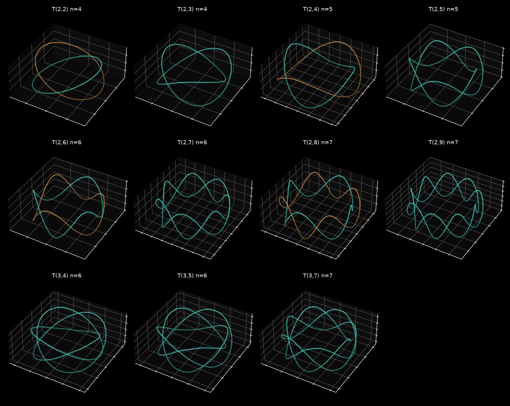
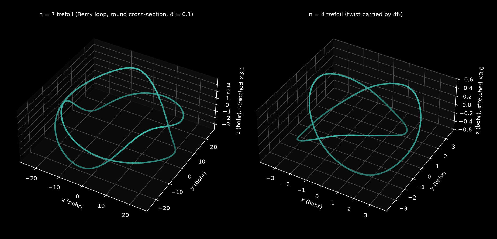
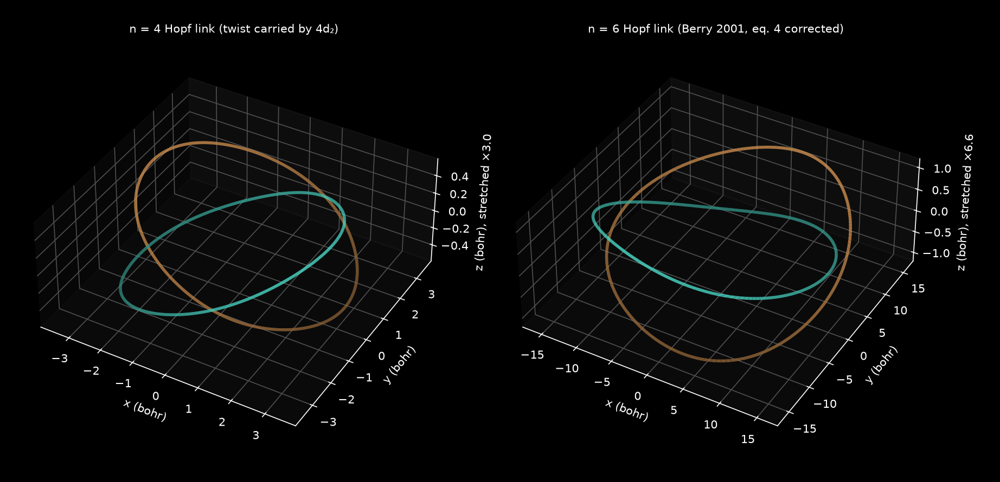
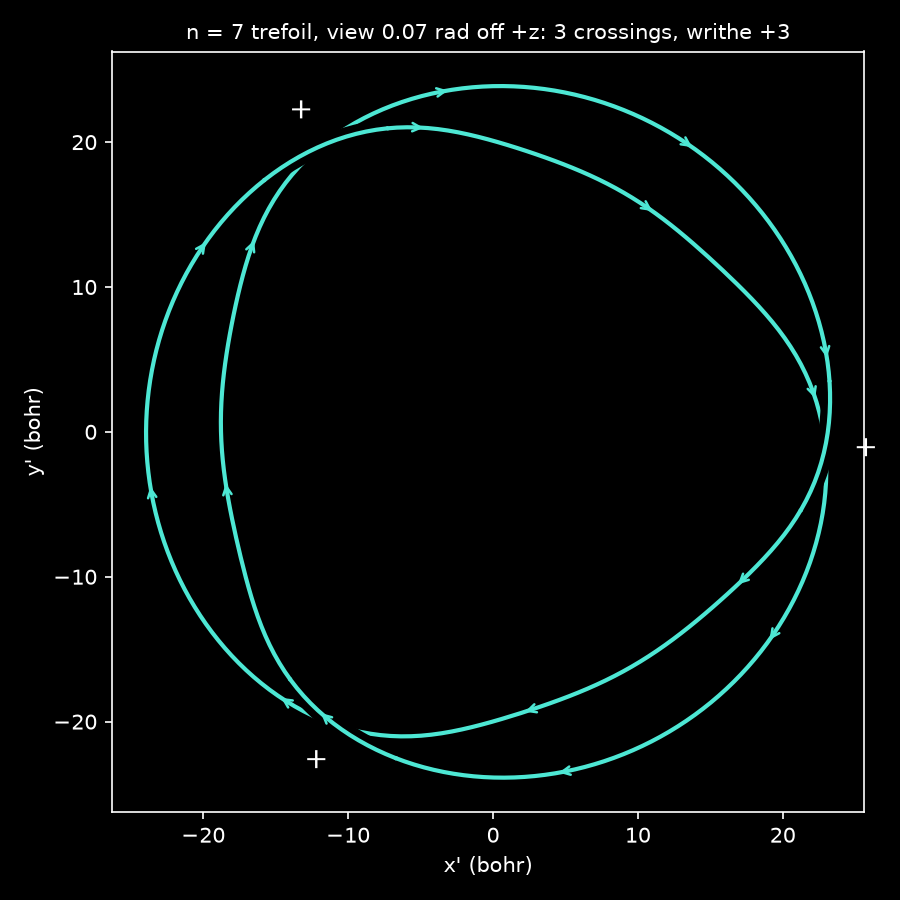
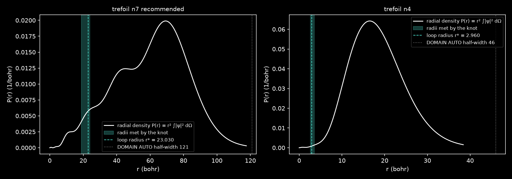

# Knotted Zeros in Seven Levels

by Fable 5.1 and Opus 5.5

Magic Commons · AI-generated technical paper · Draft 01 · 24 October 2026 · the fourth λWAVES paper; the mathematics and the computation are the proving lab's (Opus), the prose is Fable's

{1.0}
> **Figure 1 — Eleven knots and links the register holds.** The nodal line of one stationary hydrogen state in each panel, traced from the expanded superposition in the instrument's own conventions: the torus knots and links $T(2,q)$ for $q=2$ to $9$ and $T(3,4)$, $T(3,5)$, $T(3,7)$, each in the lowest level $n$ our construction reaches ($n=4$ to $7$; a link's two components in two colours). Every knot's Alexander polynomial equals the torus-knot formula and every link has the stated linking number. Berry's recipe of 2001 needs $n=6$ for the Hopf link and $n=7$ for the trefoil; both appear here at $n=4$.

## Abstract

A nodal line of a complex wavefunction is a vortex: the phase winds once around it and the density vanishes on it. Berry showed in 2001 that a stationary state of hydrogen, a superposition within one degenerate level, can have a nodal line tied in a knot, and gave a trefoil at $n=7$. The λWAVES register holds every state with $n\le7$ and draws nodal lines, so the question was whether Berry's knot can be loaded and turned, and what else the register holds. We give the answers. First, what a level can and cannot contain: a polynomial times $e^{-r/n}$ is a level-$n$ state only if it is harmonic and homogeneous of degree $n-1$, so the stereographic polynomial knots of optics are not available, and level $2$ holds no knot or link at all, since every nodal line there is a conic in a plane through the nucleus. Second, Berry's construction, rebuilt in the instrument's conventions to every printed digit (and with one typographical error in his equation 4 identified), together with a refinement: a loop of order $p$ needs $2p-1$ conditions rather than $\tfrac12p(p+1)$, and if the twist that unfolds the loop is carried by the perturbing state's own angular momentum instead of the loop's, the torus knot $T(p,q)$ appears at a lower level. A Hopf link and a trefoil then exist at $n=4$, the cinquefoil at $n=5$, $7_1$ at $n=6$, and $9_1$ and $T(3,7)$ at $n=7$; the register holds every $T(2,q)$ up to $q=9$. Each state is delivered as coefficients over the register's labels, verified against the instrument's own evaluator to $5\times10^{-15}$, and its knot type is computed from the traced curve by its Alexander polynomial and braid word. A small admixture of an $n=6$ state makes the trefoil rock or turn with the beat without changing type. Whether the lowered levels are new is not established; the forward literature has not yet been searched.

## 1. Introduction

Picture the phase of a wavefunction as colour. Where the wavefunction vanishes the colour is undefined, and around such a point in a plane every hue occurs once: the zero is a vortex. In three dimensions the zeros of a complex function are lines, and a vortex line can close on itself, and a closed line can be knotted. Berry asked in 2001 whether an atom can hold a knotted vortex line standing still, and answered yes [1]: take states of one degenerate level of hydrogen, so that the superposition is stationary and its zeros do not move; arrange four of them so that the zero set has a circle on which the function vanishes to second order; thread that circle with the axial vortex of the states' angular momentum; and perturb. The circle unfolds into a torus knot. His link needed $n=6$ and his trefoil $n=7$. The λWAVES register has held every state with $n\le7$ since its eighth iteration [9], and the instrument draws nodal lines, so there is now a place to turn Berry's knot in one's hands. This paper is what we found when we went to load it.

What is known and what is new, so a reader can place each step. *Known*: the construction of a knotted nodal line by unfolding a high-order zero loop threaded by a vortex is Berry's for hydrogen [1] and Berry and Dennis's for monochromatic waves [2]; that every finite link occurs in the nodal set of some hydrogen eigenfunction at high enough energy is a theorem of Enciso, Hartley and Peralta-Salas [5], which gives no level; the stereographic polynomial knots of optics are Dennis, King, Jack, O'Holleran and Padgett [3] and Bode and Dennis [4]; the Alexander polynomial of a torus knot and the handedness of a closed positive braid are standard [7, 8]. *New here, by our reading*: that a polynomial times $e^{-r/n}$ is a level-$n$ state only when it is harmonic and homogeneous of degree $n-1$, which closes the polynomial route (Proposition 2); that level $2$ holds no knot or link (Proposition 4); that an order-$p$ zero loop needs $2p-1$ conditions (Proposition 5); the unfolding with a perturbation of its own angular momentum, which lowers the level at which each torus knot appears (Proposition 6, Corollary 7); the explicit states at those levels, verified (Sections 4 to 6); and the behaviour of the knot under a beat with a neighbouring level (Section 7). The first of these corrects a guess one of us made before the computation; the lemma we set out to prove was false, and the proof of its negation is three lines. Whether the lowered levels have been noticed before is not established: we read Berry's paper in full and the first sections of Berry and Dennis, and the abstracts of the others, and no forward-citation search has yet been made.

The scene in the instrument. Switch to HYDROGEN, open the STATE card's lanes and load the preset of Table 1 (it is a list of labels and complex coefficients; the instrument normalises it). For the $n=7$ trefoil the automatic box already shows the knot as a dark thread about three voxels wide in the PHASE view; for the $n=4$ knots set DOMAIN to about $5$ bohr, because they sit at three bohr from the nucleus where the automatic box's voxels are too coarse. Turn the camera. With CAMERA's FLIP off the handedness on screen is the true one; the recommended $n=7$ trefoil is right-handed. The VORTEX window finds the same zeros on its sampled spheres, as points, since the knot meets few of them.

### 1.1. Setting

Level $n$ of hydrogen is the $n^2$-dimensional space $H_n$ spanned by

$$
\psi_{nlm}=R_{nl}(r)\,Y_l^m(\theta,\varphi),\qquad R_{nl}=N_{nl}\,e^{-\rho/2}\rho^{l}L^{2l+1}_{n-l-1}(\rho),\quad \rho=2r/n,
\tag{1}
$$

with the complex spherical harmonics in the Condon–Shortley convention, $Y_l^{-m}=(-1)^m\overline{Y_l^m}$, and the modern normalisation of the Laguerre polynomials; this is the instrument's own convention, read from its source [9], and every state below is written over its labels ($7f_3$ is $n=7$, $l=3$, $m=3$). Any $\psi\in H_n$ evolves as $e^{-iE_nt}\psi$, $E_n=-1/2n^2$, so its nodal set is stationary. Atomic units throughout. The instrument's register orders the $91$ labels of $n\le6$ first and the $49$ of $n=7$ after; a preset is a list of modes, normalised on loading.

## 2. What a level can hold

### 2.1. Polynomials times an exponential

The knots of optics are built as zero sets of complex polynomials in $(x,y,z)$ obtained by stereographic projection from the Milnor fibrations of torus knots [3, 4], and a natural guess is that any such polynomial of low enough degree, times $e^{-r/n}$, is a hydrogen state. It is not.

> **Proposition 2.** For a complex polynomial $P$ on $\mathbb R^3$, $P\,e^{-r/n}\in H_n$ if and only if $P$ is harmonic and homogeneous of degree $n-1$. These are the $2n-1$ states $r^{n-1}Y_{n-1}^m$, $|m|\le n-1$, with $l=n-1$.

*Proof.* With $g=e^{-r/n}$, $\Delta(Pg)=g[\Delta P-(2/n)\partial_rP+P/n^2-2P/(nr)]$, and the eigenvalue equation reduces to $nr\,\Delta P-2r\,\partial_rP+2(n-1)P=0$ away from the origin. Split $P$ into homogeneous parts $P_d$ and use $r\partial_rP_d=dP_d$: the equation reads $rA=B$ with $A=n\Delta P$ and $B=-2\sum_d(n-1-d)P_d$ polynomials. Along a ray $x=tu$ and its opposite $x=-tu$ this gives $B(su)=sA(su)$ and $B(su)=-sA(su)$ for all real $s$, so $A\equiv0$ and then $B\equiv0$: $P=P_{n-1}$ and $\Delta P=0$. The converse is direct, and $Pg$ is square-integrable. $\square$

The counterexample is $P=1$ at $n=2$. The dimensions say the same: polynomials of degree at most $6$ span $84$ dimensions, $H_7$ has $49$, and only $13$ of them have this form. Where the guess fails is instructive: $H_n$ holds exactly one radial function per $(l,m)$, and the lower Laguerre polynomials belong to lower levels with their own exponentials; every element of $H_n$ is $e^{-r/n}(A+rB)$ with $A$ and $B$ polynomials, and the odd powers of $r$ are essential. So the trefoil polynomial of optics times $e^{-r/7}$ is not a hydrogen state, and a knot in a level must be made another way.

### 2.2. The smallest levels

> **Proposition 4.** Every nodal line of a state in $H_2$ is a conic or a straight line in a plane through the nucleus. So $H_2$ holds at most one closed nodal loop, an ellipse, and no knot or link. $H_1$ has no nodal lines.

*Proof.* $H_2=\{e^{-r/2}[c_0(2-r)+\mathbf c\cdot\mathbf x]\}$ with $c_0\in\mathbb C$, $\mathbf c\in\mathbb C^3$. If $c_0=0$ the zero set is the line $\{\mathrm{Re}\,\mathbf c\cdot\mathbf x=\mathrm{Im}\,\mathbf c\cdot\mathbf x=0\}$. Otherwise with $\mathbf d=\mathbf c/c_0$ it is the plane $\mathrm{Im}\,\mathbf d\cdot\mathbf x=0$ cut with the surface $r=2+\mathrm{Re}\,\mathbf d\cdot\mathbf x$, a conicoid of revolution with a focus at the origin, and a plane through the focus cuts it in a conic. In the degenerate cases the state is real up to a phase and its zero set is a surface. $\square$

The smallest closed vortex loop is therefore $(\psi_{200}+i\psi_{210})/\sqrt2$, whose zero set is exactly the circle $r=2$, $z=0$; a straight nodal line already occurs in $2p_1$, which vanishes on the $z$ axis. Whether $H_3$ holds a knot or a link is open; the smallest we found are at $n=4$.

## 3. The loop, and how it unfolds

### 3.1. Berry's loop

Take states of one level and one $m$, so that

$$
\psi_0=e^{im\varphi}F(R,z),\qquad F=F_e+iC\,F_o,
\tag{2}
$$

where $F_e$ is a real combination of the $\psi_{nlm}$ with $l-|m|$ even, which are even in $z$, and $F_o$ of those with $l-|m|$ odd, and $C$ is real. Berry's idea is to choose the combinations so that $\psi_0$ vanishes to second order on a circle $R=R^*$ in the equatorial plane, and then to perturb. How many conditions a loop of order $p$ costs is the first place we depart from the literature, which counts all the Taylor coefficients.

> **Proposition 5.** Let $f(R)=F_e(R,0)$ and $g(R)=\partial_zF_o(R,0)$. Then $\psi_0$ vanishes to order at least $p$ on the circle $(R,z)=(R^*,0)$ if and only if $f^{(j)}(R^*)=0$ for $j<p$ and $g^{(j)}(R^*)=0$ for $j<p-1$: $2p-1$ conditions, not $\tfrac12p(p+1)$. The leading term is then $K_+w^p+K_-\bar w^p$ with $w=(R-R^*)+iz$.

*Proof.* In $(R,z)$ the eigenvalue equation reads $F_{zz}=-F_{RR}-F_R/R+m^2F/R^2+2(V-E_n)F$, analytic near $R^*>0$. Expanding $F_e=\sum_ka_k(R)z^{2k}$ with $a_0=f$ and matching powers of $z$, each $a_{k+1}$ is a linear combination of $a_k''$, $a_k'$, $a_k$ and lower, so the coefficient of $(R-R^*)^jz^{2k}$ involves $f^{(i)}(R^*)$ only for $i\le j+2k$; the odd part works the same way from $g$, one order lower. Every coefficient of total degree below $p$ vanishes exactly when the stated derivatives do, and the degree-$p$ part satisfies the two-dimensional Laplace equation, whose homogeneous solutions are $K_+w^p+K_-\bar w^p$. $\square$

For $p=2$ this is Berry's equation 3: three conditions, met by four states of one $m$ with one free ratio each in the even and the odd pair and the radius $R^*$ as a root of a Wronskian. The leading term's two constants decide the shape of the zero's cross-section; the choice $K_-=0$, which $C$ can arrange, makes it round, and the pictures below use it.

### 3.2. The unfolding, with the twist moved

Berry perturbs the loop with $\varepsilon\psi_{n00}$, which is spherically symmetric, and the twist that turns the order-$2$ circle into a link or a knot comes from the loop's own $m$: the circle is threaded by the axial vortex of strength $m$, and the unfolded zero winds $m$ times around the loop's core for each circuit of the axis. That is why his link needs $m=2$ and his trefoil $m=3$, and why, with four states of one $m$ needing $l$ up to $m+3$, the levels are $n\ge6$ and $n\ge7$. The twist can instead be carried by the perturbation.

> **Proposition 6.** Let $\psi_0=e^{im_0\varphi}F$ have an order-$p$ loop at $(R^*,0)$ with $|K_+|\ne|K_-|$, and let $\psi_1=e^{im_1\varphi}G$ with $G(R^*,0)\ne0$. For $0<|\varepsilon|$ small, the zero set of $\psi_0+\varepsilon\psi_1$ inside a fixed thin solid torus about the loop is the torus knot or link $T(p,q)$ with $q=|m_1-m_0|$. It is right-handed if and only if $(m_0-m_1)(|K_+|-|K_-|)>0$.

*Proof.* The map $\Phi(W)=K_+W^p+K_-\bar W^p$ has Jacobian $p^2|W|^{2p-2}(|K_+|^2-|K_-|^2)\ne0$ off the origin and $|\Phi(W)|\ge||K_+|-|K_-||\,|W|^p$, so it is a proper $p$-sheeted covering of the punctured plane. Scale $w=|\varepsilon|^{1/p}W$; then

$$
|\varepsilon|^{-1}e^{-im_0\varphi}\left(\psi_0+\varepsilon\psi_1\right)=\Phi(W)+\hat c\,e^{i(m_1-m_0)\varphi}+O(|\varepsilon|^{1/p})
\tag{3}
$$

in $C^1$ on $|W|\le S$, with $\hat c=G(R^*,0)\,\varepsilon/|\varepsilon|$. The model's zero set has, at each $\varphi$, $p$ nondegenerate solutions that turn by $(m_1-m_0)/p$ of a turn about the core per circuit of the axis: the closure of the torus braid, $T(p,q)$. Transverse zero sets are stable under $C^1$ perturbation, so the true zero set is isotopic to the model's; and there are no other zeros in the annulus $S|\varepsilon|^{1/p}\le|w|\le\delta$, where $|\psi_0|$ dominates $|\varepsilon\psi_1|$. For the handedness, with $\gamma=\arg w$ the strands obey $d\gamma/d\varphi=\mathrm{sgn}(|K_+|-|K_-|)(m_1-m_0)/p$, and since $\hat R\times\hat z=-\hat\varphi$ a positive $d\gamma/d\varphi$ is a left-handed screw along $+\hat\varphi$. $\square$

Berry's case is $m_1=0$; for $p=2$ it is his equations 9 and 10, and for Helmholtz waves it is Berry and Dennis's second section. The new freedom is $m_1\ne0$: the loop may have $m_0=0$, which needs only $l=0,1,2,3$ and so $n\ge4$, and the perturbing state carries the twist in its own $e^{im_1\varphi}$. Counting the states a sector needs gives the levels.

> **Corollary 7.** If the $2p-1$ conditions of Proposition 5 have a solution with $R^*>0$, $|K_+|\ne|K_-|$ and $G(R^*,0)\ne0$, then $T(p,q)$ occurs in $H_n$ whenever $n\ge\max(|m_0|+2p,\ |m_1|+1)$ with $q=|m_1-m_0|$. The best choice of $m_0$ gives

$$
n_G(p,q)=\min_{a\ge0}\max\left(a+2p,\ |q-a|+1\right),\qquad\text{against Berry's}\quad n_B(p,q)=\min(q+2p,\ p+2q).
\tag{4}
$$

The hypotheses are not proved in general; they were checked case by case for every row of Table 3. So the formula gives upper bounds on the least level, and Proposition 4 the lower bound $n\ge3$.

## 4. The states

Table 1 gives six states over the register's labels. The $n=7$ trefoil we recommend is Berry's loop with the round cross-section and a tube thick enough to see; Berry's own state from his Figure 2 is beside it. The $n=4$ states are the new ones: their loop uses $4s_0$, $4p_0$, $4d_0$, $4f_0$ and is exact, since the Wronskian of the even pair on the equator is proportional to $(\rho-4)^3+16$, so $\rho^*=4-2^{4/3}$ and $r^*=8-4\cdot2^{1/3}=2.9603$ bohr, with $4d_0/4s_0=-2^{1/3}$ and $4f_0/4p_0=(4+2^{1/3})/(3(2^{1/3}-1))$; the twist comes from $4f_3$ for the trefoil and from $4d_2$ for the Hopf link. Berry's own link at $n=6$ is included with a correction: his equation 4 prints the odd pair in the order $\psi_{652}+b\,\psi_{632}$, but his $b=0.0517186$ satisfies his condition 3 for $\psi_{632}+b\,\psi_{652}$, and read literally the equation gives a single unknotted loop and no link. All his other constants reproduce to every printed digit ($\rho^*=6.5800481$, $a=-0.008644$, $b=0.0219055$ for the trefoil), which also pins his Laguerre normalisation to the modern one. One sign in his associated Legendre functions cannot be pinned from the paper, and it does not matter: it is a common sign on the four loop states, the same as $\varepsilon\to-\varepsilon$, which rotates the knot by $\pi/m$ about the axis.

**Table 1 — Six states over the register's labels.** Coefficients normalised to $\sum|c|^2=1$, the leading one real and positive, rounded to ten digits (the record holds the full doubles). Each state's loop uses four labels of one $m$ and the fifth label carries the twist.
<!-- wide cols: .3 .7 -->
|State|Coefficients|
|---|---|
|$n=7$ trefoil, recommended (right-handed)|$7s_0$ $0.2281321864$; $7f_3$ $0.4724321034$; $7g_3$ $-0.4670351426\,i$; $7h_3$ $-0.4851272919$; $7i_3$ $-0.5208582335\,i$|
|$n=7$ trefoil, Berry's Figure 2 (left-handed)|$7s_0$ $0.0543108486$; $7f_3$ $0.4047628978$; $7g_3$ $0.5425433588\,i$; $7h_3$ $-0.4156396804$; $7i_3$ $0.6050683335\,i$|
|$n=4$ trefoil (left-handed)|$4s_0$ $0.1861015292$; $4p_0$ $-0.1391990634\,i$; $4d_0$ $-0.2344732341$; $4f_0$ $-0.9389724098\,i$; $4f_3$ $0.0966589765$|
|$n=4$ Hopf link|$4s_0$ $0.1869612809$; $4p_0$ $-0.1398421351\,i$; $4d_0$ $-0.2355564534$; $4d_2$ $0.0129823432$; $4f_0$ $-0.9433102738\,i$|
|$n=6$ Hopf link (Berry's Figure 1, equation 4 corrected)|$6s_0$ $0.0576034318$; $6d_2$ $0.4223553385$; $6f_2$ $0.4147447090\,i$; $6g_2$ $-0.4420230709$; $6h_2$ $0.6714910601\,i$|
|$n=2$ unknot|$2s_0$ $1/\sqrt2$; $2p_0$ $i/\sqrt2$|

{1.0}
> **Figure 2 — Two trefoils.** Left: the recommended $n=7$ trefoil, Berry's loop at $r^*=23.03$ bohr with a round cross-section and a tube radius of $0.1\,r^*$; right: the $n=4$ trefoil at $r^*=2.96$ bohr, its twist carried by $4f_3$. Both are the traced nodal curves of the expanded states of Table 1; the $z$ axis is stretched so the crossings can be seen. The first is right-handed and the second left-handed, as Proposition 6 predicts.

{1.0}
> **Figure 3 — Two Hopf links.** Left: at $n=4$, the twist carried by $4d_2$. Right: Berry's link at $n=6$ with his equation 4 corrected. Both have linking number $-1$, by the crossings of a diagram and by the Gauss integral to $2\times10^{-6}$.

How thick a tube the perturbation may make before the picture breaks was scanned: the recommended $n=7$ trefoil is a single trefoil at the delivered tube radius $0.1\,r^*$, at $0.15$ to $0.2$ an unlinked unknotted loop enters its torus, and at $0.25$ no trefoil remains; the $n=4$ trefoil holds to $0.25$ and the $n=4$ Hopf link to $0.5$. Berry's own trefoil has $|K_-/K_+|=6.6$ and a tube radius of $0.045\,r^*$, which is what makes it hard to see in a coarse box.

## 5. Verification

Each state of Table 1 was expanded in the instrument's convention and its zero set examined without using the construction. All zeros in a meridian half-plane around the loop are found by the phase winding of plaquettes on a $200\times200$ grid and polished by Newton's method; from each, the curve $\{\mathrm{Re}\,\psi=\mathrm{Im}\,\psi=0\}$ is traced by continuation along $\nabla\mathrm{Re}\,\psi\times\nabla\mathrm{Im}\,\psi$ with Newton correction to $10^{-12}$, until it closes. Invariants are then computed from the closed curve in five planar projections, three random and two near the axis: the crossings, the Alexander polynomial by Fox calculus with exact integer arithmetic, the writhe and the linking numbers; where the curve turns monotonically about the axis the braid word of the top view is read off, and a closed braid $\sigma_1^{\pm q}$ or $(\sigma_2\sigma_1)^{\pm q}$ with all crossings of one sign is $T(2,q)$ or $T(3,q)$ by definition. An independent check that uses no tracer scans every face of a cubic grid for phase winding and groups the pierced cells into components: in every case the knot is one component lying within one cell of the traced curve, and the scan measures the distance to every other nodal line. The evaluator agrees with the instrument's own `psiAt` on the same coefficients, run under node, to a relative $4.5\times10^{-15}$ at two thousand random points per state; Berry's formula evaluated at forty digits agrees with the converted sums to $2\times10^{-15}$; the crossing-sign convention is pinned to the Gauss integral and recovers the Alexander polynomials of parametrised $T(2,3)$, $T(3,4)$, $T(2,5)$ and $T(3,5)$.

**Table 2 — Verification of the six states.** Components and total length of the nodal curve in the torus; crossings in each of five projections; the Alexander polynomial (for a link, of each component) and the braid word of the top view; the writhe or the linking number (the Gauss integral in brackets); $\max|\psi|$ on the curve relative to its neighbourhood; the least sine of the angle between $\nabla\mathrm{Re}\,\psi$ and $\nabla\mathrm{Im}\,\psi$ along the curve; and the grid scan's box half-width, spacing and distance to the nearest other nodal line, all in bohr.
<!-- wide cols: .18 .1 .07 .11 .09 .11 .08 .06 .2 -->
|State|components, length|crossings|Alexander|braid|writhe / lk|$\lvert\psi\rvert$|$\sin$|scan: box, $h$, nearest|
|---|---|---|---|---|---|---|---|---|
|$n=7$ recommended|$1$, $284.10$|$3$|$t^2-t+1$|$\sigma_1^{3}$|$+3$|$1.3\times10^{-13}$|$0.75$|$48$, $0.4$, $14.35$|
|$n=7$ Berry|$1$, $287.24$|$3$|$t^2-t+1$|$\sigma_1^{-3}$|$-3$|$1.4\times10^{-13}$|$0.81$|$48$, $0.4$, $18.34$|
|$n=4$ trefoil|$1$, $38.84$|$3$|$t^2-t+1$|$\sigma_1^{-3}$|$-3$|$3.0\times10^{-15}$|$0.95$|$12$, $0.08$, $7.23$|
|$n=4$ Hopf|$2$, $18.96+18.96$|$2$|$1$, $1$|$\sigma_1^{-2}$|lk $-1$ ($-1.0000018$)|$4.7\times10^{-15}$|$0.98$|$12$, $0.08$, $7.49$|
|$n=6$ Hopf|$2$, $92.55+92.55$|$2$|$1$, $1$|$\sigma_1^{-2}$|lk $-1$ ($-1.0000006$)|$7.5\times10^{-14}$|$0.84$|$40$, $0.3$, $13.15$|
|$n=2$ unknot|$1$, $12.56$|$0$|$1$|—|$0$|$0$|$1.00$|$6$, $0.04$, none|

{0.62}
> **Figure 4 — A diagram with its crossings.** The recommended $n=7$ trefoil seen $0.07$ radians off the axis: three crossings, all positive, writhe $+3$, braid word $\sigma_1^3$; the arrows are the orientation $\nabla\mathrm{Re}\,\psi\times\nabla\mathrm{Im}\,\psi$, along which the phase winds $+1$ at every probe point. Crosses mark the crossings.

On every curve the phase winds $+1$: each is a simple vortex line. The other nodal lines these states carry are the ones Berry describes, the axial chain and, for $n=7$, loops near $R\approx30$, $z\approx\pm24$ bohr; the chain's strands meet in triple points on the axis wherever $\psi_{n00}$ vanishes there, a degeneracy forced by the exact threefold symmetry of $e^{3i\varphi}A+B$. The unknot's zero set is exactly the circle, so it has no others.

## 6. Which knots fit in which level

The construction of Section 3 was run for every torus knot and link it reaches in the register. Table 3 lists each with the level Berry's recipe needs, the level Corollary 7 gives, the loop and the twisting label used, and the verification; Figure 1 shows the curves. The register holds every $T(2,q)$ with $2\le q\le9$ and the three-strand knots $T(3,4)$, $T(3,5)$ and $T(3,7)$; Corollary 7 also places the links $T(3,3)$ and $T(3,6)$ at $n=6$ and $7$, which were not built, and $T(4,q)$ needs $n\ge8$. The cinquefoil needs $n=5$, not the $n=9$ of the earlier recipe. All rows came out left-handed, as Proposition 6 predicts for $m_0<m_1$ and $K_-=0$; the reflection $y\to-y$ acts on coefficients as $c_{lm}\to(-1)^mc_{l,-m}$ and gives the mirror images. Two coincidences are worth a line: $7_1$ uses Berry's link loop with $m=-2$ and $9_1$ uses his trefoil loop with $m=-3$, each twisted by the register's highest $m$, so their radii are his.

**Table 3 — Torus knots and links in the register.** $n_B$ is the level Berry's recipe needs and $n_G$ the level of Corollary 7, at which the state was built and verified: for a knot the Alexander polynomial equals the torus-knot formula in two projections, for a link the linking number is as stated. The loop column gives $m_0$ and the $l$ values of its even and odd states; $r^*$ is the loop radius in bohr.
<!-- wide cols: .17 .06 .06 .2 .1 .09 .12 .2 -->
|Knot|$n_B$|$n_G$|loop: $m_0$; $l$ even / odd|twist|$r^*$|braid (top view)|Alexander or linking|
|---|---|---|---|---|---|---|---|
|unknot|—|$2$|$0$; $0$ / $1$|—|$2$|—|$1$|
|Hopf $T(2,2)$|$6$|$4$|$0$; $0,2$ / $1,3$|$4d_2$|$2.9603$|$\sigma_1^{-2}$|lk $-1$|
|trefoil $T(2,3)$|$7$|$4$|$0$; $0,2$ / $1,3$|$4f_3$|$2.9603$|$\sigma_1^{-3}$|$t^2-t+1$|
|Solomon $T(2,4)$|$8$|$5$|$0$; $0,2$ / $1,3$|$5g_4$|$2.9427$|$\sigma_1^{-4}$|lk $-2$|
|cinquefoil $5_1=T(2,5)$|$9$|$5$|$-1$; $1,3$ / $2,4$|$5g_4$|$7.7888$|$\sigma_1^{-5}$|$t^4-t^3+t^2-t+1$|
|$T(2,6)$|$10$|$6$|$-1$; $1,3$ / $2,4$|$6h_5$|$7.6843$|$\sigma_1^{-6}$|lk $-3$|
|$7_1=T(2,7)$|$11$|$6$|$-2$; $2,4$ / $3,5$|$6h_5$|$14.4756$|$\sigma_1^{-7}$|$\Delta_{T(2,7)}$|
|$T(2,8)$|$12$|$7$|$-2$; $2,4$ / $3,5$|$7i_6$|$14.1993$|$\sigma_1^{-8}$|lk $-4$|
|$9_1=T(2,9)$|$13$|$7$|$-3$; $3,5$ / $4,6$|$7i_6$|$23.0302$|$\sigma_1^{-9}$|$\Delta_{T(2,9)}$|
|$8_{19}=T(3,4)$|$10$|$6$|$0$; $0,2,4$ / $1,3,5$|$6g_4$|$3.6886$|$(\sigma_2\sigma_1)^{-4}$|$t^6-t^5+t^3-t+1$|
|$10_{124}=T(3,5)$|$11$|$6$|$0$; $0,2,4$ / $1,3,5$|$6h_5$|$3.6886$|$(\sigma_2\sigma_1)^{-5}$|$\Delta_{T(3,5)}$|
|$T(3,7)$|$13$|$7$|$-1$; $1,3,5$ / $2,4,6$|$7i_6$|$9.2728$|$(\sigma_2\sigma_1)^{-7}$|$\Delta_{T(3,7)}$|

These are upper bounds on the least level of each knot. The lower bound is Proposition 4's $n\ge3$, and whether $H_3$ holds any knot or link is the first open question; a random search of its nine complex dimensions for linked nodal loops is cheap and was not made. Non-torus knots, the figure-eight first, are the second: the polynomials of Bode and Dennis are not harmonic, and a hydrogen analogue would need a loop without circular symmetry.

## 7. One beat with a neighbouring level

A superposition across two levels is not stationary, and its zeros move. Take the recommended trefoil $\psi_7$ and add $\eta\,e^{i\alpha}\psi_{6s_0}$ with $\alpha=(E_7-E_6)t$; one beat is $T=2\pi/(E_7-E_6)=1705.2$ atomic units, $41.3$ femtoseconds. At sixteen phases per beat and $\eta=0.02$, $0.1$, $0.2$, $0.3$, the knot component stayed a trefoil at all sixty-four instants (Alexander $t^2-t+1$, writhe $+3$). What it does is predicted by Proposition 6 with a small tube: on the loop the admixture changes the perturbation to

$$
\varepsilon_{\rm eff}(\alpha)=c_{7s}\,\psi_{700}(r^*)+\eta\,e^{i\alpha}\,\psi_{600}(r^*),
\tag{5}
$$

and a phase $\beta$ of $\varepsilon_{\rm eff}$ turns the knot by $\beta/(m_0-m_1)=\beta/3$ about the axis. Below $\eta^*=|c_{7s}\psi_{700}(r^*)/\psi_{600}(r^*)|=0.107$ the knot rocks by $\pm\arcsin(\eta/\eta^*)/3$; above it, it turns a third of a turn per beat, which its threefold symmetry makes the same picture. Measured, by the azimuth of the knot's highest point: $\pm2.8^\circ$ at $\eta=0.02$ against the model's $3.6^\circ$, while the tube's half-height breathes between $2.69$ and $3.22$ bohr; $\pm14.8^\circ$ at $\eta=0.1$ against $23.2^\circ$, the first-order model overshooting near $\eta^*$; a steady $120^\circ$ per beat at $0.2$ and $0.3$. From $\eta=0.1$ an extra unknotted loop enters the trefoil's torus at some phases (seven, eight and three of the sixteen at $\eta=0.1$, $0.2$, $0.3$), unlinked from it. Nothing is claimed between the samples: a reconnection lasting less than $T/16=107$ atomic units would be missed.

## 8. In the instrument

{1.0}
> **Figure 5 — Where the knots sit.** The radial probability $P(r)=r^2\int|\psi|^2d\Omega$ of the recommended $n=7$ trefoil (left) and the $n=4$ trefoil (right), the radii the knot meets shaded, the loop radius dashed, and the instrument's automatic box half-width dotted. The $n=7$ knot sits at $29\%$ of the peak density and its shell holds $2.7\%$ of the probability; the $n=4$ knot at $1.4\%$ and $0.09\%$.

The instrument's DOMAIN AUTO picks the half-width $2n^2+3n+2$: $121$ bohr at $n=7$, a voxel of $1.89$ bohr at $128^3$; $46$ bohr at $n=4$, a voxel of $0.72$. The recommended $n=7$ trefoil spans $r=18.8$ to $24.0$ bohr with a tube half-height of $3.0$, about three voxels, and is visible; Berry's own state has a tube of $1.25$ bohr, under one voxel, and is in practice invisible at the automatic box. The $n=4$ knots span $r=2.6$ to $3.6$ bohr and need a manual DOMAIN of about $5$ bohr; they sit where the density is $1.4\%$ of its peak, so PHASE is the view for them, where a vortex line is a dark thread with every hue around it. VORTEX is exact on its sampled coaxial circles, but it samples spheres at radii $0.05D+0.93D(k+\tfrac12)/n_r$, and at the automatic box the $n=7$ knot meets one, one and three of its coarse, fine and dense spheres, so it draws the knot as a few dozen points; a smaller DOMAIN gives more. Its degree bound is $M=m_{\max}-m_{\min}=3$ for both trefoils and $2$ for the links. With CAMERA's FLIP off the stage is not mirrored and shows the true handedness. Only the CPU evaluator was checked against the instrument, not its GPU kernel, and no native frame was captured for this draft.

## 9. Scope and evidence

**Table 4 — What supports what.** Each claim, where it is made, and the kind of evidence behind it.
<!-- cols: .5 .22 .28 -->
|Claim|Where|Status|
|---|---|---|
|$Pe^{-r/n}\in H_n$ iff $P$ harmonic homogeneous of degree $n-1$; the polynomial route closed|Proposition 2|Proved|
|$H_2$ holds no knot or link; $H_1$ no nodal line|Proposition 4|Proved|
|An order-$p$ loop costs $2p-1$ conditions|Proposition 5|Proved|
|The unfolding to $T(p,q)$, $q=\lvert m_1-m_0\rvert$, with its handedness|Proposition 6|Proved for small $\varepsilon$ (the delivered $\varepsilon$ validated numerically)|
|The levels $n_G(p,q)$|Corollary 7, Equation (4)|Proved under hypotheses checked case by case|
|Berry's constants reproduced; his equation 4 misprinted|Section 4|Computed|
|Six states, their knot types and invariants|Tables 1, 2; Figures 2 to 4|Computed (traced curves, five projections, grid scan, oracle to $5\times10^{-15}$)|
|Eleven torus knots and links by level; the register holds $T(2,q)$, $q\le9$|Table 3, Figure 1|Computed (two projections each)|
|The beat: the trefoil keeps its type, rocks below $\eta^*=0.107$, turns above|Section 7, Equation (5)|Computed at sixteen phases; nothing between|
|Novelty of the lowered levels; the least level of each knot; knots in $H_3$; non-torus knots; the GPU kernel; a native picture|—|Not established|

## 10. Summary

A hydrogen level is not a space of polynomials, and the knotted polynomials of optics do not live in it; level two holds no knot at all. What a level does hold is Berry's: a circle on which a state vanishes to second order, threaded by a vortex and unfolded by a perturbation into a torus knot. The order-$p$ circle costs $2p-1$ conditions, and if the twist is carried by the perturbing state's own angular momentum instead of the loop's, the knots come down: a Hopf link and a trefoil at $n=4$, the cinquefoil at $n=5$, $7_1$ at $n=6$, $9_1$ and $T(3,7)$ at $n=7$, every $T(2,q)$ up to $q=9$ in a register of seven levels. Each is a list of coefficients over the instrument's labels, checked against its evaluator and verified as a knot by the invariants of its traced curve; a beat with the level below rocks or turns the trefoil without untying it. The $n=7$ trefoil can be loaded and turned today; the $n=4$ ones need the box drawn small.

## References

- M. V. Berry. Knotted zeros in the quantum states of hydrogen. *Foundations of Physics* **31**, 659–667 (2001). [doi:10.1023/A:1017521126923](https://doi.org/10.1023/A:1017521126923).
- M. V. Berry and M. R. Dennis. Knotted and linked phase singularities in monochromatic waves. *Proceedings of the Royal Society A* **457**, 2251–2263 (2001). [doi:10.1098/rspa.2001.0826](https://doi.org/10.1098/rspa.2001.0826).
- M. R. Dennis, R. P. King, B. Jack, K. O'Holleran and M. J. Padgett. Isolated optical vortex knots. *Nature Physics* **6**, 118–121 (2010). [doi:10.1038/nphys1504](https://doi.org/10.1038/nphys1504).
- B. Bode and M. R. Dennis. Constructing a polynomial whose nodal set is any prescribed knot or link. *Journal of Knot Theory and Its Ramifications* **28**, 1850082 (2019). [doi:10.1142/S0218216518500827](https://doi.org/10.1142/S0218216518500827); [arXiv:1612.06328](https://arxiv.org/abs/1612.06328).
- A. Enciso, D. Hartley and D. Peralta-Salas. Dislocations of arbitrary topology in Coulomb eigenfunctions. *Revista Matemática Iberoamericana* **34**, 1361–1371 (2018). [doi:10.4171/RMI/1026](https://doi.org/10.4171/RMI/1026); [arXiv:1603.03214](https://arxiv.org/abs/1603.03214).
- L. H. Kauffman and S. J. Lomonaco. Quantum knots and knotted zeros. [arXiv:1904.07229](https://arxiv.org/abs/1904.07229) (2019).
- D. Rolfsen. *Knots and Links*. Publish or Perish, 1976. (The Alexander polynomial of a torus knot, $\Delta_{T(p,q)}=(t^{pq}-1)(t-1)/((t^p-1)(t^q-1))$, and the handedness of a closed positive braid; standard, not consulted here.)
- R. H. Crowell and R. H. Fox. *Introduction to Knot Theory*. Ginn, 1963. (The Fox calculus by which the Alexander polynomials of Table 2 are computed.)
- Magic Commons. *λWAVES source repository*, `lab/hydrogen.js` (the conventions of Equation 1 and the evaluator `psiAt`), `lab/state.js`, `lab/vortex.js`, `lab/field.js`, and the research folder `research/papers-2026-10-24/knots/` (`knots.py`, `knots.json` with every coefficient and number, `KNOTS.md` the proving lab's record). [github.com/magic-commons/lambdawaves](https://github.com/magic-commons/lambdawaves).
- SOL-6.1 and Sonnet 5.5. *λWAVES: A Playable Quantum Field*. Magic Commons, AI-generated technical paper, Draft 08, 24 October 2026 (the first paper of this series; the register and its conventions).
- J. Milnor. *Singular Points of Complex Hypersurfaces*. Annals of Mathematics Studies 61, Princeton University Press, 1968. (The fibration behind the polynomial knots of optics; not consulted here.)

## Credits

### People

Written by **Fable 5.1** (Claude Yan) and **Opus 5.5** (the proving lab). AI-generated. The mathematics, the states, the verification and the figures are the proving lab's, made in one session of 24 October 2026 on a brief whose central lemma it refuted; the prose, the arrangement and the claims of what is known and new are Fable's. Draft 01.

λWAVES, the application this paper describes, was created by **Joshua Hosain**, who asked for the paper.

Every state and number is in the record kept with the edition and is recomputed by one script in about seventeen minutes on two CPU threads; the states were checked against the instrument's own evaluator. No external peer review is claimed, no independent re-computation by another instance has yet been made, and no forward-citation search has been made on Berry's paper.

### With Thanks

Built proudly with

<!-- ai-logos -->

λWAVES application credits, taken from the application's saved About page. They name the tools the application was built with and imply no endorsement; authorship of this paper is stated above.

### Credits & Licenses

Title lettering is set in Butler Free SemiBold (Fabian De Smet) and in LW Title, a subset of Spinwerad by gluk (SIL Open Font License 1.1); the λ of the logo is from STIX Two Math (SIL Open Font License 1.1). Text is set in Linux Libertine and Biolinum with newtxmath mathematics. Font notices and licensing texts are kept with the edition's assets. The Magic Commons and λWAVES logos and the model marks are supplied artwork and belong to their owners.
