# C0 · THE GLASS — seven classes for Josh to rule (0.5.0 stage C, C0)

Adopting MIR 1.5.0-alpha.24 restyles λWAVES' kit controls without any code of ours changing. stylehash groups every changed
property into seven classes. PLAN §2 C0 makes each class Josh's ruling, with a screenshot. PLAN §9 (R-F1) gives the default
until he rules: **λWAVES' look wherever λWAVES originated it, and the kit's where BASINS designed it.** That default is
applied on branch `worktree-agent-a34f1eb47fe65acfb`. Each class below ends with
**DEFAULT APPLIED — Josh rules: keep / take the kit's / bug**.

**Five classes take the kit's** (nothing of ours to write): 1 press-scale transition, 2 box-shadow, 3 focus outline,
5 ON text-shadow and 7 border.

**Two keep λWAVES' look**: 4 `.dev-head` background and 6 backdrop-filter. Both belong to the disconnected head.

## How these were measured

**The numbers.** The kit's own `tools/stylehash.mjs` (the 1.5 worktree's), using its README's λWAVES recipe: `--gpu 1`,
ready on `__LW.ready && #controlHelp`, and the 8 states from `__LW.setTheme / setCardStyle / setFrost`.
- **before** is the 1.4.3 tree, `7044f37`, served from a `git archive` copy.
- **before2** is the same tree captured again, as the noise mask.
- **after** is this branch.
- Element·property changes are counted as **element-states summed over the 8 states**, with the number of distinct elements
  beside each count.
- Two after-runs agree exactly. A third run settled for 2.5 s first; it removes three boot-timing transients that show only
  in the first state (`#banner`, one `.k-val` mid-transition, `.warn-btn`).

**The three windows.**
- **Closed rack:** 790 elements per state.
- **Notebook open:** 805 elements per state. It changes exactly what the closed rack does; λWAVES' notebook is its own DOM.
- **Modulation window open:** 1,169 elements per state. It adds the kit's own modwindow drift (R13), which C4 owns:
  - 34 elements gone and 34 new per state;
  - the `.m2dot` shadow, `.m2vname`, `.m2pow`, the preset rim, `#modsync` / `#modcad`.

**The pictures.** Taken with the gate Firefox `g.snap()` (`tools/gate/gatekit.mjs`), with the WebGPU picture live
(`field.ok` true). Headless Chromium shows that canvas blank.
- Each picture is cropped round the element and enlarged (×3 to ×6).
- Both trees are shot at 1440 × 900 with the clock paused.
- Unless a section says otherwise, the state is the shipped first-run look: light · refractive · frost ALWAYS.
- Files: `c0-glass/<class>-<before|after>.png`. The two λWAVES-default classes also have `<class>-kit.png`: the same view
  with the default's three rules removed from the page in that session, which is exactly what "take the kit's" would show.

## 1 · press-scale transition — 816 element-states, 102 elements

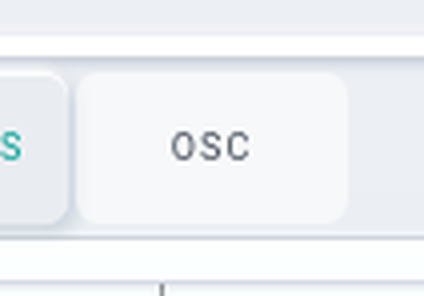 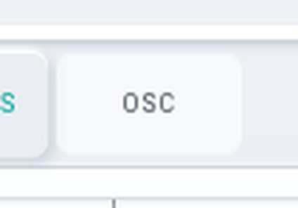

- **What changes:** every kit press gains `scale .12s` in its transition and shrinks to **0.96 while held**. The pictures
  show OSC on SHADOW held down; after, it is visibly smaller.
- **Elements:** `.seg-b` 472 (152 of them ON), `.trig` 216 (plain, ON, the palette and molecule turners, the toggles),
  `.sw` 96, `.mol-turn` / `.pal-nav` 32. With the modulation window open, `.m2macadd` and `.m2devadd` are added (832 / 104).
- **Originator: BASINS.** The kit's `base.css` says "PRESSED (INTENT): the wash above and one small scale, for every
  control the kit presses (S1)". INTENT S1 traces the one scale to BASINS' modulation window (`modhost.css` `.m2macadd`,
  row L21). λWAVES' 1.4.3 press was the wash alone.
- **Default: the kit's** (no rule of ours).

**DEFAULT APPLIED — Josh rules: keep / take the kit's / bug**

## 2 · box-shadow — 456 element-states, 57 elements

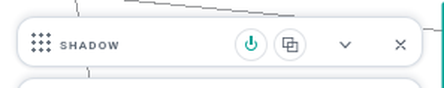 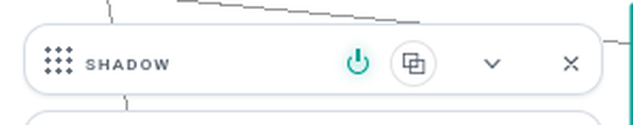

- **What changes:**
  - **One light, from above.** The card float loses its upward `0 -2px 6px` term (`--glass-shadow`). This touches the
    disconnected heads (80), every disconnected body (8 per card), `#rackToggle / #rackAdd / #rackFav`, the transport and
    its two glyph buttons.
  - **The value tip** (`.k-val`, 224) drops at menu height: `--surface-shadow-menu` (`0 10px 28px` + `0 2px 6px`) in place
    of `0 3px 8px`. See the pictures in §3.
  - **A disabled knob** (16) loses its relief.
  - **The dial** (16) goes through `--relief-raise`.
- **Originator: BASINS** (INTENT, the alpha.3 first look):
  - the kit's `skin.css`: "1.5.0-alpha.3 · INTENT: ONE LIGHT, FROM ABOVE";
  - the value tip at menu height is INTENT O4's default ("a tooltip is a popover");
  - "disabled .38, no relief" is the same INTENT pass.
- **Default: the kit's.**
- **A BUG, fixed here, not a ruling.** On the bare adopt the docked cards lost their shadow entirely (+24 to +32
  element-states).
  - Cause: skin.css read `--glass-shadow-flat`, which MIR 1.5 removed as "read by nothing".
  - Fix: 1.5's `--glass-shadow` is that same flat recipe in both themes, so `#rack > .dev` reads it now.
  - Check: a scan of every `var()` our sheets read with no fallback finds that name was the only dangling one.

**DEFAULT APPLIED — Josh rules: keep / take the kit's / bug**

## 3 · focus outline — 224 element-states, 28 elements (`.k-val`)

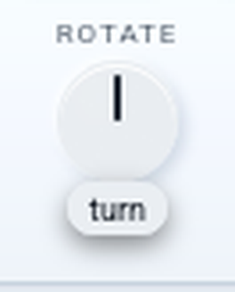 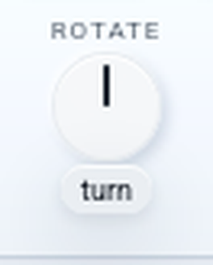

- **What changes:** not a focus style. The value tip's resting 1 px seat ring (`--neu-flat`) moves from a box-shadow spread to
  an outline: 1 px solid at .05, drawn in the same place. With the window open, `.m2vname`'s outline colour follows its ink
  (240 / 30).
- **Pictures:** the ROTATE knob's tip ("turn") with the dial hovered. The visible difference is the drop shadow, which is §2.
- **Originator:**
  - λWAVES originated the ring.
  - The kit kept it: INTENT O10, "left as it was", only re-seated as an outline.
- **Default: the kit's.** It is λWAVES' ring, and on screen it matches the 1.4.3 one.

**DEFAULT APPLIED — Josh rules: keep / take the kit's / bug**

## 4 · `.dev-head` background — 0 element-states after the default (80 element-states, 10 elements on the bare adopt)

  

- **Pictures:** dark · tinted · frost off, the state where this class is most visible.
- **What changes on the bare adopt:**
  - **1.4.3:** a disconnected window's head is a near-clear chip, `--glass-raise` (white .043 dark, .55 light), so the field
    shows through it, a lighter band over the body.
  - **1.5:** the head is the PANE, with the same fill and sheen as the body: `rgba(28,32,38,.84)` dark-tinted; the veil and
    blur under refractive frost.
  - All 10 visible heads, in all 8 states.
- **Originator: λWAVES.** The disconnected rack and its head are λWAVES'. The 1.4.3 kit, extracted from λWAVES, says: "the
  chip keeps its own lighter fill — the difference is the point".
  - The 1.5 change is BASINS' material: "THE ONLY DIFFERENCE IS THE FILL", what BASINS measured of its own bar and card;
    ADOPTING-1.5 §8 says "a disconnected head is a pane".
- **Default: λWAVES' look.** `lab/lab.css` §G carries the three 1.4.3 kit rules that painted that head, verbatim:
  - the head; its frost variant; its `frost-hold` lift.
  - They are unlayered and come first among our rules, so they beat every kit layer as 1.4.3's unlayered kit did.
  - λWAVES' own selected / TAB-hot head (skin.css) still wins over them by order.
- **Why not an `app.*` layer:** under `@layer app, mir;` a normal declaration in `app.*` ranks BELOW the kit, so a layer
  cannot keep a look the kit paints. Only `!important` could, and it would also beat our own state rules.
- **Take the kit's** = delete the first rule's `background` (and §6's lines with it).

**DEFAULT APPLIED — Josh rules: keep / take the kit's / bug**

## 5 · ON text-shadow — 132 element-states, 21 elements

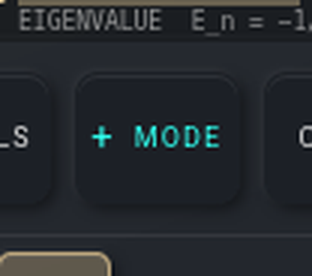 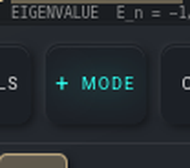

- **Pictures:** dark · tinted · frost off. SPECTRUM's `+ MODE`, ON, now glows.
- **What changes:**
  - **The ON light.** An ON trigger's label lights in accent A with its glow (`--state-on-light`, 17 px). That is the
    trigger, its two spans and its glyph: 24.
  - **The emboss.** In 6 of the 8 states (refractive, or frost), the 1 px dark text emboss on glass goes to `none`. That covers
    the three rack buttons, the transport and the transport's readouts and dial: 108.
- **Originator: BASINS.**
  - The ON light: INTENT O5's default, BASINS' ON law ("the frost face and rim; the label in accent A with the accent glow";
    never an accent fill).
  - The emboss: the kit's `skin.css`, "INTENT O3, BASINS' answer (ink.css): under glass (REFRACTIVE, or FROST) the ink
    carries no emboss; a TINTED pane keeps it".
- **Default: the kit's.**

**DEFAULT APPLIED — Josh rules: keep / take the kit's / bug**

## 6 · backdrop-filter — 0 element-states after the default (80 element-states, 10 elements on the bare adopt)

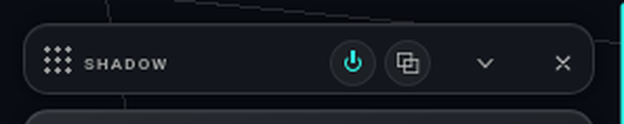 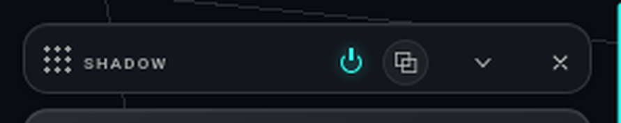 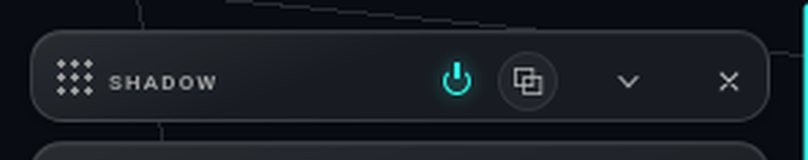

- **What changes on the bare adopt:** the disconnected head's `brightness(1.03) saturate(1.03)` lift over the picture goes
  to `none` (`blur(22px)` alone under frost). This is the same 10 heads as §4, and the same element pictured.
- **Originator: λWAVES** (as §4: the 1.4.3 head rule).
- **Default: λWAVES' look**, restored by the same §G rules.
- **Take the kit's** = delete the three `backdrop-filter` lines in lab.css §G.

**DEFAULT APPLIED — Josh rules: keep / take the kit's / bug**

## 7 · border — 80 element-states, 10 elements (`.dev-power`)

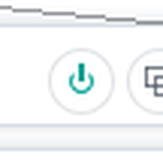 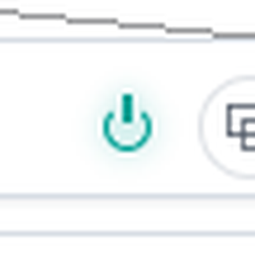

- **What changes:** a window's power control loses its 1 px rim and its face. The rider, counted under OTHER (80): background
  transparent, the glyph 6 → 8 px, and a `--power-glow` drop-shadow when on. It is now ONLY the ⏻ glyph, lit and glowing when
  on and dim when off. With the window open, the kit's modwindow drift adds `.m2vname`, the preset rim, `#modsync` and
  `#modcad` (120 / 15; C4's).
- **Originator: Josh's own call for the kit, after BASINS' modulation-window power.** The kit's `base.css`: "THE POWER
  CONTROL: ONLY the ⏻ icon — no button face, no outline, no shading, no fill (Josh 2026-10-07 …)". INTENT L31 traces it to
  `.m2pow` (alpha.21 / alpha.22).
- **Default: the kit's.**

**DEFAULT APPLIED — Josh rules: keep / take the kit's / bug**

## Outside the seven (riders and fixes, for the record)

**Riders.** OTHER on the closed rack is 150 element-states on 34 elements, all of them riders of the classes above:
- `.dev-power` (80): §7.
- A disabled knob's opacity .3 → .38 (16): INTENT "disabled .38, no relief", BASINS.
- Each card root's own background in the two frost-tinted states (20): invisible, because a disconnected root is
  `visibility: hidden`.
- The eight card bodies, the three rack buttons and the transport, 34 together (the eleven bodies and buttons at 3 states each,
  the transport at 1):
  - in the two frost-tinted states they lose the 160° sheen: BASINS' "FROST'S TINTED PANE HAS NO SHEEN";
  - under light · tinted · frost off they fill at .86 in place of .84.

**Dead-now-live, fixed before the classes were counted.** A rule of ours that LOST to a kit rule on 1.4.3 and would WIN
unlayered on 1.5 now has a twin `:not(:where(…))` narrowing, which keeps the 1.4.3 winner. There are five (commit `49cf802`):
- the frost `.dev/.glass` veil, out of the dark theme and the modulation window;
- `.m2workbar button` against the tempo pill's grid;
- `.dock-btn > svg` 13 px against the kit's 12 px glyph;
- `.reg-bar .sel`'s flex;
- `.reg-morph`'s justify.

They were found by mapping every property both a kit and an app sheet declare, on every visible element, with base and
adopted compared:
- 5 states: the four theme × card/frost combinations with the window open, plus frost-tinted;
- plus the notebook open.

The frost-tinted state shows one more flip, `body[data-card="tinted"] #transport.mini`. Its value is identical (its
`--card-opacity` resolves to the .58 the 1.4.3 kit literal had), so it is left as written.

**Notes for the kit.**
- `--glass-shadow-flat` was removed as "read by nothing", but λWAVES read it.
- stylehash's token scan does not descend into `@import` (`CSSImportRule.styleSheet`), so behind `mir/mir.css` token TEXT
  reads "undefined". No element is affected.
